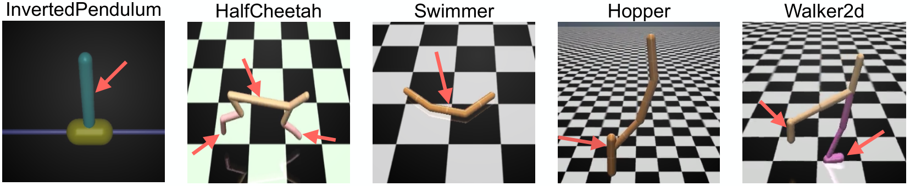

# Learning to Play — Reading Curriculum

Three lineages of research on agents that get better by playing — against opponents, inside imagined worlds, and against themselves.

*Related: [[homework]] — the World Models and Model Based RL items in that study map point back to this curriculum (Section II and Section III below).*

**TABLE OF CONTENTS**

**II. WORLD MODELS**

**Dreamer Series**

| # | Heading | Paper | Year | Venue |
|---|---|---|---|---|
| 1 | World Models | World Models | 2018 | arXiv |
| 2 | PlaNet | Learning Latent Dynamics for Planning from Pixels | 2019 | ICML |
| 3 | Dreamer | Dream to Control: Learning Behaviors by Latent Imagination | 2020 | ICLR |
| 4 | DreamerV2 | Mastering Atari with Discrete World Models | 2021 | ICLR |
| 5 | DreamerV3 | Mastering Diverse Domains through World Models | 2023 | arXiv |
| 6 | Dreamer 4 | Training Agents Inside of Scalable World Models | 2025 | arXiv |

**TD-MPC Series**

| # | Heading | Paper | Year | Venue |
|---|---|---|---|---|
| 7 | TD-MPC | Temporal Difference Learning for Model Predictive Control | 2022 | ICML |
| 8 | TD-MPC2 | TD-MPC2: Scalable, Robust World Models for Continuous Control | 2024 | ICLR |

**JEPA Family**

| # | Heading | Paper | Year | Venue |
|---|---|---|---|---|
| 9 | JEPA | A Path Towards Autonomous Machine Intelligence *(position paper — no experiments of its own)* | 2022 | OpenReview |
| 10 | I-JEPA | Self-Supervised Learning from Images with a Joint-Embedding Predictive Architecture | 2023 | CVPR |
| 11 | V-JEPA | Revisiting Feature Prediction for Learning Visual Representations from Video | 2024 | TMLR |
| 12 | ACT-JEPA | ACT-JEPA: Novel Joint-Embedding Predictive Architecture for Efficient Policy Representation Learning | 2025 | arXiv |
| 13 | V-JEPA 2 / 2-AC | V-JEPA 2: Self-Supervised Video Models Enable Understanding, Prediction and Planning | 2025 | arXiv |
| 14 | VL-JEPA | VL-JEPA: Joint Embedding Predictive Architecture for Vision-language | 2025 | arXiv |
| 15 | LeWM | LeWorldModel: Stable End-to-End Joint-Embedding Predictive Architecture from Pixels | 2026 | arXiv |
| 16 | JEPA-WM | What Drives Success in Physical Planning with Joint-Embedding Predictive World Models? | 2026 | TMLR |
| 17 | Flow-JEPA | Flow-JEPA: Robust Latent Dynamics for JEPA World Models via Flow Matching | 2026 | arXiv |

**III. GAME-PLAY**

| # | Heading | Paper | Year | Venue |
|---|---|---|---|---|
| 1 | AlphaGo | Mastering the Game of Go with Deep Neural Networks and Tree Search | 2016 | Nature |
| 2 | AlphaGo Zero | Mastering the Game of Go without Human Knowledge | 2017 | Nature |
| 3 | AlphaZero | A General Reinforcement Learning Algorithm that Masters Chess, Shogi, and Go through Self-Play | 2018 | Science |
| 4 | AlphaStar | Grandmaster Level in StarCraft II using Multi-Agent Reinforcement Learning | 2019 | Nature |
| 5 | MuZero | Mastering Atari, Go, Chess and Shogi by Planning with a Learned Model | 2020 | Nature |
| 6 | AlphaStar Unplugged | AlphaStar Unplugged: Large-Scale Offline Reinforcement Learning | 2023 | arXiv |
| 7 | Student of Games | Student of Games: A Unified Learning Algorithm for both Perfect and Imperfect Information Games | 2023 | Science Advances |
| 8 | MAZero | Efficient Multi-agent Reinforcement Learning by Planning | 2024 | ICLR |
| 9 | LAMIR | Look-ahead Reasoning with a Learned Model in Imperfect Information Games | 2026 | ICLR |
| 10 | SkyNet\* | SkyNet: Belief-Aware Planning in Partially Observable Stochastic Games | 2026 | arXiv |

**IV. REPRESENTATION LEARNING UNDER PARTIAL OBSERVABILITY**

| # | Heading | Paper | Year | Venue |
|---|---|---|---|---|
| 1 | ToMnet | Machine Theory of Mind | 2018 | ICML |
| 2 | LIAM | Agent Modelling under Partial Observability for Deep Reinforcement Learning | 2021 | NeurIPS |
| 3 | Self-Predictive RL | Bridging State and History Representations: Understanding Self-Predictive RL | 2024 | ICLR |
| 4 | In-Context Exploiter | In-Context Exploiter for Extensive-Form Games | 2024 | arXiv |

**V. RL POLICY OPTIMISATION & POST-TRAINING**

**General RL Methods**

| # | Heading | Paper | Year | Venue |
|---|---|---|---|---|
| 1 | TRPO | Trust Region Policy Optimization | 2015 | ICML |
| 2 | RARL | Robust Adversarial Reinforcement Learning | 2017 | ICML |
| 3 | PPO | Proximal Policy Optimization Algorithms | 2017 | arXiv |
| 4 | PMPO | Learning from Negative Feedback, or Positive Feedback or Both | 2025 | ICLR |
| 5 | SimbaV2 | Hyperspherical Normalization for Scalable Deep Reinforcement Learning | 2025 | ICML |

**LLM Policy Optimisation**

| # | Heading | Paper | Year | Venue |
|---|---|---|---|---|
| 6 | REINFORCE | Simple Statistical Gradient-Following Algorithms for Connectionist Reinforcement Learning | 1992 | Machine Learning |
| 7 | RLHF | Training Language Models to Follow Instructions with Human Feedback *(InstructGPT)* | 2022 | NeurIPS |
| 8 | GRPO | DeepSeekMath: Pushing the Limits of Mathematical Reasoning in Open Language Models | 2024 | arXiv |
| 9 | RLVR | Tülu 3: Pushing Frontiers in Open Language Model Post-Training *(introduces RLVR)* | 2024 | arXiv |
| 10 | REINFORCE++ | REINFORCE++: Stabilizing Critic-Free Policy Optimization with Global Normalization | 2025 | arXiv |
| 11 | GSPO | Group Sequence Policy Optimization | 2025 | arXiv |
| 12 | ScaleRL | The Art of Scaling Reinforcement Learning Compute for LLMs | 2025 | arXiv |
| 13 | Lite PPO | Tricks or Traps? A Deep Dive into RL for LLM Reasoning | 2026 | ICLR |

**RL for VLAs**

| # | Heading | Paper | Year | Venue |
|---|---|---|---|---|
| 14 | RL4VLA | What Can RL Bring to VLA Generalization? An Empirical Study | 2025 | NeurIPS |
| 15 | πRL | πRL: Online RL Fine-tuning for Flow-based Vision-Language-Action Models | 2025 | arXiv |
| 16 | WMPO | WMPO: World Model-based Policy Optimization for Vision-Language-Action Models | 2026 | ICLR |

---

## Stochastic Games

*Single-agent background: [[homework#MDPs and Bellman's Equations (RL Foundations)|MDPs and Bellman's Equations]]*

The game models below differ in *what agents observe and how the game unfolds*. How the agents' rewards relate is a separate choice that applies to every one of them. In **common-reward** games all agents get the same reward. In **zero-sum** games one agent's gain is the other's loss. **General-sum** games allow any mix. A MARL problem is a game model plus a **solution concept**: a condition on the joint policy that says what counts as "solved". The reward structure largely decides which solution concept makes sense. Common-reward games just maximise the shared return, zero-sum games use minimax, and general-sum games need equilibria plus refinements.

**Source:** Albrecht, Christianos, Schäfer — *Multi-Agent Reinforcement Learning: Foundations and Modern Approaches* (MIT Press, 2024), Ch. 4 "Solution Concepts for Games", pp. 61–88 (POSG definition from Ch. 3 §3.4, pp. 49–54)

![[papers/marl/albrecht-2024-ch4-solution-concepts.pdf|700]]

> [!note] Solution concepts at a glance (Albrecht et al., Ch. 4)
> **The game model: POSG (Ch. 3 §3.4, Def. 4; Hansen, Bernstein & Zilberstein 2004).** This is the most general model in the book. A POSG has all the elements of a stochastic game:
> - agents $I=\{1,\dots,n\}$;
> - states $S$, with terminal states $\bar S \subset S$;
> - actions $A_i$ per agent, and joint actions $A = A_1\times\dots\times A_n$;
> - rewards $\mathcal{R}_i(s,a,s')$ per agent;
> - transitions $\mathcal{T}(s' \mid s,a)$;
> - an initial distribution $\mu$.
>
> It adds, for each agent $i$, a set of observations $O_i$ and an observation function:
> $$\mathcal{O}_i(o_i^t \mid a^{t-1}, s^t), \qquad \textstyle\sum_{o_i} \mathcal{O}_i(o_i \mid a, s) = 1 \quad (3.4)$$
> Each step:
> 1. Each agent receives its own observation of the new state and the last joint action.
> 2. Each agent acts from its **own observation history**, via $\pi_i(a_i^t \mid h_i^t)$ with $h_i^t = (o_i^0,\dots,o_i^t)$.
> 3. The joint action moves the state via $\mathcal{T}$, and every agent gets its reward $\mathcal{R}_i$.
>
> - **Special cases:**
>   - It is a **stochastic game** when every agent sees everything, i.e. $o_i^t = (s^t, a^{t-1})$.
>   - It is a **POMDP** when there is one agent.
> - **What observations can express:** others' actions hidden, $o_i^t = (s^t, a_i^{t-1})$; a limited view region, as with fog of war; sensor noise; and unreliable communication.
> - **Belief states (§3.4.1):** a single agent can filter a belief $b^{t+1}(s') \propto \sum_s b^t(s)\,\mathcal{T}(s' \mid s,a^t)\,\mathcal{O}(o^{t+1} \mid a^t,s')$ (3.5). Exact beliefs are exponential in the number of state variables. With several agents, each must also reason about the others' hidden observations and policies. MARL usually doesn't know $S$, $\mathcal{T}$ or $\mathcal{O}_i$, so deep MARL uses an RNN over the observation history instead.
>
> **Setup (§4.1).** A solution is a joint policy $\pi = (\pi_1,\dots,\pi_n)$. Every concept below is a condition on each agent's expected return:
> $$U_i(\pi) = \mathbb{E}_{\hat h \sim \pi}\Big[\textstyle\sum_{\tau} \gamma^\tau R_i(s^\tau, a^\tau, s^{\tau+1})\Big] \quad (4.1,\ 4.4)$$
> It is defined on the POSG, so it covers stochastic games and one-shot games too. Eqs. 4.6–4.7 give an equivalent Bellman-style recursion.
>
> **Best response (§4.2).** This is the building block for most of the concepts below:
> $$\mathrm{BR}_i(\pi_{-i}) = \arg\max_{\pi_i} U_i(\pi_i, \pi_{-i}) \quad (4.9)$$
> It need not be unique.
>
> | Concept | Setting | Condition | Notes |
> |---|---|---|---|
> | **Minimax** (§4.3) | 2-agent zero-sum | $U_i(\pi) = \max_{\pi_i'}\min_{\pi_j'} U_i = \min_{\pi_j'}\max_{\pi_i'} U_i = -U_j(\pi)$ (4.10–4.11) | Always exists for finite games, including discounted zero-sum SGs (Shapley 1953). All minimax solutions share one game value. Solvable by LP. |
> | **Nash equilibrium** (§4.4) | General-sum, $n$ agents | $\forall i, \pi_i' : U_i(\pi_i', \pi_{-i}) \le U_i(\pi)$ (4.16) | Every policy is a best response to the others. Exists in every finite normal-form game (Nash 1950) and in SGs. May be mixed, and there may be many. In 2-agent zero-sum games it coincides with minimax. |
> | **ε-Nash** (§4.5) | General-sum | $U_i(\pi_i', \pi_{-i}) - \epsilon \le U_i(\pi)$ (4.18) | Tolerates small gains from deviating. Can be arbitrarily far from every real Nash equilibrium (Fig. 4.2). |
> | **Correlated eq.** (§4.6) | General-sum | Following a recommended action from a joint $\pi_c(a)$ beats any deviation $\xi_i$ (4.19) | Policies may be correlated. The set contains every Nash equilibrium. Can beat Nash: in Chicken it gives 5 each vs ≈4.66 for the mixed NE. Solvable by LP. |
> | **Coarse correlated eq.** (§4.6) | General-sum | Same, but only against constant deviations, decided before seeing the recommendation | The most general of the four. |
>
> Each row is more general than the one before: **minimax ⊂ Nash ⊂ correlated ⊂ coarse correlated**.
>
> **Limitations of equilibria (§4.7).**
> - **Sub-optimality:** in the Prisoner's Dilemma the only NE is (D,D), with −3 each, while (C,C) gives −1 each.
> - **Non-uniqueness:** which equilibrium do the agents coordinate on? This is the *equilibrium selection* problem.
> - **Incompleteness:** an equilibrium prescribes nothing on histories it never reaches (off-equilibrium paths).
>
> **Refinements, used to pick among equilibria (§4.8–4.9):**
> - **Pareto-optimal:** no other joint policy is at least as good for everyone and strictly better for someone (4.25).
> - **Welfare:** $W(\pi) = \sum_i U_i(\pi)$ (4.26).
> - **Fairness:** $F(\pi) = \prod_i U_i(\pi)$ (4.27).
>
> Welfare-optimal implies Pareto-optimal, but not the other way round. Welfare and fairness add nothing in common-reward or zero-sum games.
>
> **No-regret (§4.10).** This judges how agents do *across repeated episodes* instead of judging one joint policy. Regret compares an agent's total reward against the best single action (or policy) in hindsight, holding the others' play fixed:
> $$\mathrm{Regret}_i^z = \max_{a_i}\textstyle\sum_{e=1}^{z}\big[R_i(a_i, a^e_{-i}) - R_i(a^e)\big] \quad (4.28)$$
> The agents have no-regret if every agent's average regret goes to ≤ 0 (4.29).
> - With no external regret, the empirical play converges to minimax in 2-agent zero-sum games and to coarse correlated equilibria in general-sum games.
> - With no internal regret, it converges to correlated equilibria.
>
> **Complexity (§4.11).**
> - Minimax (2-agent zero-sum) and correlated equilibria can be computed in polynomial time by LP.
> - Computing a Nash equilibrium is **PPAD-complete**, even with 2 agents (Daskalakis et al. 2006/09; Chen & Deng 2006). So no efficient general algorithm, MARL included, is likely to exist.

### Stochastic (Markov) Games

### FOSGs

**Source:** Kovařík, Schmid, Burch, Bowling, Lisý — "Rethinking Formal Models of Partially Observable Multiagent Decision Making", *Artificial Intelligence* 303 (2022), 103645 · arXiv:1906.11110

![[papers/marl/kovarik-2022-fosg.pdf|700]]

**CORE IDEA**
- Partially observable multi-agent problems get modelled two ways. Game theory uses **extensive-form games (EFGs)**; MARL uses **POSGs**. The two communities rarely share results, and how the two models relate was unclear.
- The classical EFG throws away the **observations** themselves: *what* was learned, *who* learned it and *when*. So it cannot say which information is **public**. Recent search methods for imperfect-information games (DeepStack, Libratus, Pluribus) need public information to split the game into subgames. Those systems worked around the gap with game-specific hacks, e.g. "cards dealt in poker".
- The fix is the **FOSG**, a minor tweak to POSGs. Each agent's observation is **factored** into a private part and a public part, $\mathcal{O}_i = (\mathcal{O}_{priv(i)}, \mathcal{O}_{pub})$. Public information is then built into the model, rather than reverse-engineered afterwards.
- **FOSGs are the underlying model, and EFGs are derived from them.** "Unrolling" a FOSG into a tree gives an EFG. Conversely, every well-behaved classical EFG comes from some FOSG, where well-behaved means perfect recall and timeable. So most EFG results carry straight over to POSGs and FOSGs.

**EXTENSIVE-FORM GAMES (lead-in)**
- **Classical EFG (Def. 3.7).** An EFG is a game tree $\langle N, A, H, p, \pi_c, \mathcal{I}', u \rangle$:
  - $H$ is the tree of histories, with terminal histories (leaves) $Z$;
  - $p(h)$ says who acts at each history, which is either a player or chance $c$;
  - $\pi_c$ is chance's fixed strategy;
  - $u$ gives the utilities at the leaves.
- **Information sets.** Hidden information is expressed through information sets $I \in \mathcal{I}_i$: groups of histories the acting player cannot tell apart. Classical infosets are only defined for the *acting* player. Once they're formed there is no record of which observations produced them, who else saw them, or when.
- **Two things are missing:** a partition of histories into *public* sets, and infosets for players when it isn't their turn. The paper shows this information **cannot be recovered in general** (§3.3). Different augmented EFGs can collapse to the same classical EFG (Fig. 5). The best attempt at reconstructing public information for poker even yields only 5 public states along a history where you'd intuitively expect 12, and they don't line up with the betting rounds (Fig. 4).
- **The augmented EFG (Def. 3.5)** adds back a public partition $\mathcal{I}_{pub}$ and infosets for every player at every history. This is what you get by unrolling a FOSG.

**Dictionary of concepts across RL, EFGs and FOSGs (Table 1).** The correspondences are by *role*, not mathematical equivalence. For example, a history in an EFG plays the role a state plays in an MDP.

| Concept | RL | EFG | FOSG |
|---|---|---|---|
| The actor in the task | $i$ agent | $i$ player | $i$ agent, player |
| The acting rule | $\pi$ policy | $\sigma \in \Sigma$ strategy | $\pi$ / $\sigma$ policy/strategy |
| A measure of how long the task takes | $T$ finite horizon | $D$ game depth | $T$ finite horizon |
| The basic notion for describing the "state of the world" | $s \in \mathcal{S}$ state | $h \in \mathcal{H}$ history | $w \in \mathcal{W}$ world state |
| A list of everything that has happened so far, from the objective point of view | – trajectory | $h \in \mathcal{H}$ history | $h \in \mathcal{H}$ history; $t$ trajectory |
| Information based on which actors select their next actions | $s$ state (MDP); $b$ belief (POMDP) | $I \in \mathcal{I}_i$ infoset | $s_i \in \mathcal{S}_i$ action-obs. history |
| The immediate feedback on how well the actor is currently doing | $r$ reward | doesn't exist | $\mathcal{O}_i(\cdot)$ observation |
| The quantity that actors optimize for | cum. reward | $u_i$ utility | $u_i(h)$ utility; $\mathcal{R}_i(h)$ cum. reward |
| The desirability of a given situation for an actor who uses a given acting rule | $V^\pi(s)$ $s$'s value for $\pi$ | – exp. utility at $h$ | $v_i^\sigma(h)$ history value |
| The cause of non-determinism in the task | $\mathcal{T}(s,a)$ transition prob. | $\sigma_c(h,a)$ chance strategy | $\mathcal{T}(w,a)$ transition prob. |
| The probability of ending up in a given situation | – | $\pi^\sigma(h)$ reach probability | $P^\pi(h)$ reach prob. |

**SUMMARY**
- **The FOSG model (§2.2).** A FOSG is a tuple $G = \langle N, \mathcal{W}, p, w^{init}, \mathcal{A}, \mathcal{T}, \mathcal{R}, \mathcal{O} \rangle$:
  - world states $\mathcal{W}$;
  - a **player function** $p(w)$ saying who is active; everyone else plays `noop`, so both turn-based and simultaneous moves fit;
  - transitions $\mathcal{T}(w,a)$ and rewards $\mathcal{R}_i(w,a)$;
  - an observation function factored into private and public parts. After each transition, player $i$ receives the pair (private observation, public observation) and can tell which part is which.
  - Chance can be modelled as an extra player with a fixed, publicly known policy.
- **POSGs are a special case (Def. 2.3, Prop. 2.4).** A POSG is a FOSG with an empty public observation where every player is active at every step. Going the other way, forgetting the factorisation turns any FOSG into a strategically equivalent POSG. So the two are formally equivalent, but only the FOSG keeps the public/private split that decomposition needs.
- **Three points of view (§2.4, Fig. 3):**
  - **histories** $h$: the objective record;
  - **information states** $s_i$: player $i$'s own action-observation history, which its policy $\pi_i(s_i)$ conditions on;
  - **public states** $s_{pub}$: the sequence of public observations only, which every player can recover from their own $s_i$. Every player can restrict its reasoning to situations consistent with the current $s_{pub}$, and that is the basis for decomposition.
- **EFG correspondence (§3):**
  - Every FOSG unrolls into an augmented EFG with perfect recall and no "thick" public sets, and every such EFG arises this way (Thm. 3.6).
  - Stripping the public and non-acting information gives exactly the classical perfect-recall EFGs that are *1-timeable*, i.e. every move takes exactly one step on a common clock (Thm. 3.10).
  - EFGs are slightly more expressive: they allow non-timeable games and imperfect recall. The authors argue that no real game played against people has either property.
- **Transfer of EFG techniques into FOSG/RL language (§4):**
  - **CFR** is restated with RL-style values $v^\pi_i(h)$ and $q^\pi_i(h, a_i)$ and *counterfactual* values. With observable rewards it produces the same strategy as CFR on the corresponding EFG (Thm. 4.1).
  - **Decomposition and CFR-D.** The game is split along the public tree into a trunk and subgames. A **range** is each player's distribution over infostates at a public state. A **public belief state** $\beta = (s_{pub}, r)$ roots a solvable subgame.
  - **Sequence form.** Expected utility becomes $x^\top A y$ over realisation plans, so two-player zero-sum FOSGs can be solved by an LP.

---

## Section II — World Models

### Dreamer Series

#### World Models
**World Models** · Ha, Schmidhuber · arXiv 2018 *(arXiv:1803.10122)*

![[papers/world-models/world-models-2018.pdf|700]]

#### PlaNet
**Learning Latent Dynamics for Planning from Pixels** · Hafner, Lillicrap, Fischer, Villegas, Ha, Lee, Davidson · ICML 2019 *(arXiv:1811.04551)*

![[papers/world-models/planet-2019.pdf|700]]

#### Dreamer
**Dream to Control: Learning Behaviors by Latent Imagination** · Hafner, Lillicrap, Ba, Norouzi · ICLR 2020 *(arXiv:1912.01603)*

![[papers/world-models/dreamer-2020.pdf|700]]

#### DreamerV2
**Mastering Atari with Discrete World Models** · Hafner, Lillicrap, Norouzi, Ba · ICLR 2021 *(arXiv:2010.02193)*

![[papers/world-models/dreamerv2-2021.pdf|700]]

#### DreamerV3
**Mastering Diverse Domains through World Models** · Hafner, Pasukonis, Ba, Lillicrap · arXiv 2023 *(arXiv:2301.04104)*

![[papers/world-models/dreamerv3-2023.pdf|700]]

#### Dreamer 4
**Training Agents Inside of Scalable World Models** · Hafner, Yan, Lillicrap · arXiv 2025 *(arXiv:2509.24527)*

![[papers/world-models/dreamer4-2025.pdf|700]]

### TD-MPC Series

#### TD-MPC
**Temporal Difference Learning for Model Predictive Control** · Hansen, Wang, Su · ICML 2022 *(arXiv:2203.04955)*

![[papers/world-models/tdmpc-2022.pdf|700]]

#### TD-MPC2
**TD-MPC2: Scalable, Robust World Models for Continuous Control** · Hansen, Su, Wang · ICLR 2024 *(arXiv:2310.16828)*

![[papers/world-models/tdmpc2-2024.pdf|700]]

### JEPA Family

#### JEPA
**A Path Towards Autonomous Machine Intelligence** · LeCun · OpenReview 2022 *(v0.9.2, no arXiv)*

![[papers/jepa/jepa-2022.pdf|700]]

#### I-JEPA
**Self-Supervised Learning from Images with a Joint-Embedding Predictive Architecture** · Assran, Duval, Misra, Bojanowski, Vincent, Rabbat, LeCun, Ballas · CVPR 2023 *(arXiv:2301.08243)*

![[papers/jepa/i-jepa-2023.pdf|700]]

#### V-JEPA
**Revisiting Feature Prediction for Learning Visual Representations from Video** · Bardes, Garrido, Ponce, Chen, Rabbat, LeCun, Assran, Ballas · TMLR 2024 *(arXiv:2404.08471)*

![[papers/jepa/v-jepa-2024.pdf|700]]

#### ACT-JEPA
**ACT-JEPA: Novel Joint-Embedding Predictive Architecture for Efficient Policy Representation Learning** · Vujinović, Kovačević · arXiv 2025 *(arXiv:2501.14622)*

![[papers/jepa/act-jepa-2025.pdf|700]]

#### V-JEPA 2 / 2-AC
**V-JEPA 2: Self-Supervised Video Models Enable Understanding, Prediction and Planning** · Assran, Bardes, Fan, Garrido, et al. · arXiv 2025 *(arXiv:2506.09985)*

![[papers/jepa/v-jepa2-2025.pdf|700]]

#### VL-JEPA
**VL-JEPA: Joint Embedding Predictive Architecture for Vision-language** · Chen, Shukor, Moutakanni, Chung, Yu, Kasarla, Bang, Bolourchi, LeCun, Fung · arXiv 2025 *(arXiv:2512.10942)*

![[papers/jepa/vl-jepa-2025.pdf|700]]

#### LeWM
**LeWorldModel: Stable End-to-End Joint-Embedding Predictive Architecture from Pixels** · Maes, Le Lidec, Scieur, LeCun, Balestriero · arXiv 2026 *(arXiv:2603.19312)*

![[papers/jepa/lewm-2026.pdf|700]]

#### JEPA-WM
**What Drives Success in Physical Planning with Joint-Embedding Predictive World Models?** · Terver, Yang, Ponce, Bardes, LeCun · TMLR 2026 *(arXiv:2512.24497)*

![[papers/jepa/jepa-wm-2025.pdf|700]]

#### Flow-JEPA
**Flow-JEPA: Robust Latent Dynamics for JEPA World Models via Flow Matching** · Huo, Song, Luo · arXiv 2026 *(arXiv:2608.29029)*

![[papers/jepa/flow-jepa-2026.pdf|700]]

---

## Section III — Game-Play

### AlphaZero
**A General Reinforcement Learning Algorithm that Masters Chess, Shogi, and Go through Self-Play** · Silver, Hubert, Schrittwieser, et al. · Science 2018 *(accepted preprint)*

![[papers/games/alphazero-2018.pdf|700]]

> [!info]- Acronyms
> | Acronym | Meaning |
> |---|---|
> | MCTS | Monte Carlo tree search |
> | ResNet | Residual network |
> | BN / ReLU | Batch normalisation / rectified linear unit |
> | MSE | Mean-squared error |
> | LR / SGD | Learning rate / stochastic gradient descent |
> | TPU | Tensor processing unit (Google ML accelerator) |

**CORE IDEA**
- **Loop:** network → guides MCTS → search output → trains network
- Search is stronger than the raw network, so training toward it = **policy improvement**
- **Tabula rasa:** self-play from random init, rules only (no human games, openings, tablebases, handcrafted eval)

**CONTRIBUTION**

| vs. | Standard at the time | AlphaZero |
|---|---|---|
| Stockfish / Elmo | Handcrafted evaluation function | Learned value $v$ |
| Stockfish / Elmo | Move-ordering heuristics | Learned policy prior $\mathbf{p}$ |
| Stockfish / Elmo | Alpha-beta + domain tricks, ~60M pos/s | General MCTS, ~60k pos/s |
| AlphaGo Zero | Win probability (Go has no draws) | Expected outcome $\mathbb{E}[z \mid s]$ |
| AlphaGo Zero | 8× board-symmetry augmentation | None (chess/shogi are asymmetric) |
| AlphaGo Zero | New net replaces best only if it wins ≥55% | One net, updated continuously |
| AlphaGo Zero | Hyperparameters tuned for Go | Same for all three games (except noise, LR schedule) |

- Algorithm itself is AlphaGo Zero's → contribution is **generality**
- Challenged the belief that alpha-beta is inherently superior in chess/shogi

**MODEL**

$$(\mathbf{p}, v) = f_\theta(s), \qquad p_a = \Pr(a \mid s), \qquad v \approx \mathbb{E}[z \mid s] \in [-1, 1]$$

**Architecture** — conv ResNet, shared body + two heads

| Part | Layers |
|---|---|
| Body | conv 3×3, 256 filters, BN, ReLU → **19 residual blocks** (2 × [conv 3×3, 256, BN, ReLU] + skip) |
| Policy head | conv + BN + ReLU → conv to move logits → mask illegal moves, renormalise |
| Value head | conv 1×1 (1 filter) + BN + ReLU → linear 256 + ReLU → linear 1 + **tanh** |

**Input / output shapes**

| | Chess | Shogi | Go |
|---|---|---|---|
| Input $N \times N \times (MT+L)$ | 8×8×119 | 9×9×362 | 19×19×17 |
| Policy output | 8×8×73 = 4,672 | 9×9×139 = 11,259 | flat 362 |

- **Input:** last $T=8$ positions as binary piece planes (own + opponent) + constant planes (colour, move count, castling, repetitions, no-progress); board oriented to player to move
- **Chess policy planes:** 56 queen-style moves (1–7 squares × 8 directions) + 8 knight moves + 9 underpromotions, per "pick-up" square

**SEARCH (MCTS)**

Per edge: visit count $N(s,a)$, total value $W(s,a)$, mean value $Q(s,a)$, prior $P(s,a)$

**1. Select** — descend from root by

$$a_t = \arg\max_a \big[\, Q(s_t,a) + U(s_t,a) \,\big]$$

$$U(s,a) = C(s)\, P(s,a)\, \frac{\sqrt{N(s)}}{1 + N(s,a)}, \qquad C(s) = \log\frac{1 + N(s) + c_{base}}{c_{base}} + c_{init}$$

- $Q$ → exploit moves that scored well
- $U$ → explore moves the network likes but that are under-visited

**2. Expand & evaluate** — at leaf $s_L$:

$$(\mathbf{p}, v) = f_\theta(s_L), \qquad P(s_L, a) = p_a, \quad N = W = Q = 0$$

- No rollout: $v$ replaces playing the game out

**3. Backup** — for each step $t \le L$ on the path:

$$N(s_t,a_t) \leftarrow N(s_t,a_t) + 1, \qquad W(s_t,a_t) \leftarrow W(s_t,a_t) + v, \qquad Q(s_t,a_t) = \frac{W(s_t,a_t)}{N(s_t,a_t)}$$

**Output** — after 800 simulations:

$$\pi(a) = \frac{N(s_{root}, a)}{\sum_b N(s_{root}, b)}$$

**LOSS (Eq. 1)**

$$l = \underbrace{(z - v)^2}_{\text{value MSE}} \;-\; \underbrace{\boldsymbol{\pi}^\top \log \mathbf{p}}_{\text{policy cross-entropy}} \;+\; \underbrace{c\,\|\theta\|^2}_{\text{L2}}$$

| Term | Target | Note |
|---|---|---|
| Value | $z \in \{-1, 0, +1\}$, final result from player-to-move's view | Monte Carlo outcome, no bootstrapping |
| Policy | $\boldsymbol{\pi}_t$, MCTS visit distribution | Soft target over all moves → policy imitates search |
| L2 | — | $c$ not given in this paper (same as AlphaGo Zero) |

**TRAINING RECIPE**
1. **Init** $\theta$ randomly
2. **Self-play** (5,000 TPU v1) with latest $\theta$:
   - 800-sim MCTS per move
   - Dirichlet noise $\mathrm{Dir}(\alpha)$ added to root priors, $\alpha \propto 1/$typical # legal moves
   - Sample move $a_t \sim \boldsymbol{\pi}_t$
   - Chess/shogi > 512 moves → draw
3. **Store** $(s_t, \boldsymbol{\pi}_t, z)$ per position
4. **Train** (16 TPU v2): SGD on $l$
5. **Repeat** — no evaluation gate
6. **Test:** $a = \arg\max_a N(s_{root}, a)$, no noise

| Hyperparameter | Chess | Shogi | Go |
|---|---|---|---|
| Dirichlet $\alpha$ | 0.3 | 0.15 | 0.03 |
| Steps × batch | 700k × 4,096 | 700k × 4,096 | 700k × 4,096 |
| LR 0.2 → 0.02 → 0.002 → 0.0002 at | 100k / 300k / 500k | 100k / 300k / 500k | 0 / 300k / 500k |
| Self-play games | 44M | 24M | 140M |
| Training time | 9 h | 12 h | 13 days |
| Time per move (800 sims) | ~40 ms | ~80 ms | ~200 ms |

**RESULTS**

| Opponent | Result |
|---|---|
| Stockfish (chess) | 155 W / 6 L in 1,000 games |
| Elmo (shogi) | 91.2% win rate |
| AlphaGo Zero (Go) | 61% win rate |

### AlphaStar
**Grandmaster Level in StarCraft II using Multi-Agent Reinforcement Learning** · Vinyals, Babuschkin, Czarnecki, et al. · Nature 2019 *(unformatted author version)*

![[papers/games/alphastar-2019.pdf|700]]

### MuZero
**Mastering Atari, Go, Chess and Shogi by Planning with a Learned Model** · Schrittwieser, Antonoglou, Hubert, et al. · Nature 2020 *(arXiv:1911.08265)*

![[papers/games/muzero-2020.pdf|700]]

> [!info]- Acronyms
> | Acronym | Meaning |
> |---|---|
> | MCTS | Monte Carlo tree search |
> | RL / MDP | Reinforcement learning / Markov decision process |
> | SOTA | State of the art |
> | SimPLe | Simulated Policy Learning |
> | VIN / VPN | Value Iteration Networks / Value Prediction Networks |
> | DQN | Deep Q-network |
> | R2D2 | Recurrent Replay Distributed DQN |
> | Ape-X | Distributed prioritised-replay DQN |
> | IMPALA | Importance Weighted Actor-Learner Architecture |
> | ResNet | Residual network |
> | MSE | Mean-squared error |
> | IS | Importance sampling |
> | TPU | Tensor processing unit |

**CORE IDEA**
- AlphaZero's MCTS needs a **perfect simulator** (the rules) → most real problems don't have one
- MuZero **learns a model and plans inside it**
- The model is **value-equivalent**: it predicts only **reward, value, policy**, with no pixel or true-state reconstruction
- Hidden state $s^k$ has no required meaning → the agent invents its own internal "rules"

![[papers/diagrams/muzero-fig1.png]]

*Fig. 1 — Planning, acting and training with a learned model*

| Panel | Shows |
|---|---|
| **A — Plan** | $h$ encodes observations → $s^0$; $g$ unrolls hidden states $s^k$ and rewards $r^k$ for candidate actions; $f$ gives $\mathbf{p}^k, v^k$ at each node |
| **B — Act** | MCTS at each step $t$ → $\boldsymbol{\pi}_t$ from visit counts; $a_{t+1} \sim \boldsymbol{\pi}_t$; env returns $u_{t+1}$; trajectory → replay buffer |
| **C — Train** | Sample trajectory; $h$ on real history, $g$ unrolled $K$ steps on **real** actions; train $\mathbf{p}^k \to \boldsymbol{\pi}_{t+k}$, $v^k \to z_{t+k}$, $r^k \to u_{t+k}$ |

**DEVIATION FROM EXISTING METHODS**

**vs AlphaZero** (App. A)

| Rules used for | AlphaZero | MuZero |
|---|---|---|
| Transitions in the tree | Perfect simulator | Learned $s^k = g_\theta(s^{k-1}, a^k)$ |
| Legal actions | Masked at every node | Masked **only at root** |
| Terminal states | Search stops, simulator outcome | No special case; absorbing states, network value |
| Setting | 2-player, undiscounted, ±1 at end | + single-agent, discounted, intermediate rewards |

**vs other RL**

| Family | Approach | Gap MuZero fills |
|---|---|---|
| Pixel / observation models (SimPLe) | Reconstruct observations | Capacity wasted on detail; pixel planning intractable |
| Latent reconstruction models | Latent state that must reconstruct pixels | Still models irrelevant detail |
| Value-equivalent (Predictron, TreeQN, VIN, **VPN**) | Abstract MDP matched on value | VPN has no policy head and only simple lookahead → MuZero adds policy + full MCTS |
| Model-free (R2D2, Ape-X) | Learn $Q$ directly | Q-learning ablation: matches R2D2, but learns slower and ends far lower |

**CONTRIBUTION**
- First learned-model planner to reach **SOTA on Atari**
- **Matches AlphaZero on Go/chess/shogi without the rules** (slightly above it in Go)
- Learned model scales to **~100× longer search** than trained with (Go: 0.1 s → 10 s)
- **MuZero Reanalyze**: data-efficient variant that re-searches old data

**MODEL**

$$s^0 = h_\theta(o_1,\dots,o_t) \qquad r^k, s^k = g_\theta(s^{k-1}, a^k) \qquad \mathbf{p}^k, v^k = f_\theta(s^k)$$

| Function | Role | Architecture |
|---|---|---|
| $h$ representation | history → root hidden state | ResNet, **16 blocks**, 3×3 conv, 256 planes |
| $g$ dynamics | (state, action) → reward, next state (deterministic) | Same as $h$ |
| $f$ prediction | state → policy, value | AlphaZero heads |

| Input | Board games | Atari |
|---|---|---|
| $h$ input | Last 8 boards (chess: **100**, for draws) | 32 RGB frames at 96×96 + 32 past actions |
| Hidden-state size | Board size | 6×6 (stride-2 convs + avg pooling) |
| Action into $g$ | Spatial planes (chess: 8) | One-hot, tiled into planes |

- Hidden state min-max scaled to $[0,1]$
- **Atari value/reward**: categorical, 601 bins over $[-300, 300]$, after the transform

$$h(x) = \text{sign}(x)\left(\sqrt{|x|+1} - 1 + \epsilon x\right), \qquad \epsilon = 0.001$$

- Note: this paper says AlphaZero used 20 blocks; the AlphaZero paper says 19

**SEARCH (MCTS in the learned model)**
Per edge: $N, Q, P$, plus reward $R$ and next state $S$

**Select (pUCT, Eq. 2)**

$$a^k = \arg\max_a \left[ \bar Q(s,a) + P(s,a)\,\frac{\sqrt{\sum_b N(s,b)}}{1 + N(s,a)} \left( c_1 + \log \frac{\sum_b N(s,b) + c_2 + 1}{c_2} \right) \right]$$

- $c_1 = 1.25$, $c_2 = 19652$

**Expand** — at leaf, one call each to $g$ and $f$:

$$r^l, s^l = g_\theta(s^{l-1}, a^l), \qquad \mathbf{p}^l, v^l = f_\theta(s^l)$$

**Backup** (Eqs. 3–4) — discounted, with rewards:

$$G^k = \sum_{\tau=0}^{l-1-k} \gamma^\tau r_{k+1+\tau} + \gamma^{l-k} v^l$$

$$Q(s^{k-1}, a^k) \leftarrow \frac{N\,Q + G^k}{N + 1}, \qquad N \leftarrow N + 1$$

**Normalise Q** (Eq. 5) — rewards are unbounded:

$$\bar Q(s,a) = \frac{Q(s,a) - \min_{\text{tree}} Q}{\max_{\text{tree}} Q - \min_{\text{tree}} Q}$$

**Output** — search policy $\boldsymbol{\pi}_t$ (visit counts), search value $\nu_t$; act with $a_{t+1} \sim \boldsymbol{\pi}_t$

**LOSS (Eq. 1)**
Unroll $K = 5$ steps along the **real** actions:

$$l_t(\theta) = \sum_{k=0}^{K} \Big[ \ell^r(u_{t+k}, r_t^k) + \ell^v(z_{t+k}, v_t^k) + \ell^p(\boldsymbol{\pi}_{t+k}, \mathbf{p}_t^k) \Big] + c\,\|\theta\|^2$$

**Value target**

$$z_t = \begin{cases} u_T & \text{board games} \\ u_{t+1} + \gamma u_{t+2} + \dots + \gamma^{n-1} u_{t+n} + \gamma^n \nu_{t+n} & \text{Atari } (n = 10) \end{cases}$$

| Term | Target | Board games | Atari |
|---|---|---|---|
| Reward $\ell^r$ | Observed $u_{t+k}$ | Dropped | Cross-entropy $\phi(u)^\top \log r$ |
| Value $\ell^v$ | $z_{t+k}$ | MSE $(z - v)^2$ | Cross-entropy $\phi(z)^\top \log v$ |
| Policy $\ell^p$ | MCTS $\boldsymbol{\pi}_{t+k}$ | Cross-entropy | Cross-entropy |

- **Key difference from AlphaZero:** in Atari the value **bootstraps from the search value $\nu$**
- Trained end to end with backprop through time
- Gradient scaling: each head's loss × $1/K$; gradient into $g$ × $1/2$

**TRAINING RECIPE**
1. **Actors:** MCTS with latest checkpoint (refreshed every 1k steps)
2. **Exploration**
   - Board games: AlphaZero scheme
   - Atari: sample from visit counts all game long, $T$ decays 1 → 0.5 → 0.25 at 500k and 750k steps

   $$p_a = \frac{N(a)^{1/T}}{\sum_b N(b)^{1/T}}$$
3. **Replay**
   - Board games: last 1M games, uniform sampling
   - Atari: last 125k sequences of 200 steps, prioritised replay with IS correction, $\alpha = \beta = 1$

   $$P(i) = \frac{p_i^\alpha}{\sum_k p_k^\alpha}, \quad p_i = |\nu_i - z_i|, \qquad w_i = \left(\frac{1}{N} \cdot \frac{1}{P(i)}\right)^\beta$$
4. **Learner:** sample position → unroll $K=5$ → loss

| Hyperparameter | Board games | Atari |
|---|---|---|
| Steps × batch | 1M × 2,048 | 1M × 1,024 |
| Simulations per move | 800 | 50 |
| Discount $\gamma$ | 1 | 0.997 |
| Bootstrap $n$ | End of game | 10 |
| TPU v3: train / self-play | 16 / 1,000 | 8 / 32 |

**Reanalyze (App. H)**
- Re-run MCTS on old trajectories with latest $\theta$ → fresh $\boldsymbol{\pi}$ for 80% of policy targets
- Value target from a target network $\theta^-$, $n = 5$:

$$z_t = u_{t+1} + \gamma u_{t+2} + \dots + \gamma^{n-1} u_{t+n} + \gamma^n v^-_{t+n}$$

- Value loss weight 0.25; 2.0 samples per state

**RESULTS**

| Domain | Result |
|---|---|
| Go | Slightly above AlphaZero, with less compute per node |
| Chess, shogi | Matches AlphaZero |
| Atari (57 games, 20B frames) | Median 2,041% / mean 4,999% human-normalised vs R2D2 1,921% / 4,025%; beats R2D2 on 42/57, SimPLe on all |
| Atari, Reanalyze (200M frames) | Median 731% vs LASER 431%, Rainbow 231%, IMPALA 192% (all model-free) |
| Weak spots | Exploration-heavy games: Montezuma 0%, Pitfall, Venture, Solaris |

### AlphaStar Unplugged
**AlphaStar Unplugged: Large-Scale Offline Reinforcement Learning** · Mathieu, Ozair, Srinivasan, et al. · arXiv 2023 (2308.03526)

![[papers/games/alphastar-unplugged-2023.pdf|700]]

### Student of Games
**Student of Games: A Unified Learning Algorithm for both Perfect and Imperfect Information Games** · Schmid, Moravčík, Burch, et al. · Science Advances 2023 *(arXiv:2112.03178)*
- Extends: AlphaZero-style search + self-play → imperfect information (game-theoretic search)

![[papers/games/student-of-games-2023.pdf|700]]

> [!info]- Acronyms
> | Acronym | Meaning |
> |---|---|
> | SoG | Student of Games |
> | MCTS | Monte Carlo tree search |
> | CFR / CFR+ | Counterfactual regret minimisation / CFR with regret-matching+ |
> | GT-CFR | Growing-tree CFR |
> | CVPN | Counterfactual value-and-policy network |
> | PBS | Public belief state |
> | FOSG | Factored-observation stochastic game |
> | PUCT | AlphaZero's prior-weighted upper-confidence action-selection rule |
> | ReBeL | Recurrent Belief-based Learning |
> | UCT / OOS | Upper confidence bounds applied to trees / Online Outcome Sampling |
> | PSRO / R-NaD / NeuRD | Policy-Space Response Oracles / Regularised Nash Dynamics / Neural Replicator Dynamics |
> | DREAM | Deep-CFR-style method (not expanded in the paper) |
> | HUNL | Heads-up no-limit Texas hold'em |
> | MLP | Multi-layer perceptron |
> | TD(1) | Monte Carlo return target (no bootstrapping) |
> | KL | Kullback–Leibler divergence |
> | SGD / LR | Stochastic gradient descent / learning rate |
> | mbb/hand | Milli-big-blinds won per hand |
> | LBR | Local best response (exploit-finding agent) |

**CORE IDEA**
- MCTS (AlphaZero) is **not sound** under imperfect information → exploitable
- SoG = **search + self-play learning + game-theoretic reasoning** in one algorithm
- Search: **GT-CFR** over **public belief states** (FOSG formalism)
- Network: **CVPN**, the imperfect-info analogue of AlphaZero's $(\mathbf{p}, v)$
- Training: **sound self-play** (game outcomes + recursively re-solved subgames)

**DEVIATION FROM EXISTING METHODS**

| Method                                                                                                                                                      | What it did                                                                                               | SoG differs                                                   |
| ----------------------------------------------------------------------------------------------------------------------------------------------------------- | --------------------------------------------------------------------------------------------------------- | ------------------------------------------------------------- |
| AlphaZero                                                                                                                                                   | MCTS + self-play, perfect info only                                                                       | GT-CFR is sound for imperfect info too                        |
| DeepStack                                                                                                                                                   | CFR re-solving + value nets; poker-specific data gen, per-stage nets | Self-play data, one network, general re-solving               |
| ReBeL (closest)                                                                                                           | Search + learning + game theory via self-play                                                             | Guarantee holds with more search at test time; 4 domains vs 2 |
| Determinisation / MCTS variants (PimBot, Smooth UCT, OOS)                              | Sample hidden state, then search                                                                          | Not guaranteed to converge; SoG is globally consistent        |
| Game-theoretic RL (PSRO, R-NaD, DREAM, NeuRD…) | Learn equilibrium policy                                                                                  | No test-time search to refine the policy                      |

**CONTRIBUTION**
- **First single algorithm** strong on perfect-info (chess, Go) *and* imperfect-info (poker, Scotland Yard) games
- **Soundness proofs:** GT-CFR exploitability $O(1/\sqrt{T})$ up to value error (Thm 1); stays sound under repeated re-solving (Thm 2)
- **GT-CFR:** CFR on a public tree that **grows non-uniformly**, guided by PUCT
- **Sound self-play** with recursive query solving
- **General continual re-solving** (no poker-specific structure)

**BACKGROUND OBJECTS**

**Public belief state (PBS)**

$$\beta = (s_{pub},\, r), \qquad r \in \Delta(\mathcal{S}_1(s_{pub})) \times \Delta(\mathcal{S}_2(s_{pub}))$$

- $r$ = each player's range over info states consistent with the public history

**Exploitability**

$$\text{EXPL}(\pi) = \tfrac{1}{2}\Big(\max_{\pi_1'} u_1(\pi_1', \pi_2) + \max_{\pi_2'} u_2(\pi_1, \pi_2')\Big)$$

**CFR regret + regret-matching+ (CFR+)**

$$r^t(s,a) = v_i^t(s,a) - \sum_{a'} \pi^t(s,a')\,v_i^t(s,a')$$

$$Q^t(s,a) = \big(Q^{t-1}(s,a) + r^t(s,a)\big)^+, \qquad \pi^{t+1}(s,a) = \frac{Q^t(s,a)}{\sum_b Q^t(s,b)}$$

- Average policy $\bar\pi^T$ → ε-Nash at $O(1/\sqrt{T})$

**MODEL: CVPN**

$$f_\theta(\beta) = (\mathbf{v}, \mathbf{p})$$

- $\mathbf{v}$: counterfactual value per info state per player
- $\mathbf{p}$: prior policy per info state (acting player)

| Game | Network | Output | Input |
|---|---|---|---|
| Chess, Go | AlphaZero ResNet | — | Same as AlphaZero |
| Poker (HUNL) | MLP 6 × 2048 | 1,326 hands × 2 players | Board cards (52), chips committed / stack (2), who acts (3) |
| Scotland Yard | MLP 6 × 512 | 1 + 199 Mr X positions | Detective positions, tickets, who's next, rounds |

- Poker / Scotland Yard: beliefs concatenated with public-state features

**SEARCH: GT-CFR**
Per iteration, on public tree $L_t$:

**1. Regret update** — $\lceil 1/c \rceil$ public-tree CFR+ updates; leaves query the CVPN

**2. Expansion** — $\lceil c \rceil$ simulations from the root:
- Sample info state from root beliefs → sample world state
- Select actions by

$$\pi_{select}(s_i) = \tfrac{1}{2}\,\pi_{PUCT}(s_i) + \tfrac{1}{2}\,\pi_{CFR}(s_i)$$

- New public state → add **top-k children** by prior ($k=1$ perfect info, $k=\infty$ imperfect info)

**Notation / cost**
- SoG$(s, c)$: $s$ total expansion sims, $c$ per regret phase → $s / \lceil c \rceil$ iterations
- $O(kT^2)$ states and net calls; $O(T)$ net calls in perfect info

**Thm 1 — regret bound**

$$R_i^{T,full} \le \sum_{t=1}^{T} |F(L_t)|\,\epsilon \;+ \sum_{s_{pub} \in N(L_T)} |\mathcal{S}_i(s_{pub})|\, U \sqrt{A\,T}$$

- 1st term: ε-noisy leaf values at frontier $F$; 2nd: standard CFR convergence

**Thm 2 — continual re-solving over $D$ moves**

$$\text{EXPL} \le (5D + 2)\left(F\epsilon + N U \sqrt{A/T}\right)$$

- Linear in game length
- Re-solve from the closest public state in the previous tree
- Opponent range regularised: $\alpha r + (1-\alpha) r_{prev}$, $\alpha = 0.5$

**LOSS**

$$l = w_v \cdot \ell_{Huber}(\mathbf{v}, \mathbf{v}_{target}) + w_p \sum_i \ell_{KL}(\pi_i, \pi_{i,target})$$

| Head | Target |
|---|---|
| Value | **TD(1)**: game outcome on the self-play line; **bootstrapped**: counterfactual values from GT-CFR on a queried PBS subgame |
| Policy | GT-CFR output policy for every info state at the root public state |

**TRAINING RECIPE**
1. **Self-play:** GT-CFR inside the safe re-solving auxiliary game at every decision (keeps searches consistent → "sound")
2. **Explore:** mix with uniform; greedy after move 30 in chess/Go

$$\pi = (1-\epsilon)\,\pi_{controller} + \epsilon\,\pi_{uniform}$$

3. **Collect queries:** PBSs where the CVPN was queried during search
4. **Query solver:** GT-CFR on each query → value target; recursively add some new queries ($q_{recursive}$ = 0.1–0.2)
5. **Train CVPN:** supervised, sliding-window replay buffer, asynchronous with actors
6. **LR schedule:**

$$\alpha_t = \alpha_{init} \cdot d^{\,t / T_{decay}}$$

| Hyperparameter | Chess | Go | Scotland Yard | Poker |
|---|---|---|---|---|
| Batch | 2,048 | 2,048 | 1,024 | 1,024 |
| Optimiser | SGD | SGD | SGD | Adam |
| $\alpha_{init}$ / $d$ / $T_{decay}$ | 0.1 / 0.8 / 40k | 0.02 / 0.1 / 200k | 0.1 / 0.5 / 2M | 1e-4 / 0.5 / 2M |
| $w_p$ / $w_v$ | 1 / 0.25 | 1 / 0.5 | 0.05 / 1 | 0.01 / 1 |
| Replay buffer | 50M | 50M | 1M | 1M |
| $p_{td1}$ | 0 | 0.2 | 0 | 0 |
| $q_{search}$ | 1 | 0 | 0.3 | 0.9 |
| Uniform mix ε | 0 | 0 | 0 | 0.1 |
| Training search | SoG(400, 1) | SoG(400, 1) | SoG(400, 1) | SoG(10, 0.01) |

- **Poker abstraction:** fold / call / bet, bet size ~ U(0.5, 1.0) × pot per hand; stack sizes randomised in training
- **No warm start:** each search starts from scratch (AlphaZero reuses its tree)

**RESULTS**

| Domain | Result |
|---|---|
| Chess | SoG(60000, 10) > Stockfish 8 (4 threads, 1 s); < AlphaZero |
| Go | SoG(16000, 10) > Pachi (100k sims) by 1,100+ Elo; 2/400 wins vs AlphaZero |
| Poker (HUNL) | Beats **Slumbot** by 7 ± 3 mbb/hand; LBR finds no exploit (SoG +434 ± 9 mbb/hand) |
| Scotland Yard | 55% vs PimBot (10M sims) |
| Leduc, small Scotland Yard | Exploitability ↓ with more training and more search |

**Limitations**
- Weaker than AlphaZero on perfect info (MCTS more efficient there)
- Must **enumerate all info states per public state**
- Poker still needs a betting abstraction

### MAZero
**Efficient Multi-agent Reinforcement Learning by Planning** · Liu, Ye, Ma, Yang, Liang, Zhang · ICLR 2024 *(arXiv:2405.11778)*
- Extends: MuZero → cooperative multi-agent (centralised model + MCTS)

![[papers/games/mazero-2024.pdf|700]]

> [!info]- Acronyms
> | Acronym | Meaning |
> |---|---|
> | MARL / MBRL | Multi-agent RL / model-based RL |
> | MCTS / UCB / UCT | Monte Carlo tree search / upper confidence bound / UCB applied to trees |
> | pUCT | MuZero's prior-weighted UCT selection rule |
> | CTDE | Centralised training, decentralised execution |
> | OS(λ) | Optimistic Search Lambda |
> | AWPO | Advantage-Weighted Policy Optimisation |
> | BC | Behaviour cloning (imitating the search policy) |
> | SMAC | StarCraft Multi-Agent Challenge |
> | MAMBA | Dreamer-based model-based MARL baseline |
> | QMIX, QPLEX, RODE, CDS, MAPPO | Model-free MARL baselines |
> | KL | Kullback–Leibler divergence |
> | MLP / LN / ReLU | Multi-layer perceptron / layer normalisation / rectified linear unit |

**CORE IDEA**
- MARL is sample-hungry → bring MuZero's **model-based planning** to cooperative MARL
- **Model:** per-agent dynamics (shared weights) + **attention communication** + **centralised** value/reward
- **Search:** Sampled MuZero's MCTS, made **optimistic** (OS(λ)) since the learned model is deterministic
- **Policy loss:** BC → **AWPO** (also uses search *values*)

**DEVIATION FROM EXISTING METHODS**

| Method | Approach | Gap MAZero fills |
|---|---|---|
| MuZero / Sampled MuZero | Single-agent model; sampled action subset | **Flattened** joint model ignores multi-agent structure → only learns 2m_vs_1z |
| Sampled MCTS | Mean-value backup + BC | $B \ll \lvert A \rvert$ (SMAC ~$10^{42}$ joint actions vs Go ~300) → values **underestimated**; BC drops absolute values |
| MAMBA | Dreamer-style imagined data | Data-augmentation overhead; MAZero plans directly → faster wall-clock |
| Model-free MARL (QMIX, MAPPO…) | Learn values/policies directly | Much less sample-efficient |

**CONTRIBUTION**
- First effective MuZero for cooperative MARL
- **Centralised-value, individual-dynamics model** with parameter sharing + attention communication
- **OS(λ):** optimistic, depth-discounted tree value estimates
- **AWPO:** advantage-weighted policy loss (KL-constrained policy improvement)
- **SMAC:** beats all baselines on 8 maps; beats MAMBA on wall-clock

**CHALLENGES (§3)**
1. **Model design:** agents mostly independent + similar agents behave alike → need independent dynamics + parameter sharing
2. **Exponential action space:** sampled actions $B \ll \lvert A \rvert$ →
   - mean backups too pessimistic
   - BC on $\omega$ keeps only the *ranking* of sampled actions, not their *values*

**MODEL (Eq. 4)**

| Function | Equation | Scope |
|---|---|---|
| Representation | $s^i_{t,0} = h_\theta(o^i_{\le t})$ | Local |
| Communication | $e^{1:N}_{t,k} = e_\theta(s^{1:N}_{t,k}, a^{1:N}_{t+k})$ | Centralised (Transformer) |
| Dynamics | $s^i_{t,k+1} = g_\theta(s^i_{t,k}, a^i_{t+k}, e^i_{t,k})$ | Local |
| Reward | $r_{t,k} = R_\theta(s^{1:N}_{t,k}, a^{1:N}_{t+k})$ | Centralised (team) |
| Value | $v_{t,k} = V_\theta(s^{1:N}_{t,k})$ | Centralised |
| Policy | $p^i_{t,k} = P_\theta(s^i_{t,k})$ | Local |

- $h, g, P$ local → **distributed execution**; $e, R, V$ need central training
- Joint policy:

$$\boldsymbol{\pi}(\mathbf{a} \mid \mathbf{s}) = \prod_{i=1}^{N} P_\theta(a^i \mid s^i)$$

**Architecture (App. B.1)**

| Module | Structure |
|---|---|
| All except communication | MLP, each layer + ReLU + LN |
| Hidden state | 128 |
| Representation / dynamics | [128, 128] |
| Reward / value / policy heads | [32] |
| Communication | 3-layer Transformer, dropout 0.1, positional encoding per agent |

- Input: last 4 local observations stacked (partial observability)
- Dynamics: residual connection $s_k \to s_{k+1}$ (avoids vanishing gradients over the unroll)
- Value/reward: MuZero categorical, 10 bins over $[-5, 5]$

**SEARCH: OS(λ) (§4.2)**
- Deterministic model → no need to average repeated outcomes → use **optimistic top quantile**

**$d$-step returns to depth-$d$ descendants (Eq. 5)**

$$U_d(s) = \Big\{ \sum_{k<d} \gamma^k r_k + \gamma^d v(s') \;:\; \text{dep}(s') = \text{dep}(s) + d \Big\}$$

**Keep top $(1-\rho)$ (Eq. 6)**

$$U^\rho_d(s) = \text{Top}_{(1-\rho)}\big(U_d(s)\big)$$

**Depth-discounted average (Eq. 7)** — model error grows with depth

$$V^\rho_\lambda(s) = \frac{\sum_d \sum_{x \in U^\rho_d(s)} \lambda^d x}{\sum_d \lambda^d\, \lvert U^\rho_d(s) \rvert}$$

**Optimistic advantage (Eq. 8)**

$$A^\rho_\lambda(s,a) = r(s,a) + \gamma V^\rho_\lambda\big(\text{Dynamic}(s,a)\big) - v(s)$$

**Selection (Eq. 9)** — advantage replaces $Q$ in sampled pUCT, $T(s)$ = sampled action subset

$$a = \arg\max_{a \in T(s)} \left[ A^\rho_\lambda(s,a) + \frac{\hat\beta}{\beta} P(s,a) \cdot \frac{\sqrt{\sum_b N(s,b)}}{1 + N(s,a)} \cdot c(s) \right]$$

**POLICY LOSS: AWPO (§4.3)**

**Loss (Eq. 10)** — BC weighted by exponentiated advantage

$$\ell^p = -\sum_{a \in T(s)} \omega(a \mid s)\, \exp\!\Big(\frac{A^\rho_\lambda(s,a)}{\alpha}\Big) \log \pi(a \mid s; \theta)$$

**Derivation (Eqs. 11–12)** — maximise advantage near the search policy

$$\max_\eta \; \mathbb{E}_{a \sim \eta}\big[A^\rho_\lambda(s,a)\big] \quad \text{s.t.} \quad \text{KL}\big(\eta \,\|\, \pi_{MCTS}\big) \le \epsilon$$

$$\eta^*(a \mid s) \propto \pi_{MCTS}(a \mid s)\, \exp\!\Big(\frac{A^\rho_\lambda(s,a)}{\alpha}\Big)$$

- Minimising $\text{KL}(\eta^* \,\|\, \pi_\theta)$ → AWPO loss
- 100-armed bandit: AWPO converges much faster than BC (Fig. 1)

**TOTAL LOSS (Eq. 13)**

$$L = \sum_{k=1}^{K} \big(\ell^r + \ell^v + \ell^s\big) + \sum_{k=0}^{K} \ell^p$$

| Term | Definition | From |
|---|---|---|
| Reward $\ell^r$ | $\lVert r_{t,k} - u_{t+k} \rVert$ | MuZero |
| Value $\ell^v$ | $\lVert v_{t,k} - z_{t+k} \rVert$, $n=5$ bootstrapped target | MuZero |
| Consistency $\ell^s$ | $\lVert \mathbf{s}_{t,k} - \mathbf{s}_{t+k,0} \rVert$ — unrolled state ≈ encoding of real future obs | EfficientZero |
| Policy $\ell^p$ | AWPO over joint action, OS(λ) run from $\mathbf{s}_{t+k,0}$ | New |

**TRAINING RECIPE**
1. **Pipeline:** EfficientZero-style async workers (self-play / reanalyze / train)
2. **Self-play:** sampled MCTS + OS(λ), $K=10$ sampled actions, $N=100$ simulations
3. **Reanalyze:** re-run OS(λ) with a **delayed target model** $\hat\theta$ → fresh $\omega$, $A^\rho_\lambda$ (less off-policy error)
4. **Train:** unroll 5 steps, loss above, prioritised replay (MuZero settings)

| Hyperparameter | Value |
|---|---|
| Optimiser / LR / batch | Adam, $10^{-4}$ constant, 256 |
| Discount $\gamma$ / TD steps $n$ | 0.99 / 5 |
| Unroll steps | 5 |
| Sampled actions $K$ / simulations $N$ | 10 / 100 |
| OS(λ) quantile $\rho$ / decay $\lambda$ | 0.75 / 0.8 |
| AWPO temperature $\alpha$ | 3 |
| Priority exponent / correction | 0.6 / 0.4 → 1 |
| Target network update interval | 200 |
| Max grad norm | 5 |
| Observations stacked | 4 |

- $\alpha = 1$ only in the bandit toy; SMAC uses $\alpha = 3$

**RESULTS**

| Test | Finding |
|---|---|
| SMAC, 8 of 23 maps (4 easy, 4 hard), 10 seeds | Beats all baselines at equal environment steps |
| Easy maps | Model-based (MAZero, MAMBA) ≫ model-free in sample efficiency |
| Hard maps | Beats MAMBA; biggest win on **2c_vs_64zg** (2 agents, ~70 actions each) |
| Wall-clock | Faster than MAMBA (no imagined-data generation) |
| Ablation: no OS(λ) / no AWPO | Both hurt performance and efficiency |
| Ablation: network | No communication / no sharing hurt; flattened model only wins 2m_vs_1z |

**Limitations**
- Relies on a **deterministic** learned model (basis of OS(λ))
- Cooperative only (shared team reward)
- Joint action space still huge → future work: action representations

### LAMIR
**Look-ahead Reasoning with a Learned Model in Imperfect Information Games** · Kubíček, Lisý · ICLR 2026 *(arXiv:2510.05048)*
- Extends: MuZero's learned model → imperfect-information games (learned abstraction for subgame search)

![[papers/games/lamir-2026.pdf|700]]

> [!info]- Acronyms
> | Acronym | Meaning |
> |---|---|
> | LAMIR | Learned Abstract Model for Imperfect-information Reasoning |
> | IIG / II | Imperfect-information game / imperfect information |
> | MCTS | Monte Carlo tree search |
> | CFR / CFR+ | Counterfactual regret minimisation / CFR with regret-matching+ |
> | RNaD | Regularised Nash Dynamics (model-free policy-gradient; Stratego agent) |
> | NeuRD | Neural Replicator Dynamics (RNaD's policy loss) |
> | PSRO | Policy-Space Response Oracles |
> | SePoT | Earlier depth-limited search by the same group (Kubíček et al. 2024) |
> | FOSG | Factored-observation stochastic game |
> | V-trace | IMPALA's off-policy value-target correction |
> | MLP / BCE / MSE | Multi-layer perceptron / binary cross-entropy / mean-squared error |
> | AdamW | Adam with decoupled weight decay |

**CORE IDEA**
- MuZero's MCTS is **unsound** under hidden info → sound search must reason over **all histories consistent with the public state**
- LAMIR learns a model that can build that public-state subgame: **dynamics, legal actions, reward, termination** over *both* players' latent info sets
- **Abstraction:** public states can hold $>10^{18}$ states → cluster info sets into **≤ L abstract info sets**, learned online
- **Test time:** continual re-solving with CFR+ on the learned, abstracted, depth-limited tree; leaves valued by **multi-valued states**

**DEVIATION FROM EXISTING METHODS**

| Method | Approach | Gap LAMIR fills |
|---|---|---|
| MuZero | Learned model + MCTS, perfect info | Unsound for hidden info |
| DeepStack, ReBeL, Student of Games, SePoT | Sound depth-limited search | Need **explicit rules**; intractable with huge public states |
| Libratus-style abstraction | Hand-designed / offline abstraction | Domain-specific; needs game enumeration |
| Knowledge-limited subgame solving | Prune searched states | Still intractable in the tested games |
| RNaD, Deep CFR, DREAM, PSRO | Train policy directly, no search | No test-time reasoning → exploitable; LAMIR *adds* search on top of RNaD |
| Dreamer | Learned model, single-agent | Not multi-player / hidden info |

**CONTRIBUTION**
1. Identifies **what a learned model must capture** for sound IIG search; trains it from trajectories
2. **Learns a domain-independent abstraction online** (≤ L abstract info sets per public state, soft clustering)
3. **Single-phase training** of a depth-limit value function in the abstract game (multi-valued states)
4. **Continual re-solving on the learned model** — first look-ahead at this scale (II Goofspiel 15) *without domain knowledge*

**SETTING**
- Two-player zero-sum **FOSG**, simultaneous moves (sequential games → dummy moves)

$$\mathcal{G} = (N, W, w_{INIT}, A, T, R, O), \qquad O = (O_0, O_1, O_2) \text{ (public, private 1, private 2)}$$

- **No chance events** (as in MuZero): Dark Chess, Stratego, Battleship, II Goofspiel
- **Training:** simulator gives full trajectories; **test:** only own info set, no simulator, no rules

**Exploitability** (metric in small games)

$$\mathcal{E}(\pi_i) = u^{(\pi_i,\, \pi^{BR}_{-i})}_{-i}(h_{INIT}) - u^{\pi^*}_{-i}(h_{INIT})$$

**MODEL (§3)**

| Function | Signature | Role |
|---|---|---|
| Representation $\Lambda^I_\theta$ | $\mathcal{S}_i \to \mathbf{S}_i$ | Info set → latent |
| Dynamics $\Upsilon_\theta$ | $(s_1, s_2, a_1, a_2) \to (s_1', s_2', r, l)$ | **Joint** next latents for both players, reward, termination |
| Legal actions $\Gamma_\theta$ | $\mathbf{S}_i \to \{0,1\}^{\lvert A_i \rvert}$ | Legal-action mask → search stays feasible |

**Unroll** along real joint actions

$$s^{t,k+1}_1, s^{t,k+1}_2, r^{t,k+1}, l^{t,k+1} = \Upsilon_\theta\big(s^{t,k}_1, s^{t,k}_2, a^{t+k}_1, a^{t+k}_2\big)$$

**Model loss (Eq. 1)**

$$\mathcal{L}^M_\theta = \sum_{t=0}^{l-1} \Big[ \sum_i \mathcal{L}^L(\hat{A}^t_i, A^t_i) + \sum_{k=1}^{l-t} \Big( \mathcal{L}^T(l^{t,k}, \mathbb{1}[t+k=l]) + \mathcal{L}^R(r^{t,k}, r^{t+k}) + \sum_i \mathcal{L}^D\big(s^{t,k}_i, \Lambda^I_\theta(s^{t+k}_i)\big) \Big) \Big]$$

| Term | Loss | Target |
|---|---|---|
| Legal actions $\mathcal{L}^L$ | BCE | True legal mask |
| Termination $\mathcal{L}^T$ | BCE | Is step $t+k$ terminal |
| Reward $\mathcal{L}^R$ | MSE | Observed reward |
| Latent $\mathcal{L}^D$ | MSE | Encoding of the **real** next info set |

- Unlike MuZero: **no value/policy** in the model — a pure learned simulator

**ABSTRACTION (§4)**
Goal: ≤ L abstract info sets per player per public state

| Function | Map | Role |
|---|---|---|
| $\Lambda_{i,\theta}$ | public state $s_0$ → L abstract info sets | Cluster centres |
| $\Lambda^I_{i,\theta}$ | real info set → distribution over the L | Assignment; **hard argmax** (tree valid for CFR) |
| $\kappa_\theta$ | abstract info set → $\mathbb{R}^K$ | Predicted clustering property |

- **κ (hand-picked):** legal actions; + current RNaD strategy; + action history

**Soft-clustering loss (Eq. 2)** — fuzzy c-means style

$$\mathcal{L}^A_\theta = \sum_t \sum_i \sum_{\bar s \in \Lambda_{i,\theta}(s^t_0)} \lVert \kappa_\theta(\bar s) - \kappa(s^t_i) \rVert^2 \cdot \frac{e^{-\gamma \lVert \kappa_\theta(\bar s) - \kappa(s^t_i) \rVert^2}}{\sum_{\bar s'} e^{-\gamma \lVert \kappa_\theta(\bar s') - \kappa(s^t_i) \rVert^2}}$$

**Assignment loss (Eq. 3)** — cross-entropy to the nearest cluster by κ

$$\mathcal{L}^S_\theta = \sum_t \sum_i \mathcal{L}^{CE}\big(\Lambda^I_\theta(s^t_i),\; \text{nearest}_\kappa(s^t_i)\big)$$

**Combined (Eq. 4)**

$$\mathcal{L}^{MA}_\theta = \mathcal{L}^M_\theta + \mathcal{L}^A_\theta + \mathcal{L}^S_\theta$$

- $\mathcal{L}^M$ on abstract states, **no backprop** into $\Lambda, \Lambda^I, \kappa_\theta$ → abstraction decoupled from dynamics
- $\gamma \to \infty$ → hard clustering

**DEPTH-LIMITED VALUE: MULTI-VALUED STATES (§5)**

| Function | Map | Trained by |
|---|---|---|
| Strategy $\pi_\theta$ | real info set → $\Delta A$ | RNaD (NeuRD loss) |
| Transformations $\tau_\theta$ | real info set → $\mathbb{R}^{\lvert A_i \rvert \times T}$ ($T$ strategy-space directions) | Soft clustering of RNaD updates |
| Value $v_\theta$ | abstract state → $\mathbb{R}^{T \times T}$ (value per pair of transformed strategies) | V-trace targets, MSE |

**Transformed strategy** (then renormalised)

$$\pi^\chi_i(s_i, a_i) = \pi_i(s_i, a_i) + \chi(s_i, a_i)$$

**Transformation loss (Eq. 5)** — cluster RNaD policy changes $\delta^t_i = \pi^{t,NEW}_i - \pi^{t,OLD}_i$

$$\mathcal{L}^T_\theta = \sum_i \sum_{\chi_i \in T} \lVert \chi_i - \delta^t_i \rVert^2 \cdot \frac{e^{-\gamma \lVert \chi_i - \delta^t_i \rVert^2}}{\sum_{\chi'_i} e^{-\gamma \lVert \chi'_i - \delta^t_i \rVert^2}}$$

- Why: a belief-conditioned value function would need two training phases; multi-valued states → **single phase**

**TRAINING RECIPE (Eqs. 6–7)**
Two updates per episode:

$$\mathcal{L}^1_\theta = \mathcal{L}^{PG}_\theta \quad \text{(RNaD step)}$$

$$\mathcal{L}^2_\theta = \mathcal{L}^{MA}_\theta + \mathcal{L}^V_\theta + \mathcal{L}^T_\theta \quad \text{(model, abstraction, value, transformations)}$$

- RNaD first — the transformation loss needs the policy *change*

| Hyperparameter | Value |
|---|---|
| Optimiser | Adam (AdamW for $\kappa_\theta$), LR $3 \cdot 10^{-4}$ |
| Networks | MLPs + ReLU; large games: $\Upsilon_\theta$ [2048, 2048], $v_\theta$ [4096, 4096] |
| Transformations $T$ | 10 |
| Abstract info-set dimension | 64 (small) / 256 (large) |
| Batch / episodes | 64–128 / $10^5$ (small), $3 \cdot 10^6$ (large) |
| RNaD regularisation $\eta$ | 0.2 |
| Soft-clustering temperature $\gamma$ | 1 |
| CFR+ iterations / depth limit | 1,000 / 1 |

**TEST TIME: CONTINUAL RE-SOLVING**
1. Start at the initial public state with one joint abstract info set
2. **Build** a depth-limited tree with $\Upsilon_\theta$, $\Gamma_\theta$
3. **Depth limit:** extra layer where each player picks one of $T$ transformations → terminal with payoff $v_\theta$
4. **Solve** with CFR+ (1,000 iterations)
5. **Map** real info set → abstract via $\Lambda, \Lambda^I$; **sample** action from its strategy
6. **Re-solve** at the next public state via a gadget game (reuse counterfactual values + reaches)
7. Repeat until terminal

**RESULTS**

| Test | Result |
|---|---|
| II Goofspiel 5 (max 30 info sets / public state), Oshi-Zumo (625) | Every κ beats concurrent RNaD in exploitability given enough L; L = 30 + κ = action history → **one-to-one** abstraction (learns the true game) |
| Oshi-Zumo | L ≥ 5 near-perfect with κ = legal actions |
| Leduc hold'em (has chance — off-target) | L ≥ 6 learns the game; L = 5 still beats RNaD |
| Head-to-head vs RNaD, 3M episodes (κ = legal actions / RNaD strategy) | II Goofspiel 10: **54.5% / 61.6%**; 13: **60.7% / 58.3%**; 15: **80.5% / 61.8%** |
| SePoT | Only 52% in II Goofspiel 13 (subgames too big to solve) |

- **Compute:** 390 GPU-h (small) + 864 GPU-h (large) on A100; evaluation 20,736 CPU-h

**Limitations**
- **No chance nodes** (Leduc needed hand-coded workarounds)
- **Imperfect recall** from abstraction → CFR guarantee only for A-loss-recall games (II Goofspiel, Oshi-Zumo yes; Battleship, Dark Chess, Stratego no)
- **κ hand-picked**, not learned
- **No action abstraction** (e.g. poker bet sizes)
- Tree size limits L:

$$\text{nodes} \le \sum_{d=0}^{D} L^2 \lvert A \rvert^{2d}, \qquad \text{terminals} \le L^2 \lvert A \rvert^{2D} T^2$$

### SkyNet\*
**SkyNet: Belief-Aware Planning in Partially Observable Stochastic Games** · Haile · arXiv 2026 (2603.27751)
- Extends: MuZero → partially observable, stochastic, multi-player (belief-aware auxiliary heads)

> [!warning] \* Poorly written paper
> Single-author student paper: unsound search (plain MCTS under hidden info), weak ablation (inference-time only), one game / two players / one seed per model, and citation errors (wrong author list for Student of Games). Read for the idea, not the evidence.

![[papers/games/skynet-2026.pdf|700]]

> [!info]- Acronyms
> | Acronym | Meaning |
> |---|---|
> | MCTS / PUCT | Monte Carlo tree search / AlphaZero's prior-weighted upper-confidence selection rule |
> | POMDP | Partially observable Markov decision process |
> | POMCP | Partially Observable Monte-Carlo Planning (particle-filter belief search) |
> | IS-MCTS | Information-set MCTS |
> | SPR | Self-Predictive Representations |
> | UNREAL | UNsupervised REinforcement and Auxiliary Learning |
> | CLS | Classification token (learned summary token in a Transformer) |
> | GELU | Gaussian error linear unit |
> | AdamW | Adam with decoupled weight decay |
> | WR / CI | Win rate / confidence interval |
> | R² | Coefficient of determination (linear-probe fit) |

**CORE IDEA**
- MuZero's latent has **no mechanism for uncertainty** over hidden variables
- Fix: auxiliary heads predicting **winner** and **final rank** → latent must retain hidden-card / opponent info
- **Ego conditioning:** embeddings for whose value / who's acting / how many players → player-specific predictions; every trajectory trains every seat
- Search, dynamics, representation **unchanged** — representation shaping only

**DEVIATION FROM EXISTING METHODS**

| Method | Approach | SkyNet's position |
|---|---|---|
| MuZero | Learned model + MCTS; perfect info, 2-player zero-sum | + heads for partial observability, multi-player, non-zero-sum |
| Stochastic / Gumbel / Reanalyse MuZero | Chance / small sim budgets / stale targets | None handle hidden info |
| POMCP, IS-MCTS, BetaZero | Explicit belief / info-set search | "Heavyweight"; SkyNet has no explicit beliefs |
| ReBeL, Student of Games | Game-theoretic search over public belief states | Sound but costly; SkyNet trades soundness for simplicity |
| EfficientZero, SPR, UNREAL | Auxiliary losses shape representations | Same principle, **outcome-prediction** targets |

**CONTRIBUTION**
1. **Seedable Skyjo environment** with decision-granularity actions
2. **Belief-Aware MuZero:** ego-conditioned winner + rank heads
3. **Head-to-head:** 75.3% vs baseline MuZero (+194 Elo) at matched iteration
4. **Finding:** benefit appears **only with enough data throughput**

**ENVIRONMENT: SKYJO**
- 2–8 players, 150 cards (−2 to 12), 3×4 grid per player, mostly face-down; **lowest score wins**
- Matching face-up column of 3 → removed
- Revealing all cards ends the round; score **doubled** if not strictly lowest
- Hidden info + stochastic draws + multi-player + **non-zero-sum**

**Decision-granularity actions** (16 total, masked per phase)

| Phase | Decision | Actions |
|---|---|---|
| A | Draw from deck or discard | 2 |
| B | Keep or discard drawn card (after **seeing** it) | 2 |
| C | Grid position to replace / flip | 12 |

- Keep/discard is decided *after* observing the card (same reason Stochastic MuZero splits chance and decision nodes)

**Observation tokens:** per-player board (12 each, UNKNOWN for face-down); discard; global (deck size, step, player, phase, round); last 16 public actions; decision (phase, drawn value)

**MODEL**

**Baseline MuZero**

$$h_0 = f_{rep}(o_t), \qquad h_{k+1}, r_k = f_{dyn}(h_k, a_k), \qquad \pi_k, v_k = f_{pred}(h_k)$$

| Network | Structure |
|---|---|
| Representation | Transformer: 6 layers, 8 heads, $d_{model}$ 256, FF 1024, GELU, pre-norm; CLS → LayerNorm → linear → **tanh** → $h_0 \in \mathbb{R}^{512}$ |
| Dynamics | [latent; action embedding] → 2-layer MLP (GELU) + **residual** + LayerNorm; categorical reward head |
| Prediction | Separate policy / value MLPs; value categorical over $[-200, 200]$ |

- Value is **ego-perspective, not zero-sum** — not negated between players (unlike AlphaZero / MuZero)

**Ego conditioning (Eq. 2)**

$$h_{cond} = \text{LayerNorm}\big(h + e_{ego} + e_{current} + e_{nplayers}\big)$$

**Auxiliary heads** (on $h_{cond}$, same MLP shape as policy/value)

| Head | Predicts | Loss |
|---|---|---|
| Winner | $P(\text{player } i \text{ finishes first})$ per player | Cross-entropy vs outcome |
| Rank | Final-rank distribution per player | Denser than win/loss |

**LOSS**

**Baseline (Eq. 1)**

$$\mathcal{L} = \sum_{k=0}^{K} \big(\mathcal{L}^{(k)}_\pi + \mathcal{L}^{(k)}_v\big) + \sum_{k=0}^{K-1} \mathcal{L}^{(k)}_r + \lambda \lVert \theta \rVert^2$$

**Belief-aware (Eq. 3)**

$$\mathcal{L}_{belief} = \mathcal{L}_{MuZero} + \alpha\, \mathcal{L}_{winner} + \beta\, \mathcal{L}_{rank}$$

- Weights **ramped**: $\alpha: 0.1 \to 0.5$, $\beta: 0.1 \to 0.25$ (so auxiliary tasks don't dominate early)
- Policy / value / reward: cross-entropy; value target = $n$-step bootstrapped return

**TRAINING RECIPE**
1. **Self-play MCTS:** PUCT + Dirichlet root noise; ego ID carried through the unroll
2. **Opponents:** 6 heuristic bots → **checkpoint pool**; 70% current policy / 30% pool (avoids self-play collapse)
3. **Replay:** prioritised, **stratified by decision phase**
4. **Simulation schedule:** 200 → 400 → 600 per move (iterations 0–200 / 200–500 / 500+)
5. **No time penalty** (with it, both models collapsed to "end the game fastest")
6. **Perspective augmentation:** each trajectory → examples from every seat

| Hyperparameter | Both models |
|---|---|
| Iterations × (self-play episodes / train steps) | 2000 × (32 / 96) |
| Batch / LR / optimiser | 64 / $3 \times 10^{-4}$ / AdamW |
| Unroll / TD steps | 8 / 10 |
| Discount $\gamma$ | 0.997 |
| MCTS sims (self-play / eval) | 200–600 / 200 (greedy eval) |
| Dirichlet α / fraction | 0.3 / 0.25 |
| Aux weights α / β | 0.1 → 0.5 / 0.1 → 0.25 (belief model only) |

- **Compute:** ~24 h per 100 iterations on T4; H100 nodes ~1.25× faster

**RESULTS**

**Head-to-head vs baseline MuZero** (1,000 games each, alternating seats)

| Iteration | SkyNet WR (95% CI) | ΔElo |
|---|---|---|
| 125 | 36.0% [33.1–39.0] | −99 |
| 250 | 42.2% [39.2–45.3] | −55 |
| 500 | 66.8% [63.8–69.6] | +120 |
| 750 | 74.2% [71.4–76.8] | +184 |
| 1000 | **75.3% [72.5–77.9]** | **+194** |

- **Crossover at 250–500:** aux losses compete for gradient early, then win clearly
- Significance:

$$z = \frac{0.753 - 0.5}{\sqrt{0.25/1000}} \approx 16 \;\Rightarrow\; p < 10^{-50}$$

| Other test | Result |
|---|---|
| vs heuristic bots (mean over checkpoints) | 0.720 vs 0.466; SkyNet's *minimum* (0.525) > baseline mean |
| Inference ablation (ego conditioning off, same weights) | Full model wins 69.0% (iter 500), 81.1% (iter 1000) |
| Linear probes on latent | Only ego-conditioned latent has positive R² on hidden features (own hidden sum 0.076, opponent hidden sum 0.168); baseline negative |
| Low throughput (4 episodes/iter) | Both unstable (WR 0.25–0.875); SkyNet higher variance |

**Limitations (stated)**
- Predicts outcomes, not **explicit beliefs** over hidden cards → representation shaping, not belief planning
- **2-player** Skyjo only; no human comparison
- **No training-time ablation** separating heads from ego conditioning

**Caveats (mine)**
- **Unsound search:** plain MCTS over latents ≈ perfect-info assumption; no equilibrium guarantees (vs Student of Games / LAMIR)
- **Weak ablation:** removing embeddings at inference is out-of-distribution → shows dependence, not source of gain
- **Narrow evaluation:** one game, 2 players, one seed per model, only own baseline + heuristic bots

---

## Section IV — Representation Learning under Partial Observability

### ToMnet
**Machine Theory of Mind** · Rabinowitz, Perbet, Song, Zhang, Eslami, Botvinick · ICML 2018 *(arXiv:1802.07740)*

![[papers/partial-obs/tomnet-2018.pdf|700]]

### LIAM
**Agent Modelling under Partial Observability for Deep Reinforcement Learning** · Papoudakis, Christianos, Albrecht · NeurIPS 2021 *(arXiv:2006.09447)*

![[papers/partial-obs/liam-2021.pdf|700]]

### Self-Predictive RL
**Bridging State and History Representations: Understanding Self-Predictive RL** · Ni, Eysenbach, Seyedsalehi, Ma, Gehring, Mahajan, Bacon · ICLR 2024 *(arXiv:2401.08898)*

![[papers/partial-obs/self-predictive-rl-2024.pdf|700]]

### In-Context Exploiter
**In-Context Exploiter for Extensive-Form Games** · Li, Yang, Zhang, Li, Wang, Huang, Chan, An · arXiv 2024 (2408.05575)

![[papers/partial-obs/in-context-exploiter-2024.pdf|700]]

---

## Section V — RL Policy Optimisation & Post-Training

### General RL Methods

#### TRPO
**Trust Region Policy Optimization** · Schulman, Levine, Moritz, Jordan, Abbeel · ICML 2015 *(arXiv:1502.05477)*

![[papers/trpo.pdf|660]]

> [!info]- Acronyms
> | Acronym | Meaning |
> |---|---|
> | TRPO | Trust Region Policy Optimization |
> | MDP | Markov decision process |
> | KL / TV | Kullback–Leibler / total variation divergence |
> | MM | Minorization–maximization |
> | FIM | Fisher information matrix |
> | CG | Conjugate gradient |
> | CRN | Common random numbers |
> | REPS | Relative entropy policy search |
> | CEM / CMA | Cross-entropy method / covariance matrix adaptation |
> | RWR | Reward-weighted regression |
> | DQN | Deep Q-network |
> | UCC-I | MCTS-distilled CNN baseline (Guo et al. 2014) |

**CORE IDEA**
- Maximise a **local surrogate** of expected return, subject to the new policy staying inside a KL **trust region** of the old one
- Constraint derived from a lower bound on true return → monotonic improvement (for the penalised version)
- Practical algorithm: fixed KL budget $\delta$, solved by CG + line search

**DEVIATION FROM EXISTING METHODS**

| Method | Step rule | Problem |
|---|---|---|
| Vanilla policy gradient | $\ell_2$ step in parameter space | Fixed parameter step ≠ fixed policy change → can collapse the policy |
| Natural policy gradient (Kakade 2002) | $A^{-1}g$, fixed step $1/\lambda$ | Step size must be tuned; fails on hopper/walker |
| Conservative policy iteration (Kakade & Langford 2002) | Mixture $\pi_{new}=(1-\alpha)\pi_{old}+\alpha\pi'$ | Guarantee only for mixture policies |
| CEM / CMA | Black-box search over $\theta$ | Sample cost scales badly with #params |
| REPS (Peters et al. 2010) | KL on state-action marginals $p(s,a)$ | Costly nonlinear inner optimisation |
| **TRPO** | Hard KL constraint $\delta$ on $\pi(a\mid s)$, every update | Same $\delta$ across tasks, little tuning |

**CONTRIBUTION**

| What | Detail |
|---|---|
| Theorem 1 | Kakade–Langford bound extended from mixtures to **any stochastic policy** |
| Unifying view | Policy gradient, natural gradient, policy iteration = special cases of one constrained problem |
| Practical algorithm | Average-KL constraint, Fisher-vector products + CG, line search; scales to NN policies with tens of thousands of params |
| Two estimators | **Single path** (model-free, real systems) and **vine** (needs state resets, lower variance) |

**THEORY CHAIN**

**Performance difference identity** (Kakade & Langford)

$$\eta(\tilde\pi)=\eta(\pi)+\sum_s\rho_{\tilde\pi}(s)\sum_a\tilde\pi(a|s)A_\pi(s,a)$$

**Local surrogate** — swap $\rho_{\tilde\pi}\to\rho_\pi$; matches $\eta$ to first order

$$L_\pi(\tilde\pi)=\eta(\pi)+\sum_s\rho_\pi(s)\sum_a\tilde\pi(a|s)A_\pi(s,a)$$

**Theorem 1** (with $D_{TV}^2\le D_{KL}$)

$$\eta(\tilde\pi)\ \ge\ L_\pi(\tilde\pi)-C\,D^{\max}_{KL}(\pi,\tilde\pi),\qquad C=\frac{4\epsilon\gamma}{(1-\gamma)^2},\quad \epsilon=\max_{s,a}|A_\pi(s,a)|$$

**MM argument (Algorithm 1)**
- $M_i(\pi)=L_{\pi_i}(\pi)-C\,D^{\max}_{KL}(\pi_i,\pi)$ minorises $\eta$, with equality at $\pi_i$
- Maximise $M_i$ each iteration → $\eta(\pi_0)\le\eta(\pi_1)\le\dots$

**THEORY → PRACTICE**

| # | Theory | Practice | Why |
|---|---|---|---|
| 1 | Penalty $C\,D_{KL}$ | Constraint $D_{KL}\le\delta$ | Theoretical $C$ → tiny steps; penalty hard to tune |
| 2 | $D^{\max}_{KL}$ (per-state) | Average $\bar D^{\rho}_{KL}$ | Max over states intractable |
| 3 | Exact $A_\pi$ | Monte Carlo $Q$ | $A\to Q$ only shifts objective by a constant |
| 4 | Sum over actions | Importance sampling from $q$ | Sample-based estimate |

**OBJECTIVE (Eq. 14)**

$$\max_\theta\ \mathbb{E}_{s\sim\rho_{\theta_{old}},\,a\sim q}\left[\frac{\pi_\theta(a|s)}{q(a|s)}\,Q_{\theta_{old}}(s,a)\right]\quad\text{s.t.}\quad\mathbb{E}_{s\sim\rho_{\theta_{old}}}\big[D_{KL}(\pi_{\theta_{old}}(\cdot|s)\,\|\,\pi_\theta(\cdot|s))\big]\le\delta$$

- Single path: $q=\pi_{\theta_{old}}$ · Vine: $q=\pi_{\theta_{old}}$ (continuous) or uniform (Atari)

**SOLVER (App. C)**
1. Linear approx. of objective, quadratic approx. of KL: $D_{KL}\approx\tfrac12(\theta-\theta_{old})^\top A(\theta-\theta_{old})$, $A$ = FIM
2. Search direction $s\approx A^{-1}g$ via CG ($k=10$) using Fisher-vector products $J^\top MJy$ — $A$ never formed; FIM on 10% subsample → cost ≈ one gradient
3. Max step length

$$\beta=\sqrt{2\delta/s^\top As}$$

4. Line search: shrink $\beta$ exponentially until surrogate improves **and** KL ≤ $\delta$ — without it, occasional catastrophic steps

**FIM estimator:** analytic Hessian of KL (integrates over actions), not empirical gradient covariance → no per-sample gradient storage

**ESTIMATORS**

| | Single path | Vine |
|---|---|---|
| Data | Full trajectories from $\pi_{\theta_{old}}$ | Trunk trajectories → rollout set → $K$ branch rollouts per state |
| $\hat Q$ | Discounted return-to-go | Per-action rollouts with CRN; self-normalised IS (Eq. 16), no baseline |
| Variance | Higher | Much lower per $Q$ sample |
| Requirement | None | Simulator reset to arbitrary states |

**MODEL**

| Task | Policy |
|---|---|
| Locomotion | MLP (30/50 hidden) → Gaussian mean; state-independent learned log-std |
| Atari | 2 conv (16 filters, stride 2) → FC 20 → per-factor softmax; **33,500 params** |

- No value network — $Q$ from Monte Carlo rollouts only

**TRAINING RECIPE**

| | Swimmer | Hopper | Walker | Atari |
|---|---|---|---|---|
| Policy params | 364 | 4,806 | 8,206 | 33,500 |
| $\delta$ (KL) | 0.01 | 0.01 | 0.01 | 0.01 |
| $\gamma$ | 0.99 | 0.99 | 0.99 | 0.99 |
| Policy iterations | 200 | 200 | 200 | 500 |
| Sim steps / iter | 50K | 1M | 1M | 100K (SP) / 400K (vine) |
| Wall time (SP) | 5 min | 35 min | 100 min | ~30 h, 16 cores |

**RESULTS**

**Locomotion** (5 seeds)
- Both TRPO variants solve cart-pole, swimmer, hopper, walker
- Natural gradient: easy two only, no forward hopping/walking
- CEM / CMA: collapse on larger tasks
- Max-KL (cart-pole only): slightly slower than average-KL → approximation OK

**Atari** (Table 1, single runs)

| | B. Rider | Breakout | Enduro | Pong | Q\*bert | Seaquest | S. Invaders |
|---|---|---|---|---|---|---|---|
| DQN | 4092 | 168.0 | 470 | 20.0 | 1952 | 1705 | 581 |
| UCC-I | 5702 | 380 | 741 | 21 | 20025 | 2995 | 692 |
| TRPO single path | 1425.2 | 10.8 | 534.6 | 20.9 | 1973.5 | 1908.6 | 568.4 |
| TRPO vine | 859.5 | 34.2 | 430.8 | 20.9 | 7732.5 | 788.4 | 450.2 |

- Competitive on some games, well behind on Breakout / B. Rider; the point is generality — one method, locomotion and pixels

#### RARL
**Robust Adversarial Reinforcement Learning** · Pinto, Davidson, Sukthankar, Gupta · ICML 2017

![[papers/rarl.pdf|660]]

**CORE IDEA**
- Train a *protagonist* policy alongside an *adversary* policy that applies disturbance forces to the same environment.
- Framed as a zero-sum minimax game: the protagonist maximizes reward, the adversary minimizes it, both trained with [[#TRPO]] in an alternating scheme (freeze one, take policy-gradient steps on the other).
- Motivated by H-infinity control theory — treats modeling error and train/test mismatch as an extra "force" acting on the system, rather than something to average out as random noise.

**WHY TRPO**
- RARL is a two-player alternating game — if either player's update is allowed to be destructively large, it can knock the *other* player's training off a cliff mid-game (the "opponent" it's adapting to has just changed catastrophically). TRPO's monotonic-improvement guarantee keeps both sides' updates well-behaved enough for the alternating scheme to converge at all.

**WHY AN ADVERSARY INSTEAD OF NOISE INJECTION**
- Random noise gets averaged out and washes out worst-case failure modes.
- A *learned* adversary actively seeks the protagonist's weakest points, so training against it is training against a moving worst case — a much harder curriculum than fixed disturbances.

**SETUP**

| Component | Role |
|---|---|
| Protagonist (μ) | Standard RL agent, rewarded for task performance |
| Adversary (ν) | Same state space, rewarded for *destabilizing* the protagonist |
| Training | Alternating optimization — freeze one, update the other, repeat |

**RESULTS**

Tested on InvertedPendulum, HalfCheetah, Swimmer, Hopper, Walker2d (MuJoCo) — red arrows mark where the learned adversary applies its destabilizing force on each:

- Improves training stability over a protagonist trained the same way but with no adversary at all.
- Transfers better across train/test mismatch (mass, friction, damping changes).
- Notably outperforms the baseline even when the adversary is *removed at test time* — the adversarial training itself acts as a regularizer, not just a robustness patch.

**WHY IT'S THE LINEAGE'S ORIGIN POINT**
- First to formalize "put a second agent in the environment whose job is to break you" as a general-purpose RL training method, rather than a game-specific trick.
- Directly reused by later robust-RL and sim-to-real work as the default framing for adversarial disturbance training.

#### PPO
**Proximal Policy Optimization Algorithms** · Schulman, Wolski, Dhariwal, Radford, Klimov · arXiv 2017 *(arXiv:1707.06347)*

![[papers/rl-scaling/ppo-2017.pdf|700]]

> [!info]- Acronyms
> | Acronym | Meaning |
> |---|---|
> | PPO | Proximal Policy Optimization |
> | TRPO | Trust Region Policy Optimization |
> | CPI | Conservative policy iteration (source of $L^{CPI}$) |
> | KL | Kullback–Leibler divergence |
> | GAE | Generalized advantage estimation |
> | VF | Value function |
> | SGD | Stochastic gradient descent |
> | A2C / A3C | (Synchronous / asynchronous) advantage actor-critic |
> | ACER | Actor-critic with experience replay |
> | CEM | Cross-entropy method |
> | MLP | Multi-layer perceptron |
> | DQN | Deep Q-network |

**CORE IDEA**
- TRPO-like stable updates with **first-order SGD only**
- Clip the probability ratio inside the surrogate → no incentive to move the policy far from $\pi_{\theta_{old}}$
- Objective is a pessimistic lower bound on the unclipped surrogate → safe to run **multiple epochs of minibatch updates** per batch of data

**DEVIATION FROM EXISTING METHODS**

| Method | Problem (per paper) | PPO |
|---|---|---|
| Vanilla policy gradient | One gradient step per sample; multiple steps on $L^{PG}$ unjustified → destructively large updates | Multiple epochs, made safe by clipping |
| TRPO | Second-order (CG + line search); incompatible with noise (dropout) and policy/value or auxiliary parameter sharing | First-order; shared policy/value nets fine |
| TRPO penalty form (Eq. 5) | No single $\beta$ works across tasks, or within one run | Clip ratio $\epsilon$, no $\beta$ (adaptive-$\beta$ kept as baseline) |
| DQN | Fails on continuous control; poorly understood | Continuous and discrete actions |

**CONTRIBUTION**

| What | Detail |
|---|---|
| $L^{CLIP}$ | Clipped surrogate; $=L^{CPI}$ to first order at $r=1$, lower bound away from it |
| Adaptive KL penalty | Alternative / add-on; $\beta$ rescaled to hit target KL $d_{targ}$ |
| Combined objective | Clipped policy term + value loss + entropy bonus, one loss for shared nets |
| Algorithm | Actor-critic style: $N$ parallel actors × $T$ steps → $K$ epochs of minibatch Adam |

**OBJECTIVES**

**Probability ratio**

$$r_t(\theta)=\frac{\pi_\theta(a_t|s_t)}{\pi_{\theta_{old}}(a_t|s_t)},\qquad r_t(\theta_{old})=1$$

**CPI surrogate** (TRPO's objective, unconstrained)

$$L^{CPI}(\theta)=\hat{\mathbb{E}}_t\big[r_t(\theta)\hat A_t\big]$$

**Clipped surrogate (Eq. 7)**

$$L^{CLIP}(\theta)=\hat{\mathbb{E}}_t\Big[\min\big(r_t(\theta)\hat A_t,\ \text{clip}(r_t(\theta),1-\epsilon,1+\epsilon)\,\hat A_t\big)\Big]$$

| | $\hat A_t>0$ | $\hat A_t<0$ |
|---|---|---|
| Gain capped once | $r>1+\epsilon$ | $r<1-\epsilon$ |
| Effect | No push to make a good action even likelier | No push to make a bad action even less likely |

- $\min$ → ratio change ignored only when it would *improve* the objective; always counted when it makes it worse
- Fig. 2 (Hopper, first update): $L^{CLIP}$ peaks at KL ≈ 0.02 from $\pi_{old}$

**Adaptive KL penalty (Eq. 8)**

$$L^{KLPEN}(\theta)=\hat{\mathbb{E}}_t\Big[r_t(\theta)\hat A_t-\beta\,\text{KL}\big[\pi_{\theta_{old}}(\cdot|s_t),\pi_\theta(\cdot|s_t)\big]\Big]$$

- After each update, $d=\hat{\mathbb{E}}_t[\text{KL}]$: if $d<d_{targ}/1.5$ → $\beta\leftarrow\beta/2$; if $d>1.5\,d_{targ}$ → $\beta\leftarrow2\beta$
- 1.5 and 2 are heuristic, not sensitive; initial $\beta$ unimportant (adapts quickly)

**Combined loss, shared policy/value net (Eq. 9)**

$$L_t^{CLIP+VF+S}(\theta)=\hat{\mathbb{E}}_t\Big[L_t^{CLIP}(\theta)-c_1\big(V_\theta(s_t)-V_t^{targ}\big)^2+c_2\,S[\pi_\theta](s_t)\Big]$$

**ADVANTAGE ESTIMATOR**

Truncated GAE over a length-$T$ segment (Eqs. 11–12); $\lambda=1$ recovers the A3C $n$-step estimator

$$\hat A_t=\delta_t+(\gamma\lambda)\delta_{t+1}+\dots+(\gamma\lambda)^{T-t+1}\delta_{T-1},\qquad \delta_t=r_t+\gamma V(s_{t+1})-V(s_t)$$

**ALGORITHM 1 (actor-critic style)**
1. Each of $N$ actors runs $\pi_{\theta_{old}}$ for $T$ timesteps
2. Compute $\hat A_1,\dots,\hat A_T$
3. Optimise surrogate $L$ for $K$ epochs, minibatch $M\le NT$ (Adam)
4. $\theta_{old}\leftarrow\theta$, repeat

**MODEL**

| Domain | Policy |
|---|---|
| MuJoCo | MLP 2 × 64 tanh → Gaussian mean, variable std; policy/value **not shared**, no entropy bonus |
| Atari | A2C network (Mnih et al. 2016); shared, $c_1=1$, $c_2=0.01$ |

**TRAINING RECIPE**

| | MuJoCo (1M steps) | Roboschool humanoid | Atari (40M frames) |
|---|---|---|---|
| Horizon $T$ | 2048 | 512 | 128 |
| Adam LR | 3e-4 | adapted to target KL | 2.5e-4 × α |
| Epochs $K$ | 10 | 15 | 3 |
| Minibatch | 64 | 4096 | 32 × 8 |
| Actors $N$ | 1 | 32 (locomotion) / 128 (flagrun) | 8 |
| $\gamma$ / $\lambda$ | 0.99 / 0.95 | 0.99 / 0.95 | 0.99 / 0.95 |
| Clip $\epsilon$ | 0.2 | — | 0.1 × α |
| Other | — | log-std linear anneal −0.7 → −1.6 | α linear 1 → 0 |

**RESULTS**

**Surrogate ablation (Table 1)** — 7 MuJoCo tasks × 3 seeds, normalised (random = 0, best = 1)

| Variant | Score |
|---|---|
| No clipping or penalty | −0.39 (HalfCheetah worse than random) |
| Clip ε = 0.1 / **0.2** / 0.3 | 0.76 / **0.82** / 0.70 |
| Adaptive KL $d_{targ}$ = 0.003 / 0.01 / 0.03 | 0.68 / 0.74 / 0.71 |
| Fixed KL β = 0.3 / 1 / 3 / 10 | 0.62 / 0.71 / 0.72 / 0.69 |

**Continuous control (Fig. 3)**
- PPO-clip beats TRPO, CEM, adaptive vanilla PG, A2C, A2C + trust region on almost all 7 tasks
- Roboschool 3D humanoid: running, steering to random targets, getting up while pelted by cubes

**Atari, 49 games (Table 2)** — games won, averaged over 3 seeds

| Metric | A2C | ACER | PPO | Tie |
|---|---|---|---|---|
| Avg reward over all training (learning speed) | 1 | 18 | **30** | 0 |
| Avg reward, last 100 episodes (final performance) | 1 | **28** | 19 | 1 |

- Faster learning than ACER, fewer final-score wins; far simpler (no replay, no off-policy corrections)

#### PMPO
**Learning from Negative Feedback, or Positive Feedback or Both** · Abdolmaleki, Piot, Shahriari, Springenberg, et al. · ICLR 2025 *(arXiv:2410.04166)*

![[papers/rl-scaling/pmpo-2025.pdf|700]]

#### SimbaV2
**Hyperspherical Normalization for Scalable Deep Reinforcement Learning** · Lee, Lee, Seno, Kim, Stone, Choo · ICML 2025 *(arXiv:2502.15280)*

![[papers/rl-scaling/simbav2-2025.pdf|700]]

### LLM Policy Optimisation

#### REINFORCE
**Simple Statistical Gradient-Following Algorithms for Connectionist Reinforcement Learning** · Williams · Machine Learning 1992 *(journal, vol. 8, pp. 229–256)*

![[papers/llm-rl/reinforce-1992.pdf|700]]

#### RLHF
**Training Language Models to Follow Instructions with Human Feedback** · Ouyang, Wu, Jiang, Almeida, Wainwright, et al. · NeurIPS 2022 *(arXiv:2203.02155)*

![[papers/llm-rl/instructgpt-2022.pdf|700]]

#### GRPO
**DeepSeekMath: Pushing the Limits of Mathematical Reasoning in Open Language Models** · Shao, Wang, Zhu, Xu, Song, et al. · arXiv 2024 *(arXiv:2402.03300)*

![[papers/llm-rl/grpo-deepseekmath-2024.pdf|700]]

#### RLVR
**Tülu 3: Pushing Frontiers in Open Language Model Post-Training** · Lambert, Morrison, Pyatkin, Huang, Ivison, et al. · arXiv 2024 *(arXiv:2411.15124)*

![[papers/llm-rl/tulu3-rlvr-2024.pdf|700]]

#### REINFORCE++
**REINFORCE++: Stabilizing Critic-Free Policy Optimization with Global Normalization** · Hu, Liu, Xu, Shen · arXiv 2025 *(arXiv:2501.03262)*

![[papers/llm-rl/reinforce-pp-2025.pdf|700]]

#### GSPO
**Group Sequence Policy Optimization** · Zheng, Liu, Li, Chen, Yu, et al. (Qwen) · arXiv 2025 *(arXiv:2507.18071)*

![[papers/llm-rl/gspo-2025.pdf|700]]

#### ScaleRL
**The Art of Scaling Reinforcement Learning Compute for LLMs** · Khatri, Madaan, Tiwari, Bansal, Duvvuri, Zaheer, Dhillon, Brandfonbrener, Agarwal · arXiv 2025 *(arXiv:2510.13786)*

![[papers/llm-rl/scalerl-2025.pdf|700]]

#### Lite PPO
**Tricks or Traps? A Deep Dive into RL for LLM Reasoning** · Liu, Liu, He, Wang, et al. · ICLR 2026 *(arXiv:2508.08221)*

![[papers/llm-rl/lite-ppo-2026.pdf|700]]

### RL for VLAs

#### RL4VLA
**What Can RL Bring to VLA Generalization? An Empirical Study** · Liu, Gao, Wei, Chen, Liao, Wu, Yu, Wang · NeurIPS 2025 *(arXiv:2505.19789)*

![[papers/vla-rl/rl4vla-2025.pdf|700]]

#### πRL
**πRL: Online RL Fine-tuning for Flow-based Vision-Language-Action Models** · Chen, Liu, Zhang, Guo, et al. · arXiv 2025 *(arXiv:2510.25889)*

![[papers/vla-rl/pirl-2025.pdf|700]]

#### WMPO
**WMPO: World Model-based Policy Optimization for Vision-Language-Action Models** · Zhu, Yan, Hong, Shou, Ma, Guo · ICLR 2026 *(arXiv:2511.09515)*

![[papers/vla-rl/wmpo-2026.pdf|700]]
