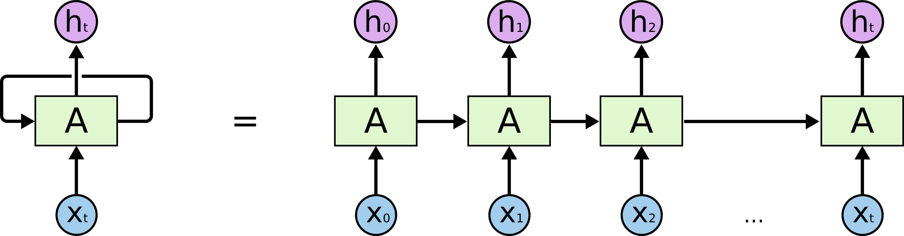
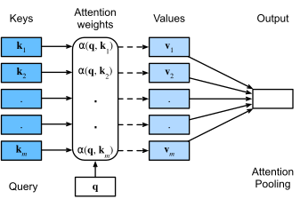
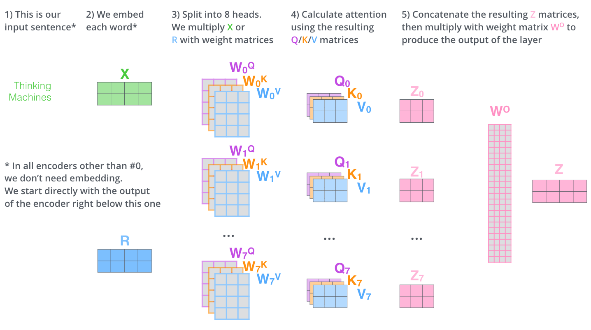
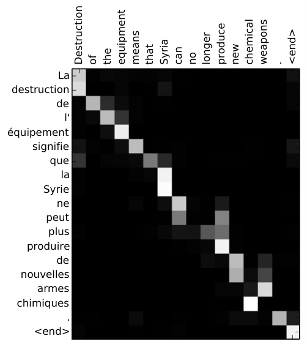
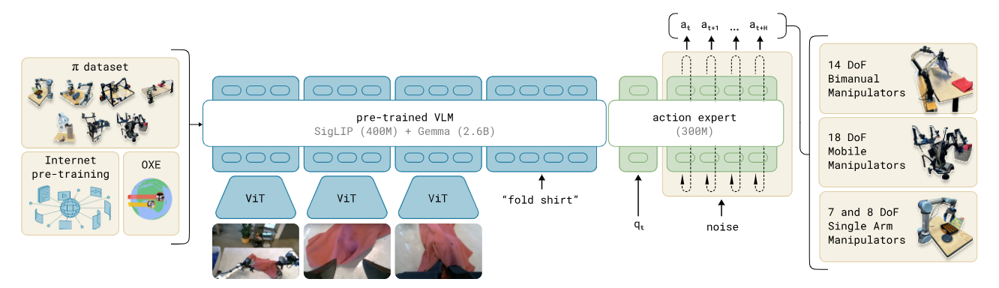
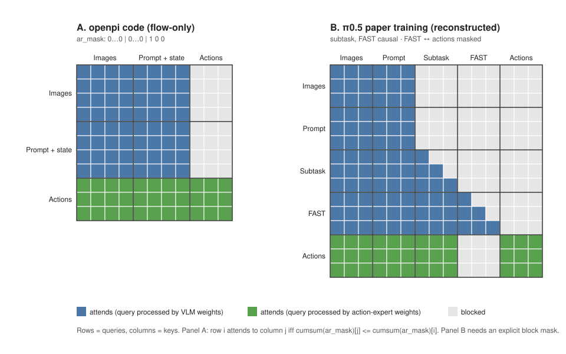
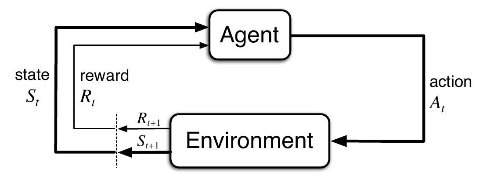

# Homework

*Study map · robot learning*

*Related: [[aamas_review]] — paper-by-paper notes for the World Models and Model-Based RL / self-play items below.*

**WHERE TO START**
&#x2713; to mark as done
- [x] [Transformers](#transformers-attention)
  - [x] [Modern attention and practices](#modern-attention-and-practices)
  - [x] [RoPe](#rope)
  - [x] [ALiBi](#alibi)
  - [x] [Position interpolation and YaRN](#position-interpolation-and-yarn)
  - [x] [Multi-Query Attention](#multi-query-attention)
  - [x] [GQA](#gqa)
  - [x] [MLA](#mla)
  - [x] [Flash Attention](#flash-attention)
  - [x] [Sparse Attention](#sparse-attention)
  - [ ] [Pre-LN vs. Post-LN](#pre-ln-vs-post-ln)
  - [ ] [KV Caching](#kv-caching)
  - [ ] [Speculative decoding](#speculative-decoding)
  - [ ] **π0**
  - [ ] **π0.5**
  - [ ] **π0.6**
  - [ ] **π0.7**
- [x] [Optimal Control](#optimal-control)
  - [x] PD / PID
  - [x] LQR
- [ ] [RL](#reinforcement-learning)
  - [x] Bellman's Equations
  - [x] MDP and POMDP formulations
  - [ ] [On v/s Off Policy](#on-vs-off-policy)
  - [ ] Dynamic Programming
  - [ ] Q learning and DQN's
  - [ ] Policy Gradients and Actor-Critics
  - [ ] Model Based RL — see [[aamas_review#Section III — Game-Play|Section III — Game-Play]] (AlphaZero, MuZero: planning with a learned model) and [[aamas_review#RARL]] (adversarial RL)
  - [ ] Diffusion Policies
  - [ ] Diffusion for Locomotion
- [ ] Imitation Learning
  - [ ] BC
  - [ ] DAgger
  - [ ] Action Chunking and ACT's
- [ ] Gen AI
  - [ ] VAE's
  - [ ] Diffusion Model - DDPM
  - [ ] Flow matching
  - [ ] Advantage weighted flow matching
- [ ] World Models — see [[aamas_review#Section II — World Models|Section II — World Models]] for the full lineage (World Models → PlaNet → Dreamer → DreamerV3; JEPA → I-JEPA → V-JEPA 2)
  - [ ] Dreamer — [[aamas_review#Dreamer Series|Dreamer series]]
  - [ ] JEPA — [[aamas_review#JEPA Family|JEPA family]]
  - [ ] Genie and Cosmos

---

# Notes

<a id="transformers-attention"></a>
## Transformers & attention — "Attention Is All You Need" (Vaswani et al., 2017)

![[papers/attention-is-all-you-need.pdf|700]]

**Core idea:** attention is sufficient, on its own, to model sequences — and dropping recurrence in favor of it trades a bit of quadratic compute cost for full parallelism and constant-length paths between any two tokens.

> [!note] Why RNNs/LSTMs were the go-to for language before this
> - **Variable-length sequences** — same fixed weight matrix applied at every step, so one small parameter set handles any input length (no fixed-size input needed, unlike a plain feedforward net).
> - **Built-in causality/order bias** — $h_t = f(h_{t-1}, x_t)$ naturally encodes "the past affects the future," which matches how language/speech/time series actually work.
> - **Weight sharing across time** — one transition function reused at every position keeps parameter count low and generalizes across positions.
> - **Constant-size memory** — $h_t$ is a fixed-size vector meant to compress "everything relevant so far," so memory doesn't grow with sequence length (unlike attention, which keeps every past token around explicitly).
>
> **Shortcomings that motivated this paper:**
>
> - **Vanishing/exploding gradients** — backprop through $t$ sequential steps means gradients get multiplied $t$ times; over long sequences they shrink to ~0 or blow up, so early tokens stop influencing training. LSTMs/GRUs (gating) reduce this but don't eliminate it.
> - **No parallelism across time** — $h_t$ requires $h_{t-1}$ to exist first, so training is forced to be sequential over the sequence length, badly underusing GPU/TPU parallelism.
> - **$O(n)$ path length between distant tokens** — even with gating, information connecting token 1 and token 100 has to survive 99 sequential hops, so long-range dependencies are hard to learn.
> - **Fixed-size hidden state is an information bottleneck** — $h_t$ must compress the *entire* history into one constant-size vector, so it inevitably loses information as the sequence grows (this is also what the original Bahdanau-style attention was bolted on to fix, before this paper removed recurrence altogether).
>
> **RNN, unrolled across time steps:**
>
> 
>
> **LSTM cell (the repeating module with its gates):**
>
> 
>
> **$\sigma$ / $\tanh$** — both are smooth, bounded, differentiable nonlinearities:
> - **Nonlinear** so stacked layers don't collapse into one linear function.
> - **Bounded** so values stay numerically stable across many layers/time steps.
>
> $\sigma$ outputs $[0,1]$ (reads as a fraction/probability); $\tanh$ is the same S-curve but zero-centered to $[-1,1]$, generally preferred inside hidden computations for better-conditioned gradients.
>
> The **×** circle is elementwise multiply — with a sigmoid gate it behaves like a *soft AND* (pass ≈1, block ≈0), not boolean logic. The **+** circle is elementwise add, merely merging two pathways (e.g. retained old memory + new gated candidate). Neither is XOR.
>
> *Diagrams: [Christopher Olah, "Understanding LSTM Networks"](https://colah.github.io/posts/2015-08-Understanding-LSTMs/)*

**ATTENTION**

**Core idea:** every output position directly looks up and weight-averages over *all* input positions, based on learned relevance (query-key similarity) — not a fixed-size summary of the past.

**Where $Q,K,V$ actually come from** — each token's embedding is projected through three learned matrices $W^Q,W^K,W^V$ to produce that token's own query, key, and value vectors:


**Query vs. Key vs. Value, as a database-style lookup** — a query is matched against every key to get compatibility weights, which then weight-average the associated values:

<div style="background:#ffffff; padding:12px;">

</div>

$$\text{Attention}(Q,K,V) = \text{softmax}\left(\frac{QK^T}{\sqrt{d_k}}\right)V$$

- $QK^T$ — every query dotted against every key → a matrix of raw compatibility scores.
- $/\sqrt{d_k}$ — scales scores down so softmax doesn't saturate into near-one-hot for large $d_k$.
- $\text{softmax}(\cdot)$ — turns each row of scores into weights that sum to 1.
- $\cdot\, V$ — use those weights to take a weighted average of the value vectors.

**The same equation, in matrix form** (all tokens' queries/keys/values stacked into $Q,K,V$ matrices at once):


*Diagrams: [Jay Alammar, "The Illustrated Transformer"](https://jalammar.github.io/illustrated-transformer/)*

**MULTI-HEAD ATTENTION**

**Core idea (Section 3.2.2):** a single attention function forces one softmax-weighted average per query — one attention pattern at a time. Paper's own words: *"Instead of performing a single attention function with $d_{model}$-dimensional keys, values and queries, we found it beneficial to linearly project the queries, keys and values $h$ times with different, learned linear projections..."*, because *"multi-head attention allows the model to jointly attend to information from different representation subspaces at different positions. With a single attention head, averaging inhibits this."*

$$\text{head}_i = \text{Attention}(QW_i^Q, KW_i^K, VW_i^V)$$
$$\text{MultiHead}(Q,K,V) = \text{Concat}(\text{head}_1,\dots,\text{head}_h)W^O$$

$W_i^Q, W_i^K \in \mathbb{R}^{d_{model}\times d_k}$, $W_i^V \in \mathbb{R}^{d_{model}\times d_v}$, $W^O \in \mathbb{R}^{hd_v \times d_{model}}$. Base model: $h=8$, $d_k=d_v=d_{model}/h=64$ — splitting into 8 heads keeps total compute comparable to one full-width head.



**Why this is more than an implementation detail** — real trained heads specialize in different relationships. Below, one head resolves the pronoun "it" back to "The animal" (not "the street") purely from learned attention weights, with no explicit coreference supervision:


*Diagrams: [Jay Alammar, "The Illustrated Transformer"](https://jalammar.github.io/illustrated-transformer/)*

**Self-attention vs. cross-attention** — same equations above; the only difference is where $Q,K,V$ come from:
- **Self-attention** (encoder; decoder's 1st sub-layer, masked): $Q,K,V$ all come from the same sequence's own current representations — every token queries every other token in its own sequence.
- **Cross-attention** (decoder's 2nd sub-layer): *"the queries come from the previous decoder layer, and the memory keys and values come from the output of the encoder."* $Q$ is decoder-side, $K,V$ are encoder-side — the decoder queries the source sequence rather than itself.

> **Note:** in self-attention, $Q/K/V$ all come from the *same* embedding (one sequence). In cross-attention, $Q$ comes from embedding₁ (decoder), $K/V$ come from embedding₂ (encoder) — two different sequences.

**What a real cross-attention weight matrix looks like** — rows/columns are source/target tokens, brightness = attention weight; this is exactly what Worked Example 2 below computes one row of by hand:



*Diagram: attention alignment matrix, English→French (in the style of [Bahdanau et al., 2015](https://arxiv.org/abs/1409.0473)).*

**UPDATE LAW (residual + LayerNorm)**

Every sub-layer — self-attention, cross-attention, or FFN — is wrapped the same way:

$$x_{\text{out}} = \text{LayerNorm}(x + \text{Sublayer}(x))$$

- $x$ — one token's current vector (512-dim). At the first sub-layer, $x = \text{Embedding}(\text{token}) + PE_{pos}$; afterward, $x$ = whatever the previous sub-layer output. (All tokens are computed together as a matrix $X$; the update is still applied independently per row/token.)
- $\text{Sublayer}(x)$ — whichever function this particular wrap surrounds, e.g. $\text{MultiHead}(x,x,x)$ for a self-attention sub-layer.
- $x + \text{Sublayer}(x)$ — **add**, don't replace: $x_{\text{out}} = x + z$, not $x_{\text{out}} = z$.
- $\text{LayerNorm}(\cdot)$ — renormalizes per token, over its own 512 features, so repeated additions across layers don't drift in scale:
$$\text{LayerNorm}(y) = \gamma \odot \frac{y - \mu}{\sqrt{\sigma^2 + \epsilon}} + \beta, \qquad \mu = \frac{1}{d}\sum_{j=1}^{d} y_j, \quad \sigma^2 = \frac{1}{d}\sum_{j=1}^{d} (y_j-\mu)^2$$
computed over the $d=512$ features of a single token (not across the batch or across other tokens); $\gamma,\beta \in \mathbb{R}^{d}$ are learned per-dimension scale/shift.

**Gradient flow through this, with $\text{Sublayer}(x) = \text{MultiHead}(x,x,x)$:**
- **Residual "highway":** $\dfrac{\partial x_{\text{out}}}{\partial x} = I + \dfrac{\partial\, \text{MultiHead}(x,x,x)}{\partial x}$ — the identity term gives gradient a direct, undiminished path back to $x$ regardless of how the attention term's own gradient behaves (He et al., 2016) — this is what makes a 6-layer stack trainable.
- **Splitting across heads:** backward through $W^O$, then $\text{Concat}$ splits the gradient into $h$ separate 64-dim chunks, one per head; each head backpropagates its chunk independently to its own $W_i^Q,W_i^K,W_i^V$.
- **Recombining at $x$:** since $Q=K=V=x$ feeds all $h$ heads at once, their gradients w.r.t. $x$ **sum** at $x$, on top of the identity term above.

**The sub-layers, concretely (Section 3.1):**

**Encoder — 2 sub-layers × $N=6$:** (1) self-attention, (2) position-wise FFN.

**Decoder — 3 sub-layers × $N=6$:** *"In addition to the two sub-layers in each encoder layer, the decoder inserts a third sub-layer, which performs multi-head attention over the output of the encoder stack."*
1. Masked self-attention — causal mask so position $i$ can't attend to positions $>i$: *"...ensures that the predictions for position $i$ can depend only on the known outputs at positions less than $i$."*
2. Cross-attention (as defined above) — the only sub-layer connecting the two stacks.
3. Position-wise FFN.

All wrapped in the same update law above.

**SUMMARY OF THE PAPER**

- **Prior art:** sequence-transduction models (translation, etc.) relied on RNN/CNN encoder-decoders, often with attention bolted on top.
- **Proposal:** the **Transformer** — an architecture built *entirely* out of attention, with no recurrence or convolution at all.
- **Why it matters:** dropping recurrence removes the $O(n)$ sequential dependency that blocks parallel training and slows learning of long-range dependencies; self-attention connects any two positions in $O(1)$ steps instead.
- **Results:** trained on WMT 2014 En→De and En→Fr, it beat prior state-of-the-art (28.4 BLEU on En→De, 41.8 on En→Fr) while training in a small fraction of the compute of the best prior models — 8 GPUs, 3.5 days, for the big model.

**1. METHOD & ARCHITECTURE**

**The full architecture (Figure 1)** — encoder stack on the left, decoder stack on the right, $N=6$ identical layers each, connected by the cross-attention arrows running from the top of the encoder into every decoder layer:

<div style="background:#ffffff; padding:12px;">

</div>

Every block in this diagram was already covered above: scaled dot-product attention, multi-head attention, the residual+LayerNorm update law ("Add & Norm"), and the encoder's 2 / decoder's 3 sub-layers. Three remaining pieces complete the picture:

**Positional encoding (Section 3.5)** — self-attention has no notion of order (it's permutation-invariant), so position is injected by literally adding a fixed vector to each token embedding before layer 1:
$$PE_{(pos,2i)} = \sin\!\left(\frac{pos}{10000^{2i/d_{model}}}\right), \qquad PE_{(pos,2i+1)} = \cos\!\left(\frac{pos}{10000^{2i/d_{model}}}\right)$$
Chosen so $PE_{pos+k}$ is a linear function of $PE_{pos}$ for any offset $k$ — in principle lets the model learn to attend by *relative* position. Table 3 found a learned positional embedding gives "nearly identical results," so this specific sinusoidal choice isn't load-bearing for quality — it's used mainly because it can extrapolate to sequence lengths longer than training.

**Position-wise FFN (Section 3.3)** — the second sub-layer in every encoder/decoder layer, applied identically to each token:
$$\text{FFN}(x) = \max(0, xW_1+b_1)W_2+b_2$$
$d_{model}=512 \to d_{ff}=2048 \to d_{model}=512$ — an up-projection, ReLU, then down-projection. This is where most of the per-token nonlinear computation (and a large share of the parameters) actually lives.

**Embeddings & softmax (Section 3.4)** — *"we share the same weight matrix between the two embedding layers and the pre-softmax linear transformation"* (one weight matrix, reused three times: input embedding, output embedding, and the final projection to vocabulary logits — fewer parameters, and ties the input/output token representations together). Embeddings are also scaled: *"In the embedding layers, we multiply those weights by $\sqrt{d_{model}}$"* before adding positional encoding, so the embedding and positional-encoding terms are on comparable scales.

**Why self-attention over RNN/CNN (Section 4)** — the paper's own complexity comparison, for sequence length $n$, dimension $d$, convolution kernel width $k$:

| Layer type | Complexity/layer | Sequential ops | Max path length |
|---|---|---|---|
| Self-attention | $O(n^2 d)$ | $O(1)$ | $O(1)$ |
| Recurrent | $O(n d^2)$ | $O(n)$ | $O(n)$ |
| Convolutional | $O(k n d^2)$ | $O(1)$ | $O(\log_k n)$ |

Self-attention wins on parallelism (no sequential ops) and path length ($O(1)$ between any two tokens), at the cost of quadratic scaling in $n$ — the trade the whole architecture is built around.

**2. CORE CONCEPTS AND HOW THEY AFFECT THE RESULTS (Table 3 ablations)**

Varying the architecture around the base model and measuring the effect on English→German BLEU / perplexity:

- **Number of heads $h$** — single-head attention (no splitting) scored **0.9 BLEU worse** than the $h=8$ base model. Too many heads also hurt slightly. So multi-head isn't just elegant — it's measurably load-bearing.
- **Head dimension $d_k$** — reducing $d_k$ hurt quality; the paper's own read: *"reducing the attention key size $d_k$ hurts model quality... determining compatibility is not easy."* A too-small per-head projection can't represent compatibility well.
- **Model size ($N$, $d_{model}$, $d_{ff}$)** — bigger models perform better, as expected — the "big" model (more layers/width) is what set the final SOTA numbers, at proportionally higher training cost.
- **Dropout** — *"dropout [is] very helpful in avoiding over-fitting."* Removing it measurably hurts generalization.
- **Positional encoding type** — sinusoidal vs. learned positional embeddings gave *"nearly identical results,"* meaning the specific PE scheme is not where the architecture's quality comes from.

Net read: the design choices that matter most for quality are multi-head splitting and per-head dimension (i.e., how attention itself is structured), not the specific positional-encoding scheme.

**3. ABLATIONS AGAINST EXISTING MODELS AT THE TIME (Table 2)**

| Model | EN→DE BLEU | EN→FR BLEU | Training cost (FLOPs, EN→DE) |
|---|---|---|---|
| GNMT + RL | 24.6 | 39.92 | $2.3\times10^{19}$ |
| ConvS2S | 25.16 | 40.46 | $9.6\times10^{18}$ |
| **Transformer (base)** | 27.3 | 38.1 | $3.3\times10^{18}$ |
| **Transformer (big)** | **28.4** | **41.8** | $2.3\times10^{19}$ |

The big model beat the prior best (GNMT+RL / ConvS2S ensembles, ~26.3–26.4 BLEU, not shown above) by **over 2.0 BLEU on En→De**, and the *base* model alone already beat single-model GNMT+RL on En→De — at roughly **1/7th GNMT+RL's training cost** ($3.3\times10^{18}$ vs. $2.3\times10^{19}$ FLOPs) and about a third of ConvS2S's. The headline result isn't just "better BLEU," it's better BLEU at substantially less training compute, which is the direct payoff of trading recurrence for parallelizable attention.

**Legend, for both worked examples below:**

| symbol | meaning |
|---|---|
| `<BOS>` | Beginning-Of-Sequence — placeholder token fed in before any real output exists, so the decoder has *something* to condition its first prediction on. |
| `<EOS>` | End-Of-Sequence — special token the model is trained to output when generation should stop. |
| $pos$ | a token's position index in its sequence (0-indexed). |
| $x$ | a token's current vector at some point in the network (embedding + PE at the start; a layer's output afterward). |
| $Q,K,V$ | query / key / value vectors — see the "Attention" section above for what each represents. |
| $z$ | the raw output of an attention sub-layer, *before* it's added back via the residual. |
| $W^Q,W^K,W^V,W^O$ | learned projection matrices for (multi-head) attention — a fresh set per layer, and a separate set again for cross-attention vs. self-attention. |
| $W_1,W_2,b_1,b_2$ | the FFN's learned weight matrices/biases. |
| $PE_{pos}$ | the fixed (not learned) positional encoding vector for position $pos$. |
| $d_{model},d_k,d_v,d_{ff},h,N$ | the standard size hyperparameters — see "Multi-head attention" and "Method & architecture" above for values. |
| `[T1], [T2], ...` | placeholder generated target tokens in Example 2, standing in for actual Sumerian words (see that example's caveat). |

**EXAMPLE 1: CONTINUE THE SENTENCE**

> [!example]+ Worked example — continuing "Sphinx of black quartz, judge my ___"
> *(next-token-prediction / language-modeling task: a single stack of* ***masked*** *self-attention + FFN layers, no encoder, no cross-attention — there's no second sequence to translate to, just "predict what comes next." Word-level tokens used for readability — a real model would use subword/BPE tokens.)*
>
> **Step by step:**
>
> 1. **Tokenize the prefix fed in so far:** `[Sphinx, of, black, quartz, ,, judge, my]` → 7 tokens, positions $0$–$6$. The model's whole job right now is to predict token 8.
> 2. **Embedding lookup:** each token ID indexes into a learned embedding table → one 512-dim vector per token (7 vectors total).
> 3. **Scale the embeddings:** multiply every embedding by $\sqrt{d_{model}}$ (Section 3.4) — puts embedding magnitudes on a comparable scale to the positional encoding about to be added.
> 4. **Compute positional encodings:** $PE_{pos}$ for $pos=0,\dots,6$, from the fixed sinusoidal formula — not learned, just calculated once from position.
> 5. **Add them:** $x_{pos} = \text{scaled embedding}_{pos} + PE_{pos}$ → 7 vectors, one per position, this is the input to layer 1.
> 6. **Layer 1 — masked self-attention:**
>    - a. Project $x$ into $Q,K,V$ for each of the $h=8$ heads: $QW_i^Q,\ KW_i^K,\ VW_i^V$.
>    - b. Compute raw scores $QK^T$ for every pair of positions.
>    - c. **Apply the causal mask:** blank out (set to $-\infty$) any score where the key's position is *after* the query's position — e.g. for query "quartz" (pos 3), scores against "," "judge," "my" (pos 4–6) get masked out before softmax ever sees them.
>    - d. Scale remaining scores by $1/\sqrt{d_k}$, apply softmax → attention weights over only the allowed (current-and-earlier) positions.
>    - e. Weighted sum of $V$ → one output per head; concatenate all 8 heads and project with $W^O$ → $z = \text{MultiHead}(x,x,x)$.
>    - f. Residual add + LayerNorm: $x' = \text{LayerNorm}(x + z)$.
> 7. **Layer 1 — FFN:**
>    - a. $x'W_1+b_1$: linear layer, $512 \to 2048$.
>    - b. $\max(0,\cdot)$: ReLU.
>    - c. $(\cdot)W_2+b_2$: linear layer, $2048 \to 512$.
>    - d. Residual add + LayerNorm: $x'' = \text{LayerNorm}(x' + \text{FFN}(x'))$ — this is the input to layer 2.
> 8. **Repeat steps 6–7 for layers 2 through $N=6$** — same operations, but each layer has its own separately learned $W^Q_i,W^K_i,W^V_i,W^O,W_1,W_2$. The causal mask is reapplied identically at every layer; only the vectors being attended over change (they're the previous layer's output, not the raw embeddings anymore). *(Omitted above for simplicity: Section 5.4 also applies dropout — to the embedding+PE sum in step 5, and to each sub-layer's output right before its residual add in steps 6f/7d — at $P_{drop}=0.1$, active only during training.)*
>
> **With actual numbers** *(toy $d_{model}=4$ instead of 512, so it fits on screen; embedding/$Q$/$K$/$V$/logit values below are made up for illustration — real ones are learned. Positional encoding is the one piece computed from the real formula, since it's fixed, not learned. Also simplified: shown as one combined head rather than splitting into $h=8$ — the real model would run 8 of these in parallel on smaller slices and concatenate, per the multi-head equations above.)*
>
> *Steps 2–5, for the token "quartz" at $pos=3$:*
> - Made-up embedding: $[0.3,\ 0.7,\ -0.2,\ 1.1]$
> - Scaled by $\sqrt{d_{model}}=2$: $[0.6,\ 1.4,\ -0.4,\ 2.2]$
> - Real $PE_3$ (from the formula, $d_{model}=4$): $[\sin 3,\ \cos 3,\ \sin 0.03,\ \cos 0.03] = [0.141,\ -0.990,\ 0.030,\ 1.000]$
> - $x_{\text{quartz}} = $ scaled embedding $+\ PE_3 = [0.741,\ 0.410,\ -0.370,\ 3.200]$ — this is what enters layer 1 (step 6).
>
> *Steps 6a–6d, masked self-attention for the query "quartz" against keys $\{$Sphinx, of, black, quartz$\}$ — "," "judge," "my" are masked out per step 6c since they're later positions (made-up $Q,K$ vectors, $d_k=4$):*
>
> | key token | $Q_{\text{quartz}}\cdot K_i$ | $/\sqrt{d_k}=2$ | softmax |
> |---|---|---|---|
> | Sphinx | 0.07 | 0.035 | 0.194 |
> | of | 0.04 | 0.020 | 0.191 |
> | black | 0.91 | 0.455 | **0.296** |
> | quartz (self) | 1.06 | 0.530 | **0.319** |
> | , judge, my | $-\infty$ | $-\infty$ | 0 (masked) |
>
> "black" and "quartz" itself dominate the weights (0.296 + 0.319 ≈ 62%) — exactly the "modifier gets attended to" behavior claimed earlier, falling out of nothing more than a dot product + softmax.
>
> *Steps 6e–6f:* weighted sum over the (made-up) value vectors gives $z_{\text{quartz}} \approx [0.437,\ 0.130,\ 0.275,\ -0.035]$ (this stands in for the already-concatenated, $W^O$-projected multi-head output); residual add gives $x_{\text{quartz}} + z_{\text{quartz}} \approx [1.178,\ 0.540,\ -0.095,\ 3.165]$, and LayerNorm rescales that to something like $[0.31,\ -0.68,\ -1.19,\ 1.56]$ (illustrative — exact values depend on the learned $\gamma,\beta$).
>
> *Step 7 (FFN)* would then take that 4-dim vector, expand it to a toy $d_{ff}=8$, ReLU, and project back to 4-dim, then residual+LayerNorm again — same mechanics as attention's residual step, just with the FFN equation instead of $\text{MultiHead}$.
>
> **Predicting the next word (steps 9–12):**
> 9. After layer $N=6$, take the final layer's output vector at the **last** position ("my", pos 6) — the only position whose job right now is "predict what's next," since it's the only one that has already seen the entire 7-token prefix.
> 10. Project that vector through the shared embedding weight matrix (Section 3.4) → one raw score ("logit") per vocabulary word.
> 11. **Softmax the logits** — toy example over a 5-word slice of the vocabulary:
>
> | candidate | logit | softmax probability |
> |---|---|---|
> | **vow** | 6.2 | **0.787** |
> | oath | 4.8 | 0.194 |
> | the | 2.0 | 0.012 |
> | gaze | 1.1 | 0.005 |
> | quartz | 0.3 | 0.002 |
>
> 12. **Pick a token** — greedy decoding just takes the argmax ("vow," ~79%); beam search / sampling would consider a few of the top candidates instead. Append "vow" to the sequence (now 8 tokens, positions 0–7) and go back to step 1 to predict what comes after "vow" (likely a period or end-of-sequence token).
>
> **Training vs. inference — the key asymmetry:**
>
> - **Training:** the full sentence is already known ("Sphinx of black quartz, judge my vow"), so it's fed in **once, in one parallel pass**, and the model predicts *every* next-token at *every* position simultaneously — "Sphinx"→predict "of", "Sphinx of"→predict "black", ..., "...judge my"→predict "vow" — all 7 predictions computed and backpropagated together in a single forward/backward pass. This only works because the causal mask already stops position $i$ from seeing position $i{+}1$; without it, predicting "of" from "Sphinx" would be cheating by looking at the answer. Loss = cross-entropy (with label smoothing $\epsilon_{ls}=0.1$) summed over all 7 positions at once.
> - **Inference (test time):** given just a prefix, there's no ground-truth continuation to feed in — the model only has its own previous *predictions* to condition on. So generation is forced to be **sequential**: predict "vow," append it, run the whole (now longer) sequence back through, predict the next token, append, repeat — one real forward pass per generated word, with no way to parallelize across positions the way training does.
>
> So the exact same masked self-attention mechanism plays two different roles: during training it's what lets one parallel pass compute every position's next-word loss at once; during inference it's what forces generation to happen one real token at a time.

**EXAMPLE 2: TRANSLATE TO SUMERIAN**

> [!example]+ Worked example — translating "Sphinx of black quartz, judge my vow" into Sumerian
> *(translation task: this is the actual architecture from the paper — a separate encoder stack, a separate decoder stack, connected by cross-attention. Sumerian is a real, extinct language reconstructed from cuneiform tablets; getting an actually-correct translation requires specialist expertise beyond this illustration, so target tokens below are just placeholders `[T1], [T2], ...` — the point is the mechanism, not translation accuracy.)*
>
> **Encoder side (source = English), steps 1–4:**
> 1. **Tokenize the full source sentence:** `[Sphinx, of, black, quartz, ,, judge, my, vow]` — 8 tokens. Unlike Example 1, the *entire* source is available up front — there's no "predict what's next" on this side.
> 2. **Embed, scale by $\sqrt{d_{model}}$, add positional encoding** — identical mechanics to Example 1, steps 2–5.
> 3. **$N=6$ encoder layers, each = self-attention then FFN — but with *no* causal mask.** Every source token attends to every *other* source token, including ones after it — "Sphinx" (pos 0) can attend to "vow" (pos 7) and vice versa, since the whole source sentence is already fully known; there's nothing to hide. (This is the one concrete difference from Example 1's masked self-attention.)
> 4. **Encoder output:** 8 contextualized 512-dim vectors — one per source token. These are held fixed and reused as $K,V$ by *every* decoder layer's cross-attention, for every decoding step that follows.
>
> **Decoder side (target = Sumerian), steps 5–11:**
>
> 5. **Initialize the decoder input:**
>    - a. The target sequence so far is just `[<BOS>]`, at position 0.
>    - b. Embed `<BOS>`, scale by $\sqrt{d_{model}}$, add $PE_0$ — same mechanics as Example 1, steps 2–5, just on the (1-token) target side instead of the source.
> 6. **Masked self-attention (decoder layer 1):**
>    - a. Project the decoder's input into $Q,K,V$ for each of the $h=8$ heads — same projection mechanics as Example 1's step 6a, but using the decoder's own weight matrices.
>    - b. Compute raw scores $QK^T$ over target positions generated so far — right now that's just position 0 against itself, since nothing else has been generated yet.
>    - c. Apply the causal mask — trivial with only one token so far, but this is what will stop position 2 from seeing position 3, etc., once generation is further along.
>    - d. Scale by $1/\sqrt{d_k}$, softmax, weighted sum of $V$, concatenate the 8 heads, project with $W^O$.
>    - e. Residual add + LayerNorm.
> 7. **Cross-attention (decoder layer 1) — the new piece:**
>    - a. Project the vector from step 6 into $Q$, using the decoder's *cross-attention* $W^Q$ (a different weight matrix than the one used for self-attention in step 6a).
>    - b. $K,V$ come from the encoder's 8 output vectors (step 4) — not from anything on the decoder side — projected through the decoder's cross-attention $W^K,W^V$.
>    - c. Compute $QK^T$: this one query compared against all 8 source-side keys.
>    - d. **No mask applied here** — unlike step 6c, the decoder is allowed to look at the entire source sentence at every step, since the source is fully known.
>    - e. Scale by $1/\sqrt{d_k}$, softmax over all 8 source positions, weighted sum of the encoder's $V$ vectors, concatenate heads, project with $W^O$.
>    - f. Residual add + LayerNorm.
> 8. Same update law as always — steps 6e and 7f are both instances of $\text{LayerNorm}(x + \text{Sublayer}(x))$, just with a different $\text{Sublayer}$ each time.
> 9. **FFN**, then residual add + LayerNorm — identical mechanics to Example 1's step 7.
> 10. Repeat steps 6–9 for all $N=6$ decoder layers, then project the final layer's last-position output through the (target-language) embedding matrix → logits over the Sumerian vocabulary → softmax → pick a token.
> 11. Append the predicted token to the target sequence and repeat steps 5–10 to generate the next Sumerian token — until an `<EOS>` token is produced.
>
> **With actual numbers — cross-attention (step 7):** the decoder is predicting the token at target position 1 (the first real word, right after `<BOS>`). Its masked self-attention (step 6) over just `<BOS>` at position 0 produces a query vector $Q_{\text{dec}}$ (made up below), which cross-attention then compares against all 8 encoder outputs — *not* just the ones "before" some position, since the source side has no ordering restriction on what the decoder may look at:
>
> | source token | $Q_{\text{dec}}\cdot K_i$ | $/\sqrt{d_k}=2$ | softmax |
> |---|---|---|---|
> | **Sphinx** | 4.5 | 2.25 | **0.468** |
> | judge | 1.7 | 0.85 | 0.115 |
> | vow | 1.5 | 0.75 | 0.104 |
> | quartz | 0.95 | 0.475 | 0.079 |
> | black | 0.9 | 0.45 | 0.077 |
> | my | 0.3 | 0.15 | 0.057 |
> | of | 0.0 | 0.0 | 0.049 |
> | , | 0.0 | 0.0 | 0.049 |
>
> The decoder's first real generation step attends nearly half its weight (**0.468**) onto "Sphinx" — plausible if it's about to produce whatever Sumerian word/determinative corresponds to the sentence's subject. Weighted sum over the (made-up) encoder value vectors gives a cross-attention output $\approx [0.619,\ 0.145,\ 0.148,\ 0.218]$, which — like every attention output in this architecture — gets added back via the residual (step 8), then passed through the FFN (step 9), eventually producing logits from which `[T1]` is picked (step 10).

### π0

**Physical Intelligence, "π0: A Vision-Language-Action Flow Model for General Robot Control"** (arXiv:2410.24164, 2024) — a flow-matching action expert attached to a pretrained VLM backbone, trained across multiple robot embodiments.

![[papers/pi0/pi0/pi0.pdf|700]]

**CORE IDEA**

- **π0 did not invent the VLA.** RT-2 (2023) coined the term. π0's change is *how* the VLA outputs actions.
- **Continuous actions via flow matching, not discretized tokens.** RT-2 and OpenVLA bin each action dimension into 256 tokens and decode them autoregressively, which is coarse and slow. π0 attaches a separate ~300M-parameter **action expert** to a PaliGemma VLM, and it generates a whole **chunk of $H=50$ continuous actions** by integrating a learned flow from noise over ~10 steps.
- **High-frequency, dexterous control.** Action chunks give up to **50 Hz** control, fast enough for laundry folding, box assembly and table bussing. Earlier VLAs ran at ~1–6 Hz and handled pick-and-place.
- **Mixture-of-experts-style split of weights.** Image and language tokens go through the VLM weights, while state and action tokens go through the action-expert weights. They interact only through attention, using a blockwise causal mask (images+language → state → actions). This keeps the VLM's web knowledge intact while the action pathway specializes.
- **LLM-style pre-train → post-train recipe.** Broad cross-embodiment pre-training (~10k hours: PI's own data across 7 robot configurations and 68 tasks, plus Open X-Embodiment) gives general physical ability. Fine-tuning on smaller curated high-quality data then teaches fluent, specific skills.
- **One model across embodiments.** Single-arm, bimanual and mobile manipulators (up to 18 DoF) share the same weights. Smaller action spaces are zero-padded to the largest.

**TIMELINE: RT-1 → π0**

**RT-1** — Google, Dec 2022
- *Architecture:* ~35M params. ImageNet-pretrained EfficientNet-B3 with FiLM language conditioning, then TokenLearner (compresses to 8 tokens per frame), then a decoder-only Transformer over a 6-frame history. 11-D actions (arm, base, mode), each discretized into 256 bins. ~3 Hz.
- *Training:* behavior cloning on ~130k real demos, 700+ tasks, 13 robots, collected over 17 months.
- *Change:* showed that a single Transformer policy scales with large, diverse robot data. No pretrained language model is involved in control yet.

**SayCan (Apr 2022) / PaLM-E (Mar 2023)** — the hierarchical detour
- *Architecture:* a large LM (PaLM; PaLM-E adds ViT image embeddings injected into the token stream) produces a **text plan**, and separate low-level policies execute it. SayCan grounds each step with RL value functions (Say × Can).
- *Change:* web knowledge is used for *planning* only. The LM never outputs motor commands.

**Diffusion Policy** — Chi et al., Mar 2023
- *Architecture:* a CNN or Transformer that **denoises a sequence of continuous actions** (DDPM), conditioned on observations, and executes them in receding-horizon fashion.
- *Change:* continuous and multimodal action distributions, with no binning. This is the conceptual ancestor of π0's flow-matching head.

**ACT / ALOHA** — Zhao et al., Apr 2023
- *Architecture:* a CVAE Transformer that predicts a **chunk of $k$ future actions** at once, with temporal ensembling. Runs on low-cost bimanual hardware at 50 Hz.
- *Training:* ~50 demos per task.
- *Change:* introduced **action chunking**, which reduces compounding error and enables high-frequency, fine-grained bimanual manipulation. π0 adopts this directly.

**RT-2** — Google DeepMind, Jul 2023 — *the first "VLA"*
- *Architecture:* a pretrained VLM (PaLI-X 5B/55B or PaLM-E 12B) used **as the policy**. Actions are written as text: 8 integers (terminate, 6-DoF delta, gripper) with 256 bins each, mapped onto existing or overwritten vocabulary tokens. Decoding is constrained to valid action tokens. ~1–3 Hz.
- *Training:* **co-fine-tuning** on web VQA/captioning data together with RT-1 robot data, so the VLM keeps its web knowledge.
- *Change:* web knowledge now transfers *into control*, giving semantic generalization such as "pick up the extinct animal". The cost is a huge model, slow inference and coarse discrete actions.

**Open X-Embodiment / RT-X** — 21 institutions, Oct 2023
- *Data:* 1M+ trajectories, 22 embodiments, 527 skills, pooled into a single format.
- *Models:* RT-1-X and RT-2-X (55B) trained on the mix. RT-2-X showed roughly 3× the emergent skills of RT-2.
- *Change:* **cross-embodiment training helps** instead of hurting. This became the standard pre-training corpus.

**Octo** — Berkeley et al., May 2024
- *Architecture:* 27M/93M Transformer with readout tokens and a **diffusion action head**. Modular: new observation or action spaces can be attached during fine-tuning. Language goals use a T5 encoder, and goal images are also supported.
- *Training:* 800k OXE trajectories.
- *Change:* an open-source generalist policy that is cheap to fine-tune. It has continuous actions but **no VLM backbone**, so it has less semantic knowledge.

**OpenVLA** — Stanford et al., Jun 2024
- *Architecture:* 7B Prismatic VLM (fused DINOv2 and SigLIP features, projector, Llama 2 7B). Uses RT-2-style discrete action tokens (256 least-used vocabulary tokens overwritten). ~6 Hz.
- *Training:* ~970k OXE trajectories. LoRA fine-tuning works.
- *Change:* the **open-source RT-2**. It beats RT-2-X (55B) by ~16.5% absolute with 7× fewer parameters. It still has the discrete-token bottleneck, so it can't do dexterous or high-frequency tasks.

**π0** — Physical Intelligence, Oct 2024
- *Architecture:* PaliGemma 3B VLM plus a 300M **flow-matching action expert** that outputs $H=50$ continuous action chunks at up to 50 Hz.
- *Training:* ~10k hours of cross-embodiment pre-training, then high-quality post-training.
- *Change:* merges the two threads, combining RT-2/OpenVLA's **VLM backbone** with Diffusion Policy/ACT's **continuous, chunked actions**.

**Trends across the timeline**

| Axis | RT-1 era | π0 |
|---|---|---|
| Backbone | Trained from scratch, ImageNet CNN | Pretrained VLM (web knowledge) |
| Action representation | Discrete bins, one step at a time | Continuous flow-matched chunks |
| Control frequency | ~1–3 Hz | Up to 50 Hz |
| Data | One lab, one robot type | Cross-embodiment (OXE plus in-house) |
| Recipe | Single-stage behavior cloning | Pre-train, then post-train |

**Architecture (Figure 3):** a pre-trained VLM backbone (SigLIP + Gemma 2.6B) processes images and language, augmented with a smaller 300M-parameter *action expert* that attends to the robot's proprioceptive state $q_t$ and generates a chunk of continuous actions $a_t, \dots, a_{t+H}$ via flow matching (denoising from noise, conditioned on the VLM's output). One model, multiple embodiments — 7/8 DoF single-arm, 14 DoF bimanual, and 18 DoF mobile manipulators all share the same backbone and action expert.




### π0.5

**Physical Intelligence, "π0.5: a Vision-Language-Action Model with Open-World Generalization"** (arXiv:2504.16054, 2025) — extends π0 with heterogeneous training data (other robots, subtask labels, web data) to generalize to entirely new environments, not just held-out tasks in familiar ones.

![[papers/pi0/pi05/pi05.pdf|700]]

**CORE IDEA**

- **Goal: open-world generalization.** π0 is strong in environments close to its training data. π0.5 targets **entirely new homes**, cleaning kitchens and bedrooms in 10–15 minute multi-stage tasks.
- **Lever: co-training on heterogeneous data.** Mobile-manipulator data from ~100 homes (~400 h) is only a small slice. **97.6% of pre-training examples come from other sources**: static robots in homes, lab cross-embodiment robots, high-level subtask annotations, and web data. Each source supplies a different kind of knowledge (physical skills, scene semantics, task structure).
- **One model, two levels of inference.** The same weights first predict a **text subtask** ("pick up the plate"), then predict **actions conditioned on that subtask**. This is chain-of-thought for robots: SayCan's hierarchy inside a single VLA.
- **Two-stage training that combines discrete and continuous actions.** Pre-training uses **FAST discrete action tokens** (fast, and everything is next-token prediction). Post-training adds π0's **flow-matching action expert** for precise, real-time continuous control.
- **Scaling result:** performance rises with the number of distinct training environments. At 104 locations it matches a baseline trained *on the test homes themselves*.

**ARCHITECTURE BLOCKS**

The model factorizes the policy into a high-level and a low-level distribution, **represented by the same weights**:
$$\pi_\theta(a_{t:t+H}, \hat{\ell} \mid o_t, \ell) = \underbrace{\pi_\theta(a_{t:t+H} \mid o_t, \hat{\ell})}_{\text{low-level}}\ \underbrace{\pi_\theta(\hat{\ell} \mid o_t, \ell)}_{\text{high-level}}$$
Here $\ell$ is the overall task ("clean the bedroom"), $\hat{\ell}$ is the predicted subtask or text answer, and $o_t = [I^1_t, \dots, I^n_t, q_t]$ are the camera images plus proprioceptive state. **Actions depend only on $\hat{\ell}$, not on $\ell$.**

```
 images I¹..Iⁿ ─► SigLIP (400M) ─┐
 prompt ℓ / ℓ̂  ─► text embed ────┼─► Gemma (2.6B) VLM weights ──► text logits y^ℓ_1:M
 state q_t (discretized → text) ─┘          ▲  shared attention         (subtask / answer / boxes / FAST)
                                            │  at every layer
 noisy actions a^{τ,ω} ─► linear ──► action expert (300M) weights ──► linear ──► vector field y^a_1:H
```

| Block | Details |
|---|---|
| **Vision encoder** | SigLIP (400M). Four cameras: forward, backward, 2× wrist. **All 4 are used for high-level inference; wrist and forward only for low-level.** |
| **VLM backbone** | Gemma 2.6B (PaliGemma init). Processes image patches, prompt, state and text/FAST output tokens. |
| **State $q_t$** | Joint angles, gripper, torso lift and base velocity, **discretized and fed as text tokens** (unlike π0, where state was continuous). |
| **Action expert** | ~300M, randomly initialized at the start of post-training. Separate weights (MoE-style) for action tokens only. Noisy actions are linearly projected in, and the output is linearly projected to a continuous vector field. |
| **Output split** | The first $M$ outputs are text logits $y^\ell_{1:M}$. The last $H$ are action-expert outputs $y^a_{1:H}$. Prefix tokens get no loss ($M + H \le N$). |
| **Attention mask** | Image patches, prompt and continuous action tokens attend **bidirectionally**. Text outputs are **causal**. **FAST tokens and flow tokens are masked from attending to each other**, so one action representation can't leak into the other. |
| **Action space** | **Target joint and end-effector poses**, with the mode given in the prompt as `<control_mode> joint/end effector <control_mode>`. Normalized to $[-1,1]$ per dimension with the 1% and 99% quantiles, and zero-padded to the largest action space (18–19 DoF). |
| **Control** | Outputs target poses for arms, grippers and torso lift, plus base velocities, at **50 Hz** with action chunking, tracked by simple PD controllers. No separate planner or collision checking. |

**Attention mask**

<div style="background:#ffffff; padding:12px;">

</div>

- **A. What the public code does** ([openpi](https://github.com/Physical-Intelligence/openpi) `src/openpi/models/pi0.py`, `pi05=True`). Only flow matching is included ("we currently only support the flow matching head for both π0.5 training and inference"). Each token gets an `ar_mask` bit, and a 1 starts a new block:
  ```python
  cumsum = jnp.cumsum(mask_ar, axis=1)
  attn_mask = cumsum[:, None, :] <= cumsum[:, :, None]         # query i sees key j iff cumsum[j] <= cumsum[i]
  valid_mask = input_mask[:, None, :] * input_mask[:, :, None]  # drop padding
  ```
  - **Prefix** = images + `"Task: {task}, State: {binned state};\nAction: "`, all `ar=0`, forming one bidirectional block (PaliGemma prefix-LM). State is binned into 256 values over $[-1,1]$ and written as numbers in the prompt.
  - **Suffix** = $H$ noisy action tokens, `ar = 1, 0, …, 0`. They see each other and the whole prefix. The prefix never sees them.
  - Because the prefix never sees the actions, the prefix **KV cache is computed once** and reused for all 10 denoising steps. Only the expert re-runs.
  - The flow time $\tau$ enters the expert through **adaRMSNorm** (`adarms_cond`). π0 instead concatenated it to the action tokens with an MLP and had a separate continuous state token.
- **B. The paper's training mask** (reconstructed from the text; not in the public code). Subtask and FAST tokens are causal, **FAST ↔ continuous actions are mutually masked** so neither can copy the other's answer, and the action tokens condition on the subtask.

**PRE-TRAINING (280k steps, $\alpha = 0$)**

A standard autoregressive transformer doing **next-token prediction only** on text, object locations and FAST action tokens. There is no action expert yet.

| Data | Contents |
|---|---|
| **MM**: diverse Mobile Manipulator | ~400 h, ~100 homes. The target platform. |
| **ME**: diverse Multi-Environment non-mobile | Single- and dual-arm static robots in many homes. Easier to transport, so there are more scenes. |
| **CE**: Cross-Embodiment lab | Many robot types in lab settings (bussing, folding shirts, etc.), plus open-source OXE. |
| **HL**: High-Level subtask | **Manual annotations** on MM/ME/CE episodes: subtask labels plus **bounding boxes of relevant objects**, which the model predicts *before* the subtask. |
| **WD**: Web Data | Captioning (CapsFusion, COCO), VQA (Cambrian-7M, PixMo, VQAv2), object localization, plus **extra indoor/household-object bounding-box data**. |
 — how π0.5 tokenizes actions for pre-training
> **FAST: Efficient Action Tokenization for Vision-Language-Action Models** · Pertsch, Stachowicz, Ichter, Driess, Nair, Vuong, Mees, Finn, Levine · arXiv:2501.09747, 2025
>
> ![[papers/pi0/fast/fast.pdf|660]]
>
> **Core concept**
> - **The problem with naive binning.** RT-2 and OpenVLA discretize each action dimension at each timestep into one of $N=256$ bins. For a chunk of $H$ actions with $D$ dimensions this gives $H \times D$ tokens:
> $$\mathcal{T}_a(a_{1:H}) = [T_{1,1}, \dots, T_{1,D}, \dots, T_{H,1}, \dots, T_{H,D}]$$
> - At high control frequencies, consecutive actions are almost identical, so each new token carries **almost no new information** given the previous ones. Next-token loss can then be driven down by simply **copying the last token**, and the model gets stuck in that local optimum. This is why OpenVLA fit the low-frequency BridgeV2 and RT-1 data but struggled on the higher-frequency DROID dataset. In the paper's toy spline experiment, error with binning rises steeply as the sampling rate increases, while FAST stays flat.
> - **Key insight: compress before you tokenize.** Remove the redundancy between timesteps so each token is high-information, the way BPE does for text. The paper does this with the **discrete cosine transform (DCT)**, the same compression used in JPEG. Smooth signals are captured by a few low-frequency coefficients, and the rest round to zero.
>
> **The pipeline (Algorithm 1)**
> 1. **Normalize** each action dimension using the 1st and 99th percentiles of the training data (robust to outliers, and gives a shared scale across embodiments):
> $$\tilde{a}^i_t = 2\,\frac{a^i_t - q^i_{01}}{q^i_{99} - q^i_{01}} - 1 \;\in [-1, 1]$$
> 2. **DCT** each dimension $i$ separately along time:
> $$C^i_j = \sum_{t=0}^{H-1} \tilde{a}^i_t \cos\!\left[\frac{\pi}{H}\left(t + \tfrac{1}{2}\right) j\right], \quad j = 0, \dots, H-1$$
> Low $j$ captures the overall shape of the trajectory and high $j$ captures sharp jerks.
> 3. **Quantize** with a scale-and-round. The scale $\gamma$ (default 10) is the only knob that trades lossiness against compression:
> $$\bar{C}^i_j = \operatorname{round}(\gamma \cdot C^i_j)$$
> Most high-frequency entries become 0, leaving a sparse $D \times H$ integer matrix.
> 4. **Flatten low-frequency-first** (column-first), interleaving dimensions:
> $$[T_k] = [\bar{C}^1_0, \dots, \bar{C}^D_0,\; \bar{C}^1_1, \dots, \bar{C}^D_1,\; \dots,\; \bar{C}^D_{H-1}]$$
> The model therefore predicts the *coarse shape of the motion first* and the fine detail last, which gave more stable rollouts than row-first flattening.
> 5. **BPE** compresses the sequence losslessly (vocabulary of 1024), merging the long runs of zeros and common coefficient patterns into dense tokens $[\tilde{T}_1, \dots, \tilde{T}_{\tilde{k}}]$. These tokens overwrite rarely used tokens in the VLM's vocabulary.
>
> **Training:** plain next-token cross-entropy on the action tokens, conditioned on the observation $o$ and instruction $\ell$, exactly like text:
> $$\mathcal{L} = -\sum_{k} \log p_\theta\!\left(\tilde{T}_k \mid \tilde{T}_{<k},\, o,\, \ell\right)$$
>
> **Decoding:** every step is invertible. Undo BPE, reshape to $D \times H$, divide by $\gamma$, apply the inverse DCT, then un-normalize. The only information lost is from rounding.
>
> **FAST+:** a *universal* BPE vocabulary trained on 1M real trajectories across many embodiments, action spaces and control frequencies. It works as an off-the-shelf tokenizer, so you don't need to train BPE for each new dataset.
>
> **Results:** **π0-FAST** (π0's backbone trained autoregressively on FAST tokens) matches diffusion/flow π0 on dexterous and long-horizon tasks while training **up to 5× faster**. It was also the first generalist policy trained on DROID that could be evaluated zero-shot in unseen environments. The trade-off is inference: autoregressively decoding tens of tokens is slower than π0's flow head.
>
> **Why π0.5 uses both:** FAST tokens for **pre-training** (fast, and every data source becomes next-token prediction alongside web and subtask text), then π0's **flow-matching action expert** added in **post-training** for fast, continuous actions at inference.

**POST-TRAINING (80k steps, $\alpha = 10$)**

**Purpose:** specialize the model to mobile manipulation in homes, and add the action expert for real-time continuous actions.

1. **Initialize** from the 280k-step pre-trained checkpoint. **Add the action expert with random weights.**
2. **Swap the data mixture:**
   - **Keep** MM and ME robot data, **filtered to successful episodes below a fixed length threshold**.
   - **Keep** WD, to preserve semantic and visual abilities.
   - **Keep** the slice of HL data from the multi-environment datasets.
   - **Add** **VI (verbal instructions)**: expert users "teleoperate with language", choosing subtask commands step by step while the robot executes them with the learned low-level policy. These are demonstrations of *good high-level outputs*. They make up only ~11% of the high-level mobile-manipulation examples but matter a lot (see ablations).
   - **Drop** CE (lab cross-embodiment), to focus on mobile manipulation and diverse environments.
3. **Train jointly** with Eq. (1) below. Next-token cross-entropy continues (keeping text, subtask and FAST prediction), and the flow-matching loss trains the action expert. **Nothing is frozen.**
4. **Inference:** autoregressively decode the subtask text $\hat{\ell}$, then run **10 flow denoising steps** conditioned on it to produce $a_{t:t+H}$. The high-level step runs at a **lower frequency** than low-level action generation.

**LOSS AND GRADIENT FLOW**

**Combined objective (Eq. 1):**
$$\mathbb{E}_{\mathcal{D},\tau,\omega}\Big[\underbrace{H\big(x_{1:M},\, f^\ell_\theta(o_t, \ell)\big)}_{\text{cross-entropy on text + FAST tokens}} \;+\; \alpha\, \underbrace{\big\| \omega - a_{t:t+H} - f^a_\theta\big(a^{\tau,\omega}_{t:t+H},\, o_t,\, \ell\big)\big\|^2}_{\text{flow matching on the action expert}}\Big]$$
where the noisy action chunk is $a^{\tau,\omega}_{t:t+H} = \tau\, a_{t:t+H} + (1-\tau)\,\omega$, with $\omega \sim \mathcal{N}(0, I)$ and $\tau \in [0,1]$. The expert predicts the vector field $\omega - a$.
- Pre-training: $\alpha = 0$, so only cross-entropy. Post-training: $\alpha = 10$.
- **Cross-entropy** covers every discrete target present in an example: subtask text, VQA answers, captions, `<loc>` box tokens, and FAST action tokens. Each example only has the targets for its own task, and the prompt tells the model which task it is.

**How gradients propagate (post-training):**
- **Cross-entropy → VLM weights** (the ordinary LM path).
- **Flow MSE → action-expert weights**, and **through the shared attention into the VLM**. At every layer the action tokens' queries attend to the VLM tokens' keys and values, so the flow loss also updates the VLM weights that produced them.
- Because the FAST and flow tokens can't attend to each other, the action expert can't copy the answer from the discrete action tokens. It has to read the actions from the images, state and subtask.
- *(My inference, not stated in the paper: there's no stop-gradient, so the randomly initialized expert's early noisy gradients do reach the VLM. The follow-up **Knowledge Insulation** paper (PI, 2025) stops exactly this gradient path, so the VLM is shaped only by the FAST cross-entropy.)*

**SUBTASK PREDICTION AND THE TEXT BOTTLENECK**

**Training:** plain supervised text prediction on annotated episodes. Each frame yields two kinds of example:

| Level | Input | Target | Loss |
|---|---|---|---|
| **High** | images + state + task $\ell$ ("clean the bedroom") | relevant boxes, then subtask $\hat{\ell}$ ("pick up pillow") | CE |
| **Low** | images + state + **ground-truth** subtask $\hat{\ell}$ | action chunk (FAST tokens and/or flow) | CE and/or flow MSE |

Labels come from **manual annotation** (HL data) and from **verbal instructions** (VI data, post-training only).

**Inference:** the subtask is decoded to **actual token IDs** (a hard discrete step), appended to the prompt as text, and re-embedded by the VLM together with the images. The action expert **never reads the text directly**. It attends to the VLM's contextual keys and values for those subtask tokens.

**Properties of the text bottleneck**
- **Interpretable and steerable:** you can read the subtask, or have a human type or say it and skip the high-level step entirely (this is how VI data is collected).
- **The low level trusts the subtask:** it's trained on ground-truth labels, so a wrong $\hat{\ell}$ gets executed competently but wrongly. The action expert can't compensate for bad high-level predictions.
- **Lossy:** anything not in the subtask string reaches the actions only through the images and state.
- **No gradient through the sampled text:** the high level learns to imitate the labels, not to pick phrasings that help the low level.
- **Known failure:** high-level inference is "easily distracted", for example opening and closing a drawer repeatedly.

**High-level ablation (Fig. 13, mock homes)**

| Variant                                                                  | Result                                                                                                           |
| ------------------------------------------------------------------------ | ---------------------------------------------------------------------------------------------------------------- |
| **Full π0.5**                                                            | **Best, beating even a human giving the subtasks**                                                               |
| Implicit HL: HL data in training, **no** subtask prediction at inference | 2nd best (not significantly different, p = 0.144). Subtask *training data* gives much of the benefit on its own. |
| Human HL (expert human as oracle high-level policy)                      | Below π0.5                                                                                                       |
| No VI / no WD / no HL                                                    | Significantly worse. VI matters despite being small, and WD mostly helps the high level.                         |
| GPT-4 as high-level policy (zero-shot, prompted with the common labels)  | Worst. An ungrounded planner doesn't match what the robot can actually do.                                       |

> [!note] Knowledge Insulation — joint FAST + flow training with a stop-gradient
> **Knowledge Insulating Vision-Language-Action Models: Train Fast, Run Fast, Generalize Better** · Driess, Springenberg, Ichter, Yu, Li-Bell, Pertsch, Ren, Walke, Vuong, Shi, Levine · arXiv:2505.23705, 2025
>
> ![[papers/pi0/ki/ki.pdf|660]]
>
> **Core idea**
> - **The problem:** bolting a *randomly initialized* action expert onto a pretrained VLM (π0-style) sends noisy flow-matching gradients back into the backbone. This **degrades the VLM's knowledge** (π0 often ignores the language command and grabs the wrong object) and **slows training** (π0 needs **7.5×** more steps than π0-FAST to reach similar performance).
> - **The obvious fixes don't work:**
>   - **Pure autoregressive (π0-FAST):** trains fast and follows language, but inference is slow (~750 ms per 1 s chunk on an RTX 4090, ~1.3 Hz versus π0's ~10 Hz), so it takes about twice as long to finish tasks.
>   - **Freezing the backbone:** VLM representations aren't good enough for robotics without adaptation. It scores **0%** on shirt folding.
> - **The fix: insulate the backbone.** Train the VLM with **FAST next-token prediction** (a clean learning signal that doesn't depend on the untrained expert) *while simultaneously* training the action expert with flow matching, and **stop the expert's gradients from reaching the backbone**. The discrete tokens adapt the VLM for robotics, and the expert just learns to *read* those representations.
>
> **Three changes to the recipe (Sec. 5)**
> 1. **Joint training:** autoregressive FAST loss and flow-matching loss at the same time, in one stage. FAST is used **only at training time**, as a representation-learning objective, and the expert produces actions at inference.
> 2. **VLM data co-training:** mix in general vision-language data (captioning, VQA, bounding boxes) and robot planning data so the backbone doesn't forget.
> 3. **Stop-gradient** between the action expert and the backbone.
>
> **Training change vs. π0.5:** π0.5 is **two-stage**: FAST-only pre-training, then a randomly initialized expert added in post-training, with gradients flowing into the VLM. KI is **single-stage**: FAST and flow are trained together from the start, and the expert never updates the backbone.
>
> **Loss (Eq. 4):** one objective with per-example masks, so any data type can be mixed in:
> $$\mathcal{L}_{\text{CO-VLA}} = \mathbb{E}_{\mathcal{D},\tau,\omega}\Big[-\sum_{j} M^\ell_j \log p_\theta(\hat{\ell}_{j+1} \mid x_{1:j}) \;+\; \alpha\, M^{\text{act}} \big\|\omega - a_{1:H} - f^a_\theta(a^{\tau,\omega}_{1:H})\big\|^2\Big]$$
> - $\hat{\ell}$ contains both text tokens and FAST action tokens.
> - $M^\ell$ marks which token positions get language loss. $M^{\text{act}}$ is on only for examples that have actions.
> - This allows VLM-only data (text loss only), action-only data, and combined data (actions plus a language annotation of what the robot should do next).
> - Because of the stop-gradient, the flow loss updates only independent weights, so they can simply use **$\alpha = 1$** (π0.5 needed $\alpha = 10$).
>
> **Architecture change: stop-gradient inside attention (Eqs. 5–6).** The backbone ($b$) and expert ($a$) interact **only through attention**, so that's where the gradient is cut. With $X_b$ as tokens processed by backbone weights and $X_a$ by expert weights:
> $$\begin{pmatrix} P_{bb} & 0 \\ P_{ab} & P_{aa} \end{pmatrix} = \operatorname{softmax}\!\left(\begin{pmatrix} Q_b(X_b)K_b(X_b)^\top & 0 \\ Q_a(X_a)\,\operatorname{sg}\!\big(K_b(X_b)\big)^\top & Q_a(X_a)K_a(X_a)^\top \end{pmatrix} + A\right)$$
> $$E = \begin{pmatrix} E_b \\ E_a \end{pmatrix} = \begin{pmatrix} P_{bb}\,V_b(X_b) \\ P_{ab}\,\operatorname{sg}\!\big(V_b(X_b)\big) + P_{aa}\,V_a(X_a) \end{pmatrix}$$
> - The top-right $0$ means backbone tokens never attend to expert tokens (one-way information flow).
> - $\operatorname{sg}(\cdot)$ on the **backbone's keys and values** when the *expert* attends to them. The forward pass is unchanged, since the expert still reads the backbone. In the backward pass, flow gradients stop at the expert's own weights.
> - The mask $A$ also blocks **FAST ↔ continuous-action attention**, so neither action representation can copy from the other.
> - This works *only because* the backbone is also trained on FAST actions. Otherwise nothing would teach the VLM action-relevant features, as the frozen-backbone result shows.
>
> **Results**
> - **Items in drawer** (held-out environment): best overall. `joint-training` without the stop-gradient has language-following problems similar to π0.
> - **HybridVLA** (discrete tokens *can* attend to the diffusion inputs) does much worse, which confirms that the mask matters.
> - **Converges as fast as π0-FAST**, with π0-level fast inference.
> - **DROID:** 0.55 vs. π0 0.49 vs. π0-FAST 0.45. **LIBERO:** new state of the art on LIBERO-90 and LIBERO-Spatial.
> - **Language following:** the stop-gradient is the most effective way to improve it, and VLM co-training helps too.
> - **VLM data** matters most for **out-of-distribution objects**, which fits π0.5's no-WD ablation.
> - **FAST vs. naive binning** as the representation objective: on shirt folding the naive-token variant was close and not significantly worse (p = 0.765). The paper argues FAST's advantage is mainly a better learning signal and faster convergence (Sec. 6, p. 9 onward).


### π0.6

**Physical Intelligence, "π*0.6: a VLA That Learns From Experience"** (arXiv:2511.14759, 2025) — introduces RECAP, which improves the policy from its own autonomous rollouts and corrections via reinforcement learning, without policy-gradient updates.

![[papers/pi0/pi06/pi06.pdf|700]]

**CORE IDEA**

- **Goal: learn from the robot's own experience, not just demonstrations.** Imitation learning is capped at demo quality and suffers from compounding errors. π\*0.6 (the star means "trained with RL") improves a flow-matching VLA from its own deployments using **RECAP**: **R**L with **E**xperience and **C**orrections via **A**dvantage-conditioned **P**olicies.
- **Key trick: advantage conditioning instead of policy gradients.** PPO/REINFORCE need action log-likelihoods, and flow-matching models don't provide a tractable one. Instead, train on **all** data with ordinary supervised learning, plus a text input saying whether each action was better than expected: `"Advantage: positive"` / `"Advantage: negative"`. At inference, always prompt `positive`.
- **Nothing is thrown away.** Unlike filtered BC or weighted regression (AWR), bad attempts stay in the dataset and teach the model what "negative" looks like.
- **Heterogeneous data in one loop:** demonstrations, autonomous rollouts (successes and failures) and **human teleop corrections** all go into the same training set.
- **Results:** espresso drinks, diverse laundry in real homes, and factory box assembly. **Throughput more than doubles** on the hardest tasks and **failure rate roughly halves**. It ran 13 hours of espresso and 2+ hours of laundry in a new home without interruption.

**WHY ADVANTAGE CONDITIONING WORKS**

For a reference (behavior) policy $\pi_{\text{ref}}$ and improvement indicator $I$, Bayes' rule gives the improved policy:
$$\hat{\pi}(a \mid o, \ell) \;\propto\; \pi_{\text{ref}}(a \mid o, \ell)\left(\frac{\pi_{\text{ref}}(a \mid I, o, \ell)}{\pi_{\text{ref}}(a \mid o, \ell)}\right)^{\beta}$$
- With $\beta = 1$, $\hat{\pi} = \pi_{\text{ref}}(a \mid I, o, \ell)$, which is just the **conditional model**, and it is provably no worse than $\pi_{\text{ref}}$. So you never have to compute $p(I \mid A)$; you just train the model to represent both the conditional and unconditional policies.
- It works like **classifier-free guidance (CFG)**. The indicator is **randomly dropped** during training, so you can sample conditionally ($\beta = 1$) or combine conditional and unconditional predictions for $\beta > 1$.
- The indicator is a hard threshold on the advantage: $I_t = \mathbb{1}\big[A^{\pi_{\text{ref}}}(o_t, a_t, \ell) > \epsilon_\ell\big]$. The threshold $\epsilon_\ell$ controls how strict "good" is (set to the **30th percentile** of values for task $\ell$). The paper found this easier than tuning $\beta$, since high CFG weights make actions aggressive.

**Policy objective (Eq. 3):**
$$\min_\theta\; \mathbb{E}_{\mathcal{D}}\Big[-\log \pi_\theta(a_t \mid o_t, \ell) \;-\; \alpha \log \pi_\theta(a_t \mid I_t, o_t, \ell)\Big]$$

**VALUE FUNCTION (the critic)**

- A **separate, smaller VLM** (670M, initialized from Gemma 3) with the same architecture design as the policy, plus a value head. It's co-trained on some web data to prevent overfitting.
- **Sparse, task-agnostic reward.** Only a success or failure label per episode is needed:
$$r_t = \begin{cases} 0 & t = T \text{ and success} \\ -C_{\text{fail}} & t = T \text{ and failure} \\ -1 & \text{otherwise} \end{cases}$$
  So the value is the negative number of **steps until success**, normalized per task to $(-1, 0)$ by the maximum episode length.
- **Distributional:** it predicts a distribution over $B = 201$ return bins, trained with cross-entropy against the discretized empirical return (a Monte Carlo estimate, Eq. 1):
$$\min_\phi\; \mathbb{E}_{\tau \in \mathcal{D}}\Big[\sum_{o_t \in \tau} H\big(R^B_t(\tau),\; p_\phi(V \mid o_t, \ell)\big)\Big], \qquad V(o_t, \ell) = \sum_b p_\phi(V = b \mid o_t)\, v(b)$$
- **Advantage** is an n-step estimate: $A(o_t, a_t) = \sum_{t'=t}^{t+N-1} r_{t'} + V(o_{t+N}) - V(o_t)$.
- The value function is run **on the fly** during VLA training to label each example's $I_t$. It's small, so this is cheap.
- It learns to detect mistakes: its output drops when the robot crumples a shirt and rises when it recovers (Fig. 4).

**ARCHITECTURE CHANGES (π0.5 → π0.6 → π\*0.6)**

| Change | Details |
|---|---|
| **Bigger backbone** | **Gemma 3 4B** (was Gemma 2.6B), with a SigLIP 400M vision encoder. |
| **Bigger action expert** | **860M** (was 300M). |
| **KI training recipe** | FAST tokens and flow trained jointly end-to-end, with the **stop-gradient** from the action expert into the backbone (see the Knowledge Insulation box above). |
| **More conditioning** | Prompt $\ell = \ell_t + s$: the task plus **metadata** $s$ that modulates how the task is performed. More robot platforms in pre-training. |
| **Advantage token** (π\*0.6) | `"Advantage: positive/negative"` placed **after the subtask $\hat{\ell}$ and before the actions**, so it affects only the action likelihoods, not subtask prediction. |
| **Actions** | Joint angles and gripper commands at **50 Hz**. |

Sequence order and log-likelihood factorization:
$$\log \pi_\theta(a_{t:t+H}, a^\ell_{t:t+H}, \hat{\ell} \mid o_t, \ell) = \log \pi_\theta(\hat{\ell} \mid o_t, \ell) + \log \pi_\theta(a^\ell_{t:t+H} \mid o_t, \ell, \hat{\ell}) + \log \pi_\theta(a_{t:t+H} \mid o_t, \ell, \hat{\ell})$$
Here $a^\ell$ are the FAST tokens and $a$ the continuous actions. The action expert **doesn't receive the FAST tokens as input**; the two are predicted independently. The continuous term has no exact likelihood, so it's replaced by the flow-matching loss, motivated as a lower bound (like diffusion's ELBO):
$$\log \pi_\theta(a, a^\ell \mid I_t, o_t, \ell, \hat{\ell}) \;\ge\; \mathbb{E}_{\eta,\omega}\Big[\log p_\theta(a^\ell \mid I_t, o_t, \ell, \hat{\ell}) - \alpha_\eta \big\|\omega - a - f_\theta(a^{\eta,\omega}, I_t, o_t, \ell, \hat{\ell})\big\|^2\Big]$$

**TRAINING PROCESS: RECAP (Algorithm 1)**

1. **Pre-train** $V_{\text{pre}}$ on all demos (tens of thousands of hours, many robots), then pre-train $\pi_{\text{pre}}$ with Eq. 3 using $V_{\text{pre}}$'s advantages. This is **offline RL pre-training**, and the result is π\*0.6.
2. **Specialize to task $\ell$:** fine-tune on the task's demos with $I_t$ **fixed to positive** (effectively SFT). This gives $\pi^0_\ell$.
3. **Collect:** deploy the policy. Some episodes run fully autonomously, and in others an expert teleoperator **intervenes** to correct mistakes. Corrections are **forced to $I_t = \text{positive}$**. Each episode gets a success or failure label.
4. **Retrain the value function** $V^k_\ell$ on all task data so far, then **retrain the policy** $\pi^k_\ell$ with the updated $I_t$ labels.
5. Both are fine-tuned **from the pre-trained checkpoint each iteration**, not from the previous iteration, to avoid drift. Repeat steps 3–4. **One iteration often already gives large gains.**

- **Corrections vs. autonomous data:** corrections fix big mistakes and help exploration, but they're disruptive and can't teach subtle things like speed. Autonomous rollouts plus the value function handle those, which is why throughput improves.
- **Baselines:** pre-trained π0.5 and π0.6 (no RL), RL-pretrained π\*0.6, and π\*0.6 offline RL + SFT (which already beats standard SFT).

> [!note] MEM — adding memory to π0.6
> **MEM: Multi-Scale Embodied Memory for Vision Language Action Models** · Torne, Pertsch, Walke, Vedder, Nair, Ichter, Ren, Wang, Tang, Stachowicz, Dhabalia, Equi, Vuong, Springenberg, Levine, Finn, Driess · arXiv:2603.03596, 2026
>
> ![[papers/pi0/mem/mem.pdf|660]]
>
> **Core idea**
> - **The problem:** π0 → π0.6 are **Markovian**. Each step sees only the current images, state and prompt ($o_t$), so they fail whenever the needed information isn't visible right now: occlusions, "which drawer did I already check?", "did I add the soap?", "how long has this been cooking?". Naively feeding a dense history of past frames into the VLM is too slow for real-time control.
> - **Key insight: different time scales need different memory modalities.**
>   - **Short-horizon memory (seconds) → video.** A dense recent-frame history handles occlusions, dynamics and timing, and lets the robot notice a failed grasp and retry differently.
>   - **Long-horizon memory (minutes) → text.** Semantic events ("placed three bowls in the top right cabinet") compress into a few tokens and last up to **~15 minutes**.
>
> **Factorization.** Memory is split between the two levels of π0.5's hierarchy:
> $$\pi(a_{t:t+H}, l_{t+1}, m_{t+1} \mid o_{t-T:t}, m_t, g) \approx \underbrace{\pi_{\text{LL}}(a_{t:t+H} \mid o_{t-K:t}, l_{t+1}, g)}_{\text{low level: } K \text{ recent frames}}\; \underbrace{\pi_{\text{HL}}(l_{t+1}, m_{t+1} \mid o_t, m_t, g)}_{\text{high level: current frame + text memory}}$$
> Here $g$ is the task goal, $l$ the subtask and $m$ the language memory, with $K \ll T$. The text memory stands in for the long history, so only a few dense frames are needed.
>
> **Short-horizon memory: the video encoder (architecture change)**
> - **SigLIP ViT with a modified attention pattern.** Patchify each frame separately. Most layers use normal **bidirectional spatial attention within each frame**. **Every 4th layer additionally attends across time**: each patch attends to the **same patch location in past frames**, with a **causal temporal mask** (space-time factorized attention, as in video transformers).
> - **Cost:** factorization reduces attention cost from $\mathcal{O}(n^2K^2)$ to $\mathcal{O}(Kn^2 + nK^2)$, with $n$ patches per frame and $K$ frames.
> - **Token compression:** in the upper layers, **past-frame tokens are dropped** and only the **current frame's tokens** go to the VLM backbone. The VLM sees the same number of image tokens as a single-frame model, and the encoder is forced to fold history into the current frame's representation.
> - **No new parameters:** only the attention pattern changes, plus a fixed **sinusoidal temporal position encoding with $e(0) = 0$**. With $K = 1$ the encoder is *exactly* the original ViT, so it loads pretrained weights with no mismatch.
> - **Latency (Fig. 3, 4 cameras, H100):** naive per-frame encoding passes the ~300 ms real-time limit at about 4 frames and reaches ~3.5 s at 16. The video encoder stays around 0.2 s even at 16 frames.
> - **State history:** π0.6 writes state as text, which would explode for a sequence of states. MEM instead **linearly projects each past proprioceptive state to one continuous token**, so it adds $K$ tokens.
>
> **Long-horizon memory: language memory $m_t$ (training change)**
> - The high-level policy predicts **two things**: the next subtask $l_{t+1}$ **and an updated memory summary** $m_{t+1}$, conditioned on its previous summary $m_t$. For example:
>   - $m_t$: "I placed a plate in the cabinet and moved to the counter."
>   - $m_{t+1}$: "I placed a plate in the cabinet, moved to the counter, and picked up a bowl."
> - **Labels come from an off-the-shelf LLM.** Given an episode's subtask annotations $l_{0:T}$ plus a **success or failure flag per subtask**, the LLM is asked to summarize everything from previous subtasks that is still relevant. That output is the training target for $m_{t+1}$.
> - **Compression is the point.** The LLM is told to **remove or compress** details ("put a light green bowl, a dark blue bowl and a bright yellow bowl…" becomes "placed three bowls in the top right cabinet"). This keeps inference fast and reduces **train/inference distribution shift**.
> - **Why not just concatenate past subtasks?** Training demos are near-optimal, so each subtask appears once. At inference the policy fails and repeats itself ("pick up bowl → pick up bowl → pick up bowl"), producing histories it never saw in training. A compressed memory simply isn't updated until the subtask succeeds, so failed attempts don't pollute it.
>
> **Training setup**
> - Built on π0.6: **Gemma 3 4B**, **860M action expert**, **KI recipe** (FAST + flow, no gradients from the expert into the backbone), 448×448 images, up to 4 cameras.
> - **Pre-training:** 6 observations (5 past + current) at a **1 s stride**. The data mix includes robot demos, policy rollouts, human corrections, vision-language data and **video-language data (e.g. video captioning)**.
> - **Post-training:** the horizon can be **expanded to 18 frames / 54 s** without retraining from scratch, similar to context extension in LLMs.
> - Runs with real-time chunking (inference-time or training-time) for asynchronous execution.
>
> **Results**
> - **Long-horizon tasks (Fig. 6: recipe setup, clean kitchen), average task progress:**
>
> | Variant | Avg. progress |
> |---|---|
> | π0.6, no memory | ~35% |
> | Video memory only | ~30% |
> | Text memory only | ~30% |
> | Naive text (concatenated subtasks) + video | ~37% |
> | **π0.6-MEM** | **~70%** (clean kitchen ~88% vs. ~20% without memory) |
>
>   Both memories are needed: without video the robot doesn't know how long it has been wiping or washing and gets stuck, and without text it loses track of recipe steps.
> - **In-context adaptation (Fig. 7):** after fine-tuning on human corrections, the memory model **changes strategy after a failure** (re-grasping a chopstick at a different height, trying the other fridge-door direction). Gains are **+11% on chopstick** and **+62% on fridge** over memoryless π0.6, which just repeats the same failed attempt.
> - **Memory-capability suite (Fig. 8):** average **~74%** for MEM vs. ~29% no memory, ~34% pool memory (average-pool past frames into one token) and ~39% proprio-only memory. Pool memory fails on multi-object tracking, and proprio memory fails whenever the *environment's* state matters (which drawer holds the object).
> - **Pre-training matters (Fig. 9):** adding the video encoder only in post-training gives **~51% vs. ~73%**, even from the same π0.6 checkpoint.
> - **No regression (Fig. 10):** matches π0.6 on tasks that don't need memory (~84% avg for both). Prior work reported memory *hurting* performance through causal confusion (copying past actions); the paper attributes avoiding this to diverse pre-training data.
>
> *(Percentages are read off bar charts, so treat them as ±a few points.)*

### π0.7

**Physical Intelligence, "π0.7: a Steerable Generalist Robotic Foundation Model with Emergent Capabilities"** (arXiv:2604.15483, 2026) — diverse context conditioning during training enables compositional generalization: combining skills learned in different contexts to solve tasks never seen together during training.

![[papers/pi0/pi07/pi07.pdf|700]]

### BUMBLE

**Shah, Yu, Zhu, Zhu, Martín-Martín (UT Austin), "BUMBLE: Unifying Reasoning and Acting with Vision-Language Models for Building-wide Mobile Manipulation"** (arXiv:2410.06237, ICRA 2025): a frozen VLM (GPT-4o) as the central reasoner for a mobile manipulator, selecting parameterized skills with dual-layered memory, for tasks that span rooms and floors.

![[papers/bumble/bumble.pdf|700]]

**CORE IDEA**

- **Task: building-wide mobile manipulation.** Very long-horizon tasks from free-form instructions ("I want something fizzy to drink, but I am on a diet"). The robot must navigate rooms and **floors** (calling and using elevators), clear its path (**open doors, push obstacles**), and handle unseen objects in clutter. Tasks need **up to 12 skills and 15+ minutes** per trial.
- **Approach: no training.** A **frozen VLM is the decision-maker**, and everything else is supplied around it:
  1. **Open-world perception** (Grounded-SAM masks + depth) so the VLM can refer to precise objects and distances.
  2. A **library of parameterized motor skills**, so the VLM never outputs low-level actions.
  3. **Dual-layered memory**: a short-term log of the current trial and a long-term bank of past mistakes.
- **Contrast with the π lineage.** This is the **SayCan-style "VLM as planner"** approach, not a VLA:

| | π0 → π0.6 (VLA) | BUMBLE (VLM planner) |
|---|---|---|
| VLM outputs | Continuous motor actions at 50 Hz | Skill name + skill parameters |
| Training | Large-scale robot data + fine-tuning | **None**, only prompting |
| Low-level control | Learned action expert | Hand-built skills and motion planners |
| Memory | None (MEM adds a learned video + text memory) | **In the prompt**: execution log + error bank |
| Horizon / scale | One room, ~10–15 min | Whole building, multiple floors |
| Improves by | Collecting data and retraining | Swapping in a better VLM |

**COMPONENTS**

**1. Perception:** **Grounded-SAM** (GroundingDINO boxes + SAM-HQ masks) segments foreground objects, and point clouds from depth give each object's **distance to the robot**. A segmentation model is used instead of asking the VLM directly because it gives pixel-accurate masks for manipulation.

**2. Skill library.** Each skill is instantiated from VLM-chosen parameters:

| Skill | Parameter |
|---|---|
| `GoToLandmark` | goal image from a **topological visual map** (landmark images as nodes, 2D occupancy maps for paths) |
| `NavigateNearObj` | object |
| `MoveBase` | direction (forward / left / right) |
| `Pickup` | object |
| `PushObjOnGround` | object + direction |
| `OpenDoor` | which arm / side |
| `CallElevator`, `UseElevator` | button |

**3. Dual-layered memory**
- **Short-term:** for each step of the *current* trial, it stores the scene image, subtask, skill, parameters and the **system-detected success or failure**. This lets the VLM reason over the whole execution history and recover, for example by repositioning the base after a failed grasp.
- **Long-term:** erroneous VLM predictions **flagged by a human operator** from past trials, stored with the context (instruction, image, predicted subtask/skill/parameters) plus a **VLM-written analysis of why it failed**. These go in the prompt as lessons. It is collected before evaluation and **not updated during evaluation**.

**4. Two VLM queries per decision step**, both with **chain-of-thought (CoT)**:
1. **Subtask + skill selection.** Input: instruction, skill descriptions, current RGB, robot location, short- and long-term memory. Output: the next subtask ("go to a place where you can find a soda") and a skill (`GoToLandmark`).
2. **Skill-parameter estimation** with **Set-of-Mark (SoM) prompting.** Candidate parameters are **drawn on the image as numbered markers**: objects from Grounded-SAM (prompted per skill, e.g. "buttons" for `UseElevator`) or arrow endpoints for `MoveBase` directions, with distances in the prompt. The VLM picks a marker ID. Past parameter mistakes are included too.

Then the skill runs, and the outcome is appended to short-term memory before the next step.

**RESULTS**

- **Long-horizon tasks** (retrieve marker, retrieve diet soda, rearrange chairs), 3 buildings, 10 trials each, 70 trials and 90+ hours total. Average success:

| Method | Avg. success |
|---|---|
| Inner Monologue (language-only scene description, no images, no long-term memory) | 6.7% |
| COME (images, no long-term memory) | 35.7% |
| **BUMBLE** | **47.1%** |

  Both baselines were given BUMBLE's skill library and short-term memory for a fair comparison, so most of the gap comes from **long-term memory**.
- **Single-step skill-parameter accuracy** (OfflineSkillDataset, ~120 images): **BUMBLE 80.2%**, COME 72.6%, Inner Monologue 61.7%.
- **Ablations:** removing **CoT** gives **60.7%** (−19.5 points). Removing **SoM** (describing the object in text and letting Grounded-SAM find it) gives about **49%** (−31 points). Grounded-SAM can't tell "*Diet* Dr. Pepper" from Dr. Pepper, but the VLM can when looking at marked candidates.
- **Scales with the VLM** (Fig. 5, parameter accuracy): GPT-4o **80.2%** vs. GPT-4o-mini 51.8%, Gemini 1.5 Pro 65.3% vs. Flash 46.3%, Claude 3.5 Sonnet 64.5%. Performance rises with model capability within each family.
- **Failure analysis** (38 failures in 70 trials): **28 were VLM reasoning errors** (7 in interactive navigation, e.g. the wrong elevator button; 11 in adjusting the base for reachability; 9 picking the wrong object), versus 10 from sensors or segmentation. Wrong-object errors rise from **10.0% with 5–10 distractors to 38.9% with 20–25**.
- **User study** (n = 10, unseen tasks): Likert rating **3.7 vs. 2.6** for COME, with 22 points fewer irrecoverable failures and 12 points fewer recoverable ones. It is often rated "suboptimal completion" because VLMs plan greedily and grab the nearest visible object.
- **Emergent recovery:** it learned to use `MoveBase` to reposition when depth readings failed (NaN values).

**Limitations**
- The long-term memory grows without bound, so retrieval or compression is needed. This is the same problem MEM addresses by *learning* to compress memory into text.
- Landmark images for `GoToLandmark` must be collected by humans.
- Skills that can't be described in language need extra machinery.
- Every decision is a slow API call, so it is far from 50 Hz control.

<a id="modern-attention-and-practices"></a>
## Modern Attention and practices

1. RoPE
2. ALiBi
3. Position interpolation and YaRN
4. Multi-Query Attention
5. GQA
6. MLA
7. Flash Attention
8. Sparse Attention
9. Pre-LN vs. Post-LN
10. KV Caching
11. Speculative decoding


### RoPE

![[papers/rope/roformer.pdf|700]]

**CORE IDEA**

- Rotate $Q$ and $K$ by an angle proportional to their position, instead of adding a positional vector to the embedding.
- Paper's own motivation: *"they commonly add the position information to the context representation and thus render them unsuitable for the linear self-attention architecture."*
- Addition (the original paper's $PE$) doesn't compose well with certain attention variants; rotation does — rotating two vectors by different amounts and then comparing them algebraically leaves behind only the *difference* between those amounts.

**METHOD: THE 2D CASE**

- Treat a query/key pair as a 2D vector (or a complex number) and rotate it by an angle proportional to its position:
$$f_q(x_m,m) = (W_qx_m)e^{im\theta}, \qquad f_k(x_n,n) = (W_kx_n)e^{in\theta}$$
- This happens **after** the usual projection ($W_qx_m$), not before — RoPE rotates the already-computed $Q,K$, it doesn't touch the raw token embedding.
- Take the dot product between a query rotated by $m$ and a key rotated by $n$:
$$q_m^\top k_n \propto e^{i(m-n)\theta}$$
- The absolute positions $m,n$ cancel down to just their **difference** — relative position falls directly out of the attention score, with no separate mechanism needed for it.

**WHY $Q$ AND $K$ MUST ROTATE THE SAME DIRECTION**

- Same rotation function, same $\theta_i$ frequencies, same sign convention for both — only the position plugged in differs ($m$ for $Q$, $n$ for $K$).
- Not a design nicety — it's required for the math above. Rotations are orthogonal, so $R_{\Theta,m}^\top = R_{\Theta,-m}$, and composing two rotations adds their angles: $R_{\Theta,-m}R_{\Theta,n} = R_{\Theta,n-m}$.
- Putting that together:
$$q_m^\top k_n = (R_{\Theta,m}q)^\top(R_{\Theta,n}k) = q^\top R_{\Theta,m}^\top R_{\Theta,n}\,k = q^\top R_{\Theta,n-m}\,k$$
which depends on $(n-m)$ alone — this is the whole reason $Q$ and $K$ share the same rotation convention.
- Rotating $Q$ and $K$ in *opposite* directions would instead accumulate to $R_{\Theta,n+m}$ — the **sum** of positions, not their difference — destroying the relative-position property entirely.

**EXTENDING TO THE FULL $d$-DIMENSIONAL $Q,K$ VECTORS**

- Split the $d$ dimensions into $d/2$ pairs, and rotate each pair by its own frequency $\theta_i$ — a block-diagonal rotation matrix, one $2\times2$ rotation block per pair:
$$R^d_{\Theta,m} = \begin{pmatrix}\cos m\theta_1 & -\sin m\theta_1 & & & \\ \sin m\theta_1 & \cos m\theta_1 & & & \\ & & \cos m\theta_2 & -\sin m\theta_2 & \\ & & \sin m\theta_2 & \cos m\theta_2 & \\ & & & & \ddots\end{pmatrix}, \qquad \theta_i = 10000^{-2(i-1)/d}$$
- Same $\theta_i$ frequency scheme as the original paper's sinusoidal $PE$ (base 10000, geometrically spaced) — RoPE reuses that idea, it just applies it as a rotation instead of an addition.

**EFFICIENT COMPUTATION, IN PRACTICE**

- Nobody actually builds the sparse rotation matrix — it's computed element-wise, cheaply:
$$R^d_{\Theta,m}x = \begin{pmatrix}x_1\\x_2\\x_3\\x_4\\\vdots\end{pmatrix}\odot\begin{pmatrix}\cos m\theta_1\\\cos m\theta_1\\\cos m\theta_2\\\cos m\theta_2\\\vdots\end{pmatrix} + \begin{pmatrix}-x_2\\x_1\\-x_4\\x_3\\\vdots\end{pmatrix}\odot\begin{pmatrix}\sin m\theta_1\\\sin m\theta_1\\\sin m\theta_2\\\sin m\theta_2\\\vdots\end{pmatrix}$$
- i.e. $x\cos(m\theta) + \text{rotate\_half}(x)\sin(m\theta)$ — two multiplies and an add, no matrix at all.

**TWO MORE PROPERTIES WORTH KNOWING**

- **Long-term decay:** the paper shows the magnitude of $q_m^\top k_n$ tends to shrink as $|m-n|$ grows, purely as a side effect of the rotation math — *"the inner-product will decay when the relative position increase[s],"* matching the intuition that far-apart tokens should generally get weaker attention, without that behavior being hand-designed in.
- **$V$ is left alone:** the paper explicitly does *not* rotate the value vectors — *"the position information in the value term is removed by setting $f_v(x_j) := W_vx_j$"* (plain projection, no rotation). Compare to the original sinusoidal $PE$, which — because it's added to the shared input $x$ before $Q,K,V$ are even computed — leaks position into all three, $V$ included. RoPE is more surgical: position only shapes *how much* attention a query pays to a key, not *what content* comes through once weights are decided.

**ANCILLARY — NoPE**

Not every modern model uses RoPE (e.g. SmolLM3, Kimi Linear apply **NoPE** — No Positional Encoding — in some of their layers). The paper that established this: **"The Impact of Positional Encoding on Length Generalization in Transformers"** (Kazemnejad et al., NeurIPS 2023, arXiv:2305.19466).

![[papers/nope/nope.pdf|700]]

**Setup**
- Compares 5 positional schemes on a decoder-only Transformer: APE (original sinusoidal/learned), T5's relative PE, ALiBi, RoPE, and NoPE (nothing at all).
- Trained on sequences up to length 20, tested on sequences up to 2× that — this is a **length generalization** test, not just in-distribution accuracy.
- Tasks: copying/reversing sequences, arithmetic/reasoning (addition, polynomial eval, sorting, summation, parity), plus SCAN and PCFG.

**Headline result**
- *"NoPE outperforms all explicit positional encoding schemes"* — and does it while computing *less*, not more (no extra positional terms at all).
- Of the explicit methods, T5's relative PE generalized best; **RoPE and plain APE generalized poorly**.

**How can a model know position with *no* explicit signal at all?**
- The **causal mask itself already leaks position** — no explicit encoding needed.
- Mechanism (Theorem 1): the causal mask forces token $t$ to only attend over positions $1$ through $t$. A uniform softmax over exactly those $t$ positions naturally produces attention weights around $1/t$ — and $t$ *is* the position. Combined with a fixed anchor (a `<BOS>`-style token), the network can pull that $1/t$ signal into its hidden state, and the FFN can decode it back into an explicit position value.
- Theorem 2: later layers can then build *relative* position out of that recovered absolute position.

**What NoPE ends up learning in practice**
- Measuring how similar NoPE's learned attention patterns are to each explicit method's, the paper found NoPE's patterns most closely resemble **T5's relative PE**.
- So SGD, left with zero positional signal to work with, discovers something close to relative positional encoding **on its own**, unprompted.

**Caveats the paper itself flags**
- Main experiments used ~107M-parameter models trained from scratch (not fine-tuned pretrained models) — limits direct applicability to production-scale LLMs, though follow-up 1.3B-parameter runs showed the same trend.
- Chain-of-thought/scratchpad prompting helped inconsistently across tasks, not uniformly.

### ALiBi

![[papers/alibi/alibi.pdf|700]]

**CORE IDEA**

- Don't encode position in the embeddings at all — instead, **penalize attention scores directly, based on distance**, right before the softmax.
- Motivation, from the abstract: *"how does a model achieve extrapolation at inference time for sequences that are longer than it saw during training?"* — sinusoidal PE and RoPE both degrade badly past their trained sequence length; ALiBi is a "train short, test long" fix.
- Never touches embeddings, $Q$, $K$, or $V$ — the *only* place position shows up is a subtraction applied to the raw attention score.

**METHOD**

- Normal attention score: query dotted with key. ALiBi just subtracts a distance penalty before the softmax:
$$\text{score}(i,j) = q_i \cdot k_j - m\cdot|i-j|$$
- $m$ is a **fixed, non-learned, per-head slope** — some heads penalize distance harshly (steep $m$, only look at nearby tokens), others barely penalize it at all (shallow $m$, can look far back).
- Slopes are set once, ahead of time, as a fixed geometric sequence across the $n$ heads — e.g. for 8 heads: $\{1/2^1, 1/2^2, \dots, 1/2^8\}$; general rule: start at $2^{-8/n}$ and use that same value as the ratio between consecutive heads.

**ADOPTION AND A REAL LIMITATION**

- Used in production by **BLOOM (176B), MPT/MPT-7B, BloombergGPT**, and explored in some **Falcon** variants — real adoption, but it plateaued there; essentially everything released since 2023 (LLaMA, Mistral, Qwen, Gemma, DeepSeek) picked RoPE instead.
- A 2026 paper (*"When Attention Goes Blind: Numerical Failure in ALiBi Positional Encodings"*) found a genuine bug: since the penalty grows **unboundedly** with distance, at long enough range it becomes so negative it underflows floating-point precision (~$-92$ in bfloat16), and softmax rounds it to exactly zero — making that attention head "blind" past a certain distance, ironically undercutting ALiBi's whole point.

### Position interpolation and YaRN

**Position Interpolation** — "Extending Context Window of Large Language Models via Position Interpolation" (Chen et al., Meta AI, 2023, arXiv:2306.15595)

![[papers/pi/pi.pdf|700]]

**YaRN** — "YaRN: Efficient Context Window Extension of Large Language Models" (Peng, Quesnelle, Fan, Shippole, ICLR 2024, arXiv:2309.00071)

![[papers/yarn/yarn.pdf|700]]

**CORE IDEA: POSITION INTERPOLATION (PI)**

- Don't let the model see position numbers bigger than anything it saw in training — **squeeze** longer sequences' position numbers back down into the original trained range, rather than letting them extrapolate past it.
- Why naive extrapolation fails: RoPE's rotation math behaves well within its trained position range, but produces huge, unstable attention scores once fed position values it's never seen — perplexity can shoot past 1,000 (comparable to an untrained model).
- Mechanism: replace position $m$ with $m \cdot (L/L')$ before computing the rotation angle, where $L$ = original trained context length, $L'$ = new, longer target length. A token at "position 32,000" in a long sequence gets treated as if it were around "position 2,000" — scaled down proportionally so nothing ever exceeds the range the model already learned.
- Cost: since the model already handles every value in $[0, L)$ well, this only needed ~1,000 fine-tuning steps to extend LLaMA (7B–65B) from 2,048 → 32,768 tokens (16×).

**CORE IDEA: YaRN**

- PI's flaw: it compresses **every** RoPE frequency pair by the same fixed ratio, with no exceptions.
- Problem 1 — loses high-frequency detail: *"stretching the RoPE embeddings indiscriminately results in the loss of important high frequency details which the network needs in order to resolve tokens that are both very similar and very close together."*
- Problem 2 — compresses local relative distance: *"all tokens become closer to each other... this scaling severely impairs a LLM's ability to understand small and local relationships."*
- Fix — treat frequency pairs unequally, by kind ("NTK-aware"/"NTK-by-parts"):
  - **Low-frequency pairs** (slow-spinning, long-range): interpolate heavily, same as PI.
  - **High-frequency pairs** (fast-spinning, fine local distance): leave essentially untouched.
  - **Pairs in between**: blend gradually via a ramp function, not a hard cutoff.
- Extra trick on top — attention temperature scaling: rescale attention logits before the softmax, $\text{softmax}(q^\top k / (t\sqrt{|D|}))$, with $\sqrt{1/t} = 0.1\ln(s)+1$ ($s$ = scale factor). Adds zero overhead at inference or training.

**PI VS. YaRN — THE KEY DIFFERENCE**

| | Position Interpolation | YaRN |
|---|---|---|
| Compression | Uniform — every frequency pair scaled by the same ratio | Selective — low frequencies compressed, high frequencies left alone, ramped in between |
| Local/nearby-token resolution | Degraded (high-frequency detail lost) | Preserved |
| Extra mechanism | None | + attention temperature scaling on softmax logits |
| Fine-tuning cost / context reached | ~1,000 steps → 32K tokens | 2.5× fewer steps than PI, 10× fewer tokens than Code Llama's approach → 128K tokens |

### Multi-Query Attention

**"Fast Transformer Decoding: One Write-Head is All You Need"** (Noam Shazeer, Google, 2019, arXiv:1911.02150)

![[papers/mqa/mqa.pdf|700]]

**CORE IDEA**

- The bottleneck in autoregressive decoding isn't compute — it's **reloading K and V from memory, once per generated token.** Fix: give every head its own $Q$, but make all heads **share one single K and one single V.**
- Why training is fast but inference is slow: *"training these layers is generally fast and simple, due to parallelizability across the length of the sequence, incremental inference (where such parallelization is impossible) is often slow, due to the memory-bandwidth cost of repeatedly loading the large 'keys' and 'values' tensors."*
- Structural change: ordinary multi-head attention gives each of the $h$ heads its own K and V projection, so K/V storage scales with $h$. Multi-query attention keeps $h$ separate $Q$ projections but collapses K and V down to **one shared version used by every head.**

**Results, from the paper:**
- Memory-to-compute ratio drops from scaling with $h$ to being divided by $h$ — roughly an $h\times$ reduction in exactly the memory traffic that was the bottleneck.
- Incremental decoding speed: **46 μs/token → 3.8 μs/token**, about a **12× speedup**.
- Quality cost (WMT14 En-De BLEU): 26.7 → 26.5 (dev), 28.4 → 28.5 (test) — *"slightly worse than the baseline, but much closer than any alternatives involving decreasing $h$, $d_k$ and $d_v$."*

**What's actually given up:** since K *and* V are both shared, every head recombines from the exact same pool of value vectors — no head sees content another head doesn't. What still varies per head is only $Q$, so heads can still specialize in *what to attend to* (different weight distributions over the sequence), just not in *what content gets extracted* once attention weights are decided. That's the gap GQA and MLA (below) each partially close back.

### GQA

**"GQA: Training Generalized Multi-Query Transformer Models from Multi-Head Checkpoints"** (Ainslie et al., Google, EMNLP 2023, arXiv:2305.13245)

![[papers/gqa/gqa.pdf|700]]

**CORE IDEA**

- Don't jump straight to the extreme (MQA: all heads share **one** K/V) — interpolate between MHA and MQA instead.
- Split the $h$ query heads into $G$ groups; each group shares one K head and one V head. $G{=}1$ is exactly MQA; $G{=}h$ is exactly MHA — GQA is the family containing both as special cases.
- Paper's own framing: *"Grouped-query attention divides query heads into G groups, each of which shares a single key head and value head."*

**"Uptraining" — converting an existing MHA checkpoint cheaply, not retraining from scratch:**
- **Mean-pool** each group's existing per-head K/V projection matrices down into one shared projection.
- Follow with a small amount of additional pretraining (~5% of original pretraining compute) so the model adapts.

**Results (paper's own numbers, XXL-size model):**

| | Inference time | Avg. ROUGE |
|---|---|---|
| MHA | 1.51s | 47.2 |
| MQA | 0.24s | 46.6 |
| GQA-8 | 0.28s | 47.1 |

GQA gets almost all of MQA's speed while recovering almost all of MHA's quality — sitting at the good end of the tradeoff curve instead of either extreme.

**Addendum — what "uptraining" actually is, step by step:**
1. Start from an already fully-trained MHA checkpoint (the expensive part is already paid for).
2. **Surgery (instant, no training):** for each group of heads, mean-pool their separate K matrices into one shared K, same for V. This alone produces a new, GQA-shaped checkpoint — but quality dips slightly since these averaged weights were never actually trained together.
3. **Uptrain (the only part that's actual training):** continue training that new checkpoint normally — same data, same loss, same optimizer as before — for a short additional stretch (~5% of the original pretraining compute) until quality recovers.
4. Done — one new GQA checkpoint, for ~5% extra cost instead of a full retrain.

This is strictly **sequential**, not parallel: the old MHA checkpoint is used exactly once, to set the new checkpoint's starting weights, then discarded — it's never referenced again during the uptraining phase. Testing different group counts $G$ (1, 4, 8, 16...) means repeating this entire 4-step sequence once per $G$, as independent experiments — not stages within a single run.

**Why this doesn't contradict "GQA is about inference efficiency":** uptraining only matters when retrofitting a *pre-existing* MHA model someone already paid to train (the paper's example: T5). If you're training a new model from scratch — the common case today — you just train with GQA's architecture from step one and never touch MHA at all; there's no redundant MHA training being "wasted."

**Not the same as distillation:** distillation keeps a frozen teacher and a training student running *side by side*, with the student learning to match the teacher's output distribution at every step. Uptraining never runs the old model during training at all — it transplants weights once (via averaging), then trains the single resulting model on ordinary ground-truth data. Closer to "warm-starting" or "structured weight surgery + continued pretraining" than to teacher-student distillation.

### MLA

**"DeepSeek-V2: A Strong, Economical, and Efficient Mixture-of-Experts Language Model"** (DeepSeek-AI, 2024, arXiv:2405.04434) — MLA (Multi-head Latent Attention) is introduced within this technical report, not a standalone paper.

![[papers/mla/mla.pdf|700]]

**CORE IDEA**

- Don't just reduce **how many** K/V copies exist (GQA/MQA) — compress **what each one contains.**
- DeepSeek-V2's own framing: GQA/MQA "often compromise performance in their attempt to reduce the KV cache," because they still cache full-size K/V vectors, just fewer distinct copies.
- MLA instead compresses K and V **jointly** into one small shared latent vector per token — a genuine dimensionality reduction, not just fewer heads sharing a full-size thing:
  - Compress: $c_t^{KV} = W^{DKV}h_t$ (down-projection to a small latent).
  - Reconstruct when needed: $k_t^C = W^{UK}c_t^{KV}$, $v_t^C = W^{UV}c_t^{KV}$ (up-projection back out).
- Efficiency trick: those up-projection matrices can be mathematically **absorbed** into the query/output projections, so reconstruction costs no extra compute at inference.

**Results:** cache size works out to about the same as GQA with only ~2.25 groups — but with *better* quality than full MHA, not worse. Concretely: a **93.3% KV-cache reduction** vs. DeepSeek 67B (their own prior dense model).

**One wrinkle — decoupled RoPE**

*Why absorption works with no rotation involved:* $\text{dot}(q_C, k_C) = \text{dot}(q_C, W_{UK}c_{KV}[j]) = \text{dot}(q_C W_{UK}^\top, c_{KV}[j])$. Since $W_{UK}$ is a **fixed matrix, independent of position**, the adjusted query $q_C W_{UK}^\top$ can be computed **once** and reused against every cached $c_{KV}[j]$, regardless of $j$ — one adjusted query for every key, that's the entire saving.

*Why RoPE breaks this specifically:* RoPE rotates $K$ by an angle depending on *that key's own position* $j$, so a rotated reconstruction would look like $k_{\text{rot}}[j] = \text{Rotate}(j)\,W_{UK}c_{KV}[j]$. Folding this into the query side the same way as before:
$$\text{dot}(q_C,\ \text{Rotate}(j)W_{UK}c_{KV}[j]) = \text{dot}(q_C W_{UK}^\top \text{Rotate}(j)^\top,\ c_{KV}[j])$$
Now $\text{Rotate}(j)^\top$ is stuck to the query — and it depends on $j$, the **key's** position, which differs for every cached token being compared against. There's no longer one fixed adjusted query reusable everywhere; you'd need a *different* adjusted query per key position, destroying the "compute it once" saving that made absorption worthwhile.

*The fix — keep RoPE out of the compressed pathway entirely.* Split $Q$ and $K$ into two independent, concatenated pieces:
- A **content piece** ($q_C$, $k_C$) — reconstructed from the compressed latent exactly as before, no rotation, absorption works untouched.
- A separate, small **position piece** ($q_R$, $k_R$) — computed directly from the raw hidden state (never from the compressed latent), and *this* piece alone carries the RoPE rotation.

Since a dot product of concatenated vectors splits cleanly — $\text{dot}([q_C;q_R],[k_C;k_R]) = \text{dot}(q_C,k_C) + \text{dot}(q_R,k_R)$ — the content half keeps its absorption trick untouched, while the position half is handled entirely separately: $k_R$ is small, cached directly (no fixed-matrix reconstruction trick attempted on it), and rotated the ordinary per-position way with no conflict, since absorption was never being attempted there in the first place. The fix isn't "make rotation compatible with absorption" — it's keeping the two in separate lanes that never have to interact.

**The full mechanism, as pseudocode (one token `t`, per layer, heads `i = 1..n_h`):**

```
# --- Setup ---

# 1. Compress hidden state into a small KV latent — THIS is what gets cached
c_KV[t] = W_DKV @ h[t]            # h[t] = token's hidden state (large)
                                    # c_KV[t] is small: dim d_c << n_h * d_h

# 2. Compress hidden state into a small Q latent too (separate from KV compression)
#    Saves training activation memory only — queries are never cached,
#    so this does nothing for inference KV-cache size.
c_Q[t] = W_DQ @ h[t]

# --- Reconstructing K and V from the cached latent, per head ---

# 3. Up-project the compressed KV latent back to full K and V (per head i)
k_C[t, i] = W_UK[i] @ c_KV[t]      # "content" part of K for head i
v_C[t, i] = W_UV[i] @ c_KV[t]      # "content" part of V for head i

# --- Decoupled RoPE (handles position, kept OUTSIDE the compression) ---

# 4. A separate small per-head query piece that actually gets rotated
q_R[t, i] = RoPE( W_QR[i] @ c_Q[t], position=t )

# 5. A separate small key piece, shared across ALL heads (computed once per token)
k_R[t]    = RoPE( W_KR @ h[t], position=t )

# --- Assemble full Q and K per head by concatenating content + position parts ---

q[t, i] = concat( W_UQ[i] @ c_Q[t],   q_R[t, i] )   # [content-Q ; rotated-Q]
k[t, i] = concat( k_C[t, i],           k_R[t]    )   # [content-K ; rotated-K, shared]

# --- Ordinary attention from here, using assembled q/k, and v_C for values ---

for each head i:
    scores[t, j, i] = dot(q[t, i], k[j, i]) / sqrt(d_h + d_h_R)   # for all j <= t
    weights[t, :, i] = softmax(scores[t, :, i])
    o[t, i] = sum_j( weights[t, j, i] * v_C[j, i] )

output[t] = W_O @ concat(o[t, 1], ..., o[t, n_h])
```

**What actually lives in the KV cache, per token:** just `c_KV[t]` and `k_R[t]` — both small — never the reconstructed `k_C`, `v_C`, or anything per-head-sized.

**The "absorption" optimization** — why the up-projection in step 3 costs nothing extra at inference: algebraically rearrange the dot product so the up-projection is folded into the query side *once*, ahead of time, instead of reconstructing `k_C` per token:

```
dot(q_C[t,i], k_C[j,i]) = dot(q_C[t,i], W_UK[i] @ c_KV[j])
                         = dot(q_C[t,i] @ W_UK[i].T, c_KV[j])   # fold W_UK into q_C once
```

The adjusted query is dotted directly against the raw cached `c_KV[j]` — `k_C` is never materialized. The same trick folds `W_UV` in *after* the weighted sum over `c_KV` on the output side, so `v_C` is never materialized either. That's what makes the compression genuinely free at inference, not just smaller-but-slower.

### Flash Attention

**"FlashAttention: Fast and Memory-Efficient Exact Attention with IO-Awareness"** (Dao, Fu, Ermon, Rudra, Ré, 2022, arXiv:2205.14135)

![[papers/flashattn/flashattn.pdf|700]]

**CORE IDEA**

- Attention's slowness isn't about how much math it does — it's about how much data gets shuffled between slow and fast GPU memory. Restructure the computation so intermediate results never leave fast memory.
- GPUs have two memory tiers: HBM (large, ~2TB/s) and SRAM (tiny, on-chip, ~19TB/s — nearly 10× faster). Paper's own framing: *"On modern GPUs, compute speed has out-paced memory speed, and most operations in Transformers are bottlenecked by memory accesses."*
- Standard attention computes the full $N\times N$ score matrix and softmax output and **writes both to slow HBM**, then reads them back. Since $N \gg d$ usually, that $N\times N$ matrix dominates memory traffic — the arithmetic itself is cheap; the writing/re-reading is what's slow.

**The fix — tiling, so the big matrix is never materialized in slow memory at all:** split $Q,K,V$ into small blocks that fit in SRAM, loop over K/V blocks, and for each one compute a partial attention result entirely on-chip, only writing the final accumulated output back to HBM once. The full $N\times N$ matrix never exists anywhere at once — only small pieces of it, briefly, inside fast memory.

**The trick that makes it work — online softmax:** softmax normally needs to see a whole row of scores to compute its normalizing sum, but blocks only reveal part of a row at a time. Fix: keep two small running statistics per row (running max, running rescaled sum), and update them incrementally as each new block arrives, correcting earlier partial results by a rescale factor. Result: a mathematically **exact** softmax, not an approximation, computed one block at a time.

**Backward pass — recompute instead of store:** rather than saving the full attention matrices from the forward pass, only the output and the two running statistics are kept; the attention matrix gets **recomputed** block-by-block during backprop from $Q,K,V$ already in SRAM. More total arithmetic, but since it never leaves fast memory, still faster overall than fewer FLOPs with slow HBM round-trips.

**Results:** HBM accesses drop from $\Theta(Nd+N^2)$ (standard) to $\Theta(N^2d^2/M)$ (FlashAttention, $M$=SRAM size) — up to **9× fewer** memory accesses. **7.6×** faster on the attention computation alone (GPT-2); **15%** faster end-to-end BERT-large training vs. the MLPerf 1.1 record; **3×** faster GPT-2 training at 1K sequence length; memory footprint becomes **linear** in sequence length instead of quadratic.

Key reframe: this is an **exact** algorithm (identical output to standard attention, up to floating point) — the speedup comes entirely from *where* data lives during computation, not from approximating or changing what attention computes.

**HOW EXACTLY $Q,K,V$ GET SLICED (Algorithm 1)**

**Block sizes**, derived from SRAM capacity $M$ and head dimension $d$:
$$B_c = \left\lceil \frac{M}{4d} \right\rceil, \qquad B_r = \min\left(\left\lceil \frac{M}{4d} \right\rceil,\ d\right)$$
(sized so that a $Q$, $K$, $V$, and output block can all sit in SRAM together at once).

**Splitting:** $Q$ (length $N$) is split into $T_r = \lceil N/B_r \rceil$ row-blocks; $K$ and $V$ are each split into $T_c = \lceil N/B_c \rceil$ blocks.

**Loop order — outer over K/V, inner over Q:**
```
for j = 1 to Tc:                     # outer loop: K/V blocks
    load K_j, V_j into SRAM          # loaded once per j, reused across all i
    for i = 1 to Tr:                 # inner loop: Q blocks
        load Q_i, O_i, l_i, m_i into SRAM   # O_i/l_i/m_i = this Q block's running output/stats
        S_ij = Q_i @ K_j.T                        # on-chip matmul
        m_ij_tilde  = rowmax(S_ij)
        P_ij_tilde  = exp(S_ij - m_ij_tilde)
        l_ij_tilde  = rowsum(P_ij_tilde)
        m_i_new = max(m_i, m_ij_tilde)                                    # merge running max
        l_i_new = exp(m_i - m_i_new)*l_i + exp(m_ij_tilde - m_i_new)*l_ij_tilde  # merge running sum
        O_i, l_i, m_i  <- updated, rescaled versions          # write back to HBM
```

So each K/V block is loaded into SRAM **once** and reused across every Q block (inner loop), while each Q block's output/statistics get updated **once per K/V block** (once per outer iteration) — after all $T_c$ outer iterations finish, every $O_i$ holds the complete, exact attention output for that block. The full $N\times N$ score matrix $S$ is never assembled anywhere — only one $B_r \times B_c$ tile of it exists at any moment, inside SRAM.

### Sparse Attention

**"Generating Long Sequences with Sparse Transformers"** (Child, Gray, Radford, Sutskever, OpenAI, 2019, arXiv:1904.10509)

![[papers/sparse/sparse.pdf|700]]

**CORE IDEA**

- Full attention costs $O(n^2)$ because every token attends to every other token. Restrict each token to attend to only a **subset** of positions, following a fixed, structured pattern instead — brings cost down to $O(n\sqrt{n})$ (more generally $O(n\sqrt[p]{n})$ for $p$ separate patterns).
- The paper proposes **two alternative schemes** — Strided and Fixed. You pick **one of the two for your whole model**, not both. What *is* used together, **within whichever single scheme you pick**, is a pair of heads: one local, one long-range.

**Scheme A — Strided attention** (Section 4.3) — two heads used together within this scheme:
$$A_i^{(1)} = \{t, t+1, \dots, i\} \text{ for } t=\max(0,i-l) \qquad A_i^{(2)} = \{j : (i-j) \bmod l = 0\}$$
- Head 1: local window, the previous $l$ positions.
- Head 2: every $l$-th position further back — a periodic sample reaching all the way back through the sequence.
- $l$ is the stride, chosen close to $\sqrt{n}$. Good fit when data has periodic/grid structure (e.g. images) — poor fit for text, since *"spatial coordinates for an element do not necessarily correlate with the positions where the element may be most relevant in the future."*

**Scheme B — Fixed attention** (used instead of Strided, for text) — again, two heads used together within this scheme:
$$A_i^{(1)} = \{j : \lfloor j/l \rfloor = \lfloor i/l \rfloor\} \qquad A_i^{(2)} = \{j : j \bmod l \in \{t,\dots,l\}\},\ t=l-c$$
- Head 1: same block as $i$ (block-local).
- Head 2: specific fixed "summary" positions that every future position can see. Paper's own example: *"if the stride is 128 and c=8, then all future positions greater than 128 can attend to positions 120-128, all positions greater than 256 can attend to 248-256, and so forth."*

**Why each scheme needs two heads, not one:** the paper's stated design goal — *"these two criteria allow us to keep the ability of Transformers to propagate signals from arbitrary input positions to arbitrary output positions in a **constant number of steps**, while reducing the total effective computation to $O(n\sqrt[p]{n})$."* A single local-only pattern can't do this: with window size $l$, connecting two far-apart positions takes roughly $n/l$ hops — growing with $n$, not constant. Adding the second (strided or fixed) pattern gives every position a cheap direct path to far-away positions, so full connectivity survives in a small, fixed number of hops regardless of sequence length — this reasoning is the paper's design rationale, not a stated "local-only failed in our experiments" finding.

### Pre-LN vs. Post-LN

**"On Layer Normalization in the Transformer Architecture"** (Xiong et al., ICML 2020, arXiv:2002.04745)

![[papers/prepostln/prepostln.pdf|700]]

### KV Caching

**"Efficiently Scaling Transformer Inference"** (Pope et al., Google, 2022, arXiv:2211.05102) — the standard systems-level reference for how KV caching and multi-dimensional partitioning work at large-model inference scale (KV caching itself doesn't have one single "inventing" paper — it's a natural consequence of autoregressive decoding, already implicit in the original Transformer's design).

![[papers/kvcache/kvcache.pdf|700]]

### Speculative decoding

**"Fast Inference from Transformers via Speculative Decoding"** (Leviathan, Kalman, Matias, Google, ICML 2023, arXiv:2211.17192)

![[papers/specdec/specdec.pdf|700]]

<a id="optimal-control"></a>
## Optimal Control

### PD / PID

**Åström & Murray, *Feedback Systems: An Introduction for Scientists and Engineers*** (Princeton University Press, 2nd ed.) — Chapter 10, "PID Control."

![[papers/pid/pid-control-ch10.pdf|700]]

### LQR

**Boyd & Lall, Stanford EE363** ("Linear Dynamical Systems") lecture notes — discrete-time finite-horizon LQR and continuous-time LQR.

![[papers/lqr/dlqr.pdf|700]]

![[papers/lqr/clqr.pdf|700]]

<a id="reinforcement-learning"></a>
## Reinforcement Learning

### MDPs and Bellman's Equations (RL Foundations)

**Sutton & Barto, *Reinforcement Learning: An Introduction*** (2nd ed., MIT Press, 2018) — free from the authors' [site](http://incompleteideas.net/book/the-book-2nd.html).

Chapter 1, "Introduction" — what RL is, the agent–environment loop, rewards, and the elements of an RL system (policy, reward signal, value function, model).

![[papers/rl/sutton-barto-ch1-intro.pdf|700]]

Chapter 3, "Finite Markov Decision Processes" — the MDP as the formal framework for RL: agent–environment interface, goals and rewards, returns and discounting, value functions, Bellman equations, and optimality.

![[papers/rl/sutton-barto-ch3-mdp.pdf|700]]

> [!note] MDP at a glance — components, symbols, equations
> *Notation follows Sutton & Barto Ch. 3. Figure 3.1 from the chapter (p. 48).*
>
> 
>
> At each step $t$ the agent observes a state, picks an action, and the environment answers with a reward and a next state. The reward is indexed $R_{t+1}$ because it is determined jointly with $S_{t+1}$ (Puterman and Bertsekas index the reward at time $t$ instead).
>
> **Core components**
>
> | Component | Symbol | Meaning |
> |---|---|---|
> | State | $S_t \in \mathcal{S}$ | What the agent observes about the environment at time $t$ |
> | Action | $A_t \in \mathcal{A}(s)$ | Choice available in state $s$ |
> | Reward | $R_{t+1} \in \mathcal{R} \subset \mathbb{R}$ | Scalar feedback that arrives with $S_{t+1}$; the agent maximizes its cumulative sum |
> | Dynamics | $p(s', r \mid s, a)$ | Probability of landing in $s'$ with reward $r$ after taking $a$ in $s$ |
> | Policy | $\pi(a \mid s)$ | The agent's rule for choosing actions |
> | Discount | $\gamma \in [0, 1]$ | How much future reward is worth relative to immediate reward ($\gamma = 1$ only for episodic tasks) |
> | Return | $G_t$ | Discounted sum of future rewards from time $t$ |
> | State value | $v_\pi(s)$ | Expected return starting in $s$ and following $\pi$ |
> | Action value | $q_\pi(s, a)$ | Expected return taking $a$ in $s$, then following $\pi$ |
> | Advantage | $A_\pi(s, a)$ | How much better action $a$ is than the policy's average behavior in $s$ (not defined in Ch. 3; used in policy-gradient methods) |
> | Optimal values | $v_*(s),\ q_*(s, a)$ | Best achievable $v_\pi$ / $q_\pi$ over all policies |
>
> **Trajectory and dynamics** (3.1–3.3)
>
> $$S_0, A_0, R_1, S_1, A_1, R_2, S_2, A_2, R_3, \dots$$
>
> $$p(s', r \mid s, a) \doteq \Pr\{S_t = s',\ R_t = r \mid S_{t-1} = s,\ A_{t-1} = a\}, \qquad \sum_{s' \in \mathcal{S}} \sum_{r \in \mathcal{R}} p(s', r \mid s, a) = 1$$
>
> **Markov property** (p. 49)
>
> The next state and reward depend only on the current state and action, not on how the agent got there:
>
> $$\Pr\{S_{t+1}, R_{t+1} \mid S_t, A_t\} = \Pr\{S_{t+1}, R_{t+1} \mid S_0, A_0, R_1, \dots, S_{t-1}, A_{t-1}, R_t, S_t, A_t\}$$
>
> Sutton & Barto treat this as a restriction on the *state*, not on the decision process: the state must carry every part of the past that matters for the future. That is why $p(s', r \mid s, a)$ alone fully describes the dynamics, and why $v_\pi$, $q_\pi$ and $\pi$ can take only $s$ as input. When the agent cannot see such a state, the problem is a POMDP (below).
>
> **Marginals** (3.4, 3.5)
>
> $$p(s' \mid s, a) = \sum_{r \in \mathcal{R}} p(s', r \mid s, a)$$
>
> $$r(s, a) \doteq \mathbb{E}\big[R_t \mid S_{t-1} = s,\ A_{t-1} = a\big] = \sum_{r \in \mathcal{R}} r \sum_{s' \in \mathcal{S}} p(s', r \mid s, a)$$
>
> **Return** (3.8, 3.9)
>
> $$G_t = R_{t+1} + \gamma R_{t+2} + \gamma^2 R_{t+3} + \cdots = \sum_{k=0}^{\infty} \gamma^k R_{t+k+1} = R_{t+1} + \gamma G_{t+1}$$
>
> **Value functions** (3.12, 3.13)
>
> $$v_\pi(s) \doteq \mathbb{E}_\pi[G_t \mid S_t = s], \qquad q_\pi(s, a) \doteq \mathbb{E}_\pi[G_t \mid S_t = s,\ A_t = a]$$
>
> **Advantage** (not in Ch. 3)
>
> $$A_\pi(s, a) \doteq q_\pi(s, a) - v_\pi(s), \qquad \mathbb{E}_{a \sim \pi}\big[A_\pi(s, a)\big] = 0$$
>
> Positive means $a$ beats the policy's average in $s$, negative means it is worse. At the optimum, $A_*(s, a) \le 0$ for all $a$ and $\max_a A_*(s, a) = 0$. The TD error $\delta_t = R_{t+1} + \gamma\, v_\pi(S_{t+1}) - v_\pi(S_t)$ is an unbiased one-sample estimate of $A_\pi(S_t, A_t)$.
>
> **Bellman expectation equation** (3.14)
>
> $$v_\pi(s) = \sum_a \pi(a \mid s) \sum_{s', r} p(s', r \mid s, a)\big[r + \gamma\, v_\pi(s')\big]$$
>
> **Optimality** (3.15–3.17)
>
> $$v_*(s) \doteq \max_\pi v_\pi(s), \qquad q_*(s, a) \doteq \max_\pi q_\pi(s, a)$$
>
> $$q_*(s, a) = \mathbb{E}\big[R_{t+1} + \gamma\, v_*(S_{t+1}) \mid S_t = s,\ A_t = a\big]$$
>
> **Bellman optimality equations** (3.19, 3.20)
>
> $$v_*(s) = \max_a \sum_{s', r} p(s', r \mid s, a)\big[r + \gamma\, v_*(s')\big]$$
>
> $$q_*(s, a) = \sum_{s', r} p(s', r \mid s, a)\Big[r + \gamma \max_{a'} q_*(s', a')\Big]$$
>
> A policy that is greedy with respect to $v_*$ is optimal. For finite MDPs, the Bellman optimality equation has a unique solution, $v_*$. This needs $\gamma < 1$, or $\gamma = 1$ with termination guaranteed under every policy.

### POMDPs

*Not covered yet.*

**Kaelbling, Littman & Cassandra, "Planning and Acting in Partially Observable Stochastic Domains"** (Artificial Intelligence 101, 1998, pp. 99–134) — the standard reference that brought POMDPs from operations research into AI: observations instead of states, belief states, and exact solution methods.

![[papers/rl/kaelbling-1998-pomdp.pdf|700]]

<a id="on-vs-off-policy"></a>
#### On- vs Off-Policy

**Sutton & Barto, Chapter 5, "Monte Carlo Methods"** — the on/off-policy distinction is introduced here: on-policy control without exploring starts (§5.4), off-policy prediction via importance sampling (§5.5), and behavior vs target policies.

![[papers/rl/sutton-barto-ch5-mc.pdf|700]]

### Dynamic Programming

**Bellman, "The Theory of Dynamic Programming"** (Bulletin of the American Mathematical Society 60(6), 1954, pp. 503–515) — Bellman's invited AMS address laying out multi-stage decision processes, state variables, the functional equations, and the *principle of optimality*: "An optimal policy has the property that whatever the initial state and initial decisions are, the remaining decisions must constitute an optimal policy with regard to the state resulting from the first decisions."

![[papers/rl/bellman-1954-dynamic-programming.pdf|700]]

**Sutton & Barto, Chapter 4, "Dynamic Programming"** — policy evaluation, policy improvement, policy iteration, value iteration, asynchronous DP, and generalized policy iteration.

![[papers/rl/sutton-barto-ch4-dp.pdf|700]]

> [!note] DP at a glance
> *Notation follows Sutton & Barto Ch. 4. DP assumes a perfect model $p(s', r \mid s, a)$ of a finite MDP and turns the Bellman equations into update rules.*
>
> **Policy evaluation** (§4.1, Eq. 4.5): compute $v_\pi$ for a fixed $\pi$ by sweeping the Bellman expectation equation until it stops changing.
>
> $$v_{k+1}(s) = \sum_a \pi(a \mid s) \sum_{s', r} p(s', r \mid s, a)\big[r + \gamma\, v_k(s')\big]$$
>
> **Policy improvement** (§4.2, Eq. 4.9): act greedily with respect to $v_\pi$. The policy improvement theorem guarantees $v_{\pi'} \ge v_\pi$ for every state, with equality only when $\pi$ is already optimal.
>
> $$\pi'(s) = \arg\max_a \sum_{s', r} p(s', r \mid s, a)\big[r + \gamma\, v_\pi(s')\big]$$
>
> **Policy iteration** (§4.3): alternate full evaluation and improvement, $\pi_0 \to v_{\pi_0} \to \pi_1 \to v_{\pi_1} \to \cdots \to \pi_*$. A finite MDP has finitely many deterministic policies, so it converges in a finite number of iterations.
>
> **Value iteration** (§4.4, Eq. 4.10): skip full evaluation and apply the Bellman optimality equation as an update, then read off the greedy policy at the end.
>
> $$v_{k+1}(s) = \max_a \sum_{s', r} p(s', r \mid s, a)\big[r + \gamma\, v_k(s')\big]$$
>
> **Generalized policy iteration** (§4.6): almost every RL method is some interleaving of "make $v$ match $\pi$" (evaluation) and "make $\pi$ greedy with respect to $v$" (improvement).
>
> **Limits:** needs the full model $p$, and each sweep costs about $|\mathcal{S}|^2 |\mathcal{A}|$, with one table entry per state (Bellman's *curse of dimensionality*). Model-free RL keeps the updates but replaces the sum over $s'$ with sampled transitions; function approximation replaces the table.

**ITERATIVE POLICY EVALUATION, EXPLAINED**

Iterative policy evaluation answers one question: given a fixed policy $\pi$, what is $v_\pi(s)$ for every state? It does not change $\pi$; it only scores it.

**The problem.** The Bellman expectation equation says what $v_\pi$ must satisfy, but $v_\pi$ appears on both sides, once per state: $|\mathcal{S}|$ equations in $|\mathcal{S}|$ unknowns. Solving that linear system directly is expensive and does not generalize.

$$v_\pi(s) = \sum_a \pi(a \mid s) \sum_{s', r} p(s', r \mid s, a)\big[r + \gamma\, v_\pi(s')\big]$$

**The trick: guess, then repeatedly fix the guess.**

1. Start with any guess, usually $v_0(s) = 0$ for all $s$.
2. Sweep every state, computing a new value from the *old* values of its successors (Eq. 4.5):
$$v_{k+1}(s) = \sum_a \pi(a \mid s) \sum_{s', r} p(s', r \mid s, a)\big[r + \gamma\, v_k(s')\big]$$
   In words: new value of $s$ = expected immediate reward + $\gamma$ × old estimate of where you land.
3. Repeat until values stop changing. The sequence $\{v_k\}$ converges to $v_\pi$.

This is the Bellman equation used as an *update rule* instead of an equation to solve. Each application is an **expected update**: it averages over every action $\pi$ might take and every outcome $p$ could produce, rather than using one sample.

**Why it works.** $v_k$ is the value of following $\pi$ for only $k$ steps. $v_0$ looks ahead zero steps, $v_1$ includes one step of real reward, $v_2$ two steps, and so on. Each sweep pushes reward information one step further back from where it is earned. With $\gamma < 1$, far-future rewards count less and less, so the estimates settle (the update is a contraction).

**Worked example: Example 4.1, 4×4 gridworld (Figure 4.1).** The two corner cells are terminal, every move gives reward $-1$, $\gamma = 1$, and $\pi$ is the *equiprobable random policy* (up, down, left, right each with probability ¼; moving into a wall leaves you in place). For state 1, next to the top-left terminal corner:

| $k$ | $v_k(1)$ | Why |
|---|---|---|
| 0 | 0.0 | Initial guess |
| 1 | −1.0 | Every action costs −1; all old successor values are 0 |
| 2 | −1.7 | $\tfrac14[(-1+0) + (-1-1) + (-1-1) + (-1-1)] = -1.75$ (shown truncated): only *left* reaches the terminal, whose value stays 0; the others land on states that had $v_1 = -1$ |
| 3 | −2.4 | |
| 10 | −6.1 | |
| ∞ | −14 | $= v_\pi(1)$ |

The final $v_\pi$ "gives for each state the negation of the expected number of steps from that state until termination": a random walker from state 1 needs 14 steps on average; from the far cells, 22.

**Two details.**
- *Two arrays vs in-place:* Eq. 4.5 strictly uses the old array $v_k$ on the right-hand side. Overwriting values in place also converges to $v_\pi$, and usually faster, because newer values get used sooner (§4.1).
- *Where it fits:* policy evaluation is the "evaluate" step of policy iteration. Evaluate $\pi$, make it greedy (Eq. 4.9), evaluate again. In Figure 4.1, the greedy policy on the random policy's $v_\pi$ is already optimal.

**POLICY ITERATION, EXPLAINED**

Policy evaluation only *scores* a policy. Policy iteration uses that score to *improve* the policy, and repeats until it can't be improved any more.

**Step 1: is there a better action than the one $\pi$ picks?** Knowing $v_\pi$, ask for each state: what if I take action $a$ once, then go back to following $\pi$? That is exactly $q_\pi$ (Eq. 4.6):

$$q_\pi(s, a) = \sum_{s', r} p(s', r \mid s, a)\big[r + \gamma\, v_\pi(s')\big]$$

If $q_\pi(s, a) > v_\pi(s)$, deviating once is better than following $\pi$, so it should be better still to deviate *every* time $s$ is visited.

**Step 2: the policy improvement theorem makes that intuition precise.** For deterministic policies $\pi, \pi'$, if

$$q_\pi(s, \pi'(s)) \ge v_\pi(s) \quad \text{for all } s \qquad (4.7)$$

then $v_{\pi'}(s) \ge v_\pi(s)$ for all $s$. So switching to the **greedy policy**, the action with the highest $q_\pi$ in every state (Eq. 4.9), can never make things worse:

$$\pi'(s) = \arg\max_a q_\pi(s, a) = \arg\max_a \sum_{s', r} p(s', r \mid s, a)\big[r + \gamma\, v_\pi(s')\big]$$

And if greedy changes nothing ($v_{\pi'} = v_\pi$), then $v_\pi$ satisfies the Bellman optimality equation, so $\pi$ is already optimal.

**Step 3: alternate.** Evaluate (E), improve (I), repeat:

$$\pi_0 \xrightarrow{E} v_{\pi_0} \xrightarrow{I} \pi_1 \xrightarrow{E} v_{\pi_1} \xrightarrow{I} \pi_2 \xrightarrow{E} \cdots \xrightarrow{I} \pi_* \xrightarrow{E} v_*$$

Each policy is a strict improvement over the previous one unless it is already optimal. A finite MDP has only finitely many deterministic policies, so this must reach $\pi_*$ and $v_*$ in a **finite number of iterations**.

**The algorithm (§4.3 box), in words.**
1. *Initialize:* arbitrary $V(s)$ and $\pi(s)$ for every state; $V(\text{terminal}) = 0$.
2. *Policy evaluation:* sweep Eq. 4.5 (with $\pi$ deterministic, the sum over $a$ collapses to $a = \pi(s)$) until the largest change in a sweep, $\Delta$, is below a small threshold $\theta$.
3. *Policy improvement:* set every $\pi(s)$ to the greedy action. If no state's action changed ("policy-stable"), stop and return $V \approx v_*$, $\pi \approx \pi_*$. Otherwise go back to step 2.

**Why it's fast in practice.**
- Each evaluation starts from the previous policy's value function, which barely changes between policies, so evaluation converges quickly.
- Few iterations are needed. In Jack's Car Rental (Example 4.2, Figure 4.2), starting from "never move any cars", the sequence $\pi_0 \to \pi_4$ reaches the optimal policy. In the Figure 4.1 gridworld, one improvement of the random policy is already optimal.

**Subtlety (Exercise 4.4).** The pseudocode can loop forever if the policy keeps switching between two or more *equally good* policies (ties in the argmax). A practical fix is to keep the old action unless another action is strictly better.

**Link to value iteration.** Full evaluation between improvements is not required. Stopping evaluation after a single sweep and folding the greedy step into it gives value iteration (Eq. 4.10). Any mix of partial evaluation and improvement is *generalized policy iteration*.

**VALUE ITERATION, EXPLAINED**

Same sweep as iterative policy evaluation, different question: not "how good is this fixed $\pi$?" but "how good is the best possible behavior?"

| | Iterative policy evaluation (Eq. 4.5) | Value iteration (Eq. 4.10) |
|---|---|---|
| Over actions | $\sum_a \pi(a \mid s)$, the policy's average | $\max_a$, the best action |
| Turns into an update rule | Bellman *expectation* equation | Bellman *optimality* equation |
| Converges to | $v_\pi$ | $v_*$ |
| Policy | Input | None during sweeps; read off greedily at the end |

$$v_{k+1}(s) = \max_a \sum_{s', r} p(s', r \mid s, a)\big[r + \gamma\, v_k(s')\big]$$

- **As truncated policy iteration:** stop evaluation after *one* sweep and improve immediately. The $\max_a$ is that improvement step folded into the evaluation sweep. Motivation from Figure 4.1: evaluation sweeps beyond the first three do not change the greedy policy.
- **Algorithm (§4.4 box):** initialize $V$ arbitrarily ($V(\text{terminal}) = 0$); sweep with the update above until the largest change $\Delta < \theta$; output $\pi(s) = \arg\max_a \sum_{s', r} p(s', r \mid s, a)[r + \gamma V(s')]$.
- **Gridworld contrast (Example 4.1 setup):** policy evaluation of the random policy converges to $v_\pi(1) = -14$ (average steps of a random walker). Value iteration converges to $v_*(1) = -1$ and $-3$ in the far corners (shortest path), exactly after 3 sweeps, since each sweep pushes the correct distance-to-goal one step further out.
- **Intermediate $v_k$ are not the value of any policy**, unlike policy iteration, where every step has a real policy with a real value.
- **Truncated policy iteration:** mixing some $\sum_a \pi$ sweeps with some $\max_a$ sweeps is often faster; all such variants converge for discounted finite MDPs.
- **Link to Q-learning:** Q-learning is value iteration on $q$, with the sum over $s'$ replaced by one sampled transition.

### Q-learning and DQN

**Sutton & Barto, Chapter 6, "Temporal-Difference Learning"** — TD prediction, Sarsa (on-policy TD control, §6.4), Q-learning (off-policy TD control, §6.5), Expected Sarsa, and maximization bias / Double Q-learning.

![[papers/rl/sutton-barto-ch6-td.pdf|700]]

**Mnih et al., "Playing Atari with Deep Reinforcement Learning"** (DeepMind, NeurIPS Deep Learning Workshop 2013, arXiv:1312.5602) — the original DQN: a convolutional network trained with Q-learning directly from Atari pixels, stabilized with experience replay.

![[papers/rl/mnih-2013-dqn-atari.pdf|700]]

<a id="gen-ai"></a>
## Gen AI

### VAE's

**Kingma & Welling, "Auto-Encoding Variational Bayes"** (arXiv:1312.6114, 2013) — the original paper introducing the variational autoencoder and the reparameterization trick.

![[papers/vae/vae.pdf|700]]

### Diffusion Model - DDPM

**Ho, Jain & Abbeel, "Denoising Diffusion Probabilistic Models"** (arXiv:2006.11239, 2020) — the paper that made diffusion models practical for high-quality image synthesis.

![[papers/ddpm/ddpm.pdf|700]]

### Flow matching

**Lipman, Chen, Ben-Hamu, Nickel & Le, "Flow Matching for Generative Modeling"** (arXiv:2210.02747, ICLR 2023) — simulation-free training of continuous normalizing flows by regressing a vector field along fixed conditional probability paths; subsumes diffusion paths as a special case.

![[papers/flowmatching/flowmatching.pdf|700]]

### Advantage weighted flow matching

**Xue, Ge, Zhang, Li & Ma, "Advantage Weighted Matching: Aligning RL with Pretraining in Diffusion Models"** (arXiv:2509.25050, 2025) — reuses the pretraining flow/score-matching loss for RL fine-tuning, reweighting each sample by its advantage instead of switching to a separate, higher-variance policy-gradient objective.

![[papers/awm/awm.pdf|700]]
